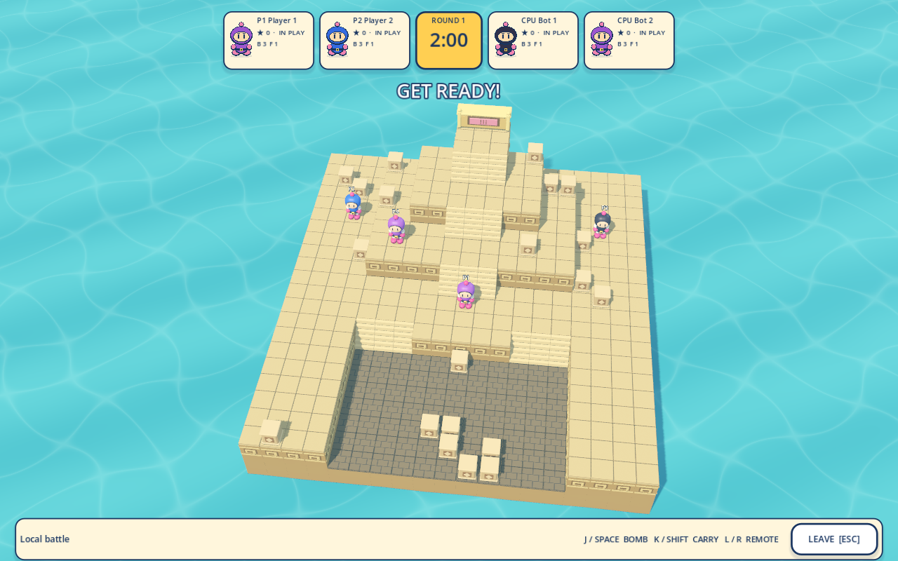
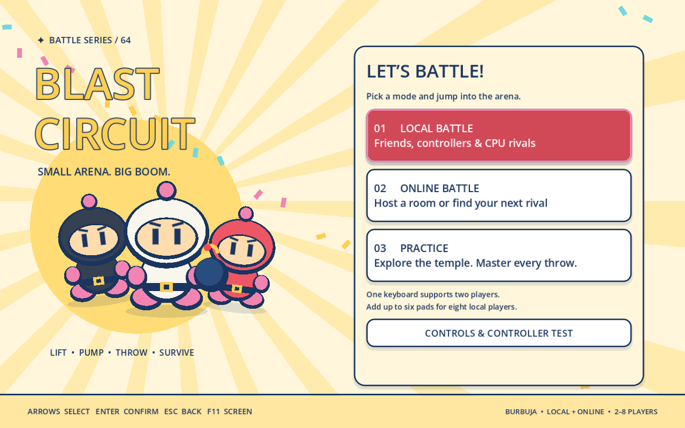
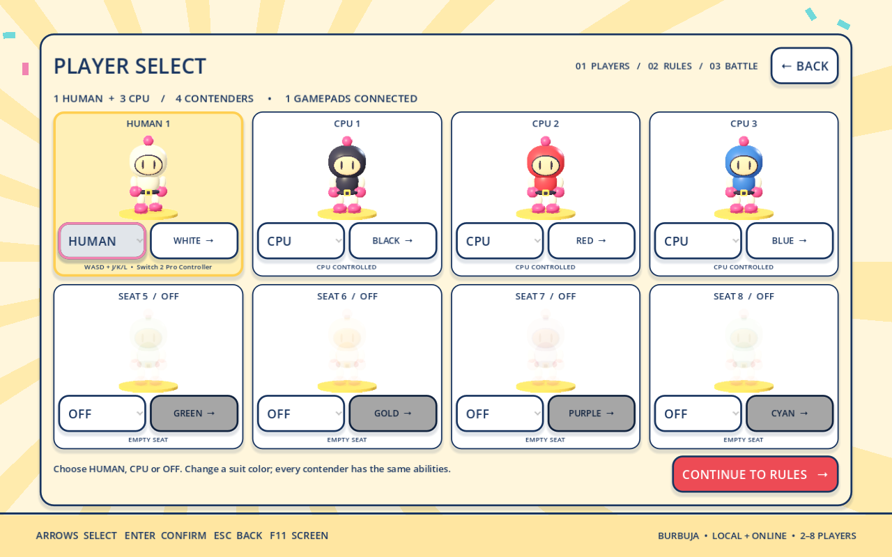
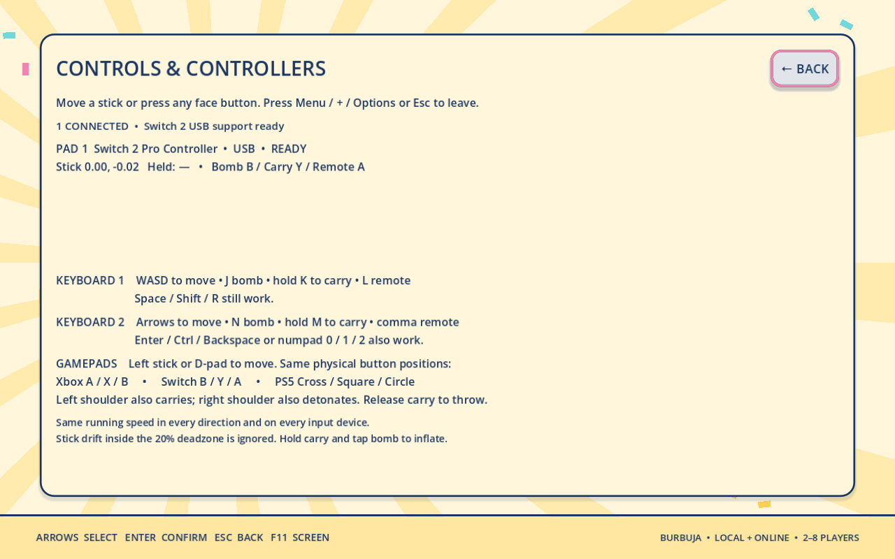
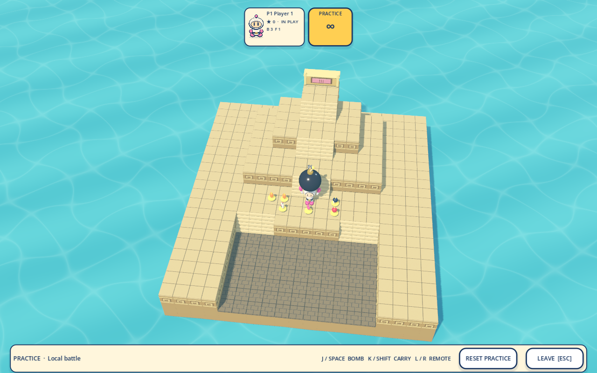
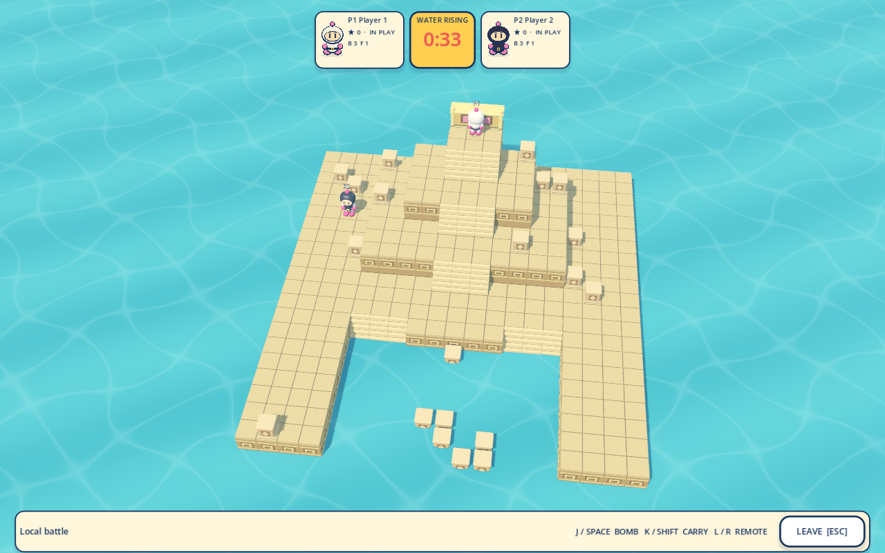

# Blast Circuit

A playable Godot C# arena battle game inspired by Bomberman 64, with original procedural art, 2–8 participants, local play, online private lobbies, matchmaking and server-controlled bots. The featured Sunken Temple arena has a stepped sandstone pyramid, a recessed courtyard, broad stairs and surrounding water. Animated characters, original synthesized audio, debris, and bomb effects run in the Godot client.

The original game supports four simultaneous players. Eight-player support and the numerical simulation tuning are decisions for this project. See [research and sources](docs/research.md).

## Run the game

Install **Godot 4.7.2 .NET** and the **.NET 10 SDK** (10.0.401 was used for verification). The root project pins `Godot.NET.Sdk/4.7.2` and targets `net10.0`. Use matching Godot export templates for desktop exports; a standalone export has not been produced here.

Both local and online builds currently require the kernel realtime contracts. A clean checkout does not build until that dependency is supplied. The kernel checkout is an external dependency ignored by this game's Git repository. It remains locally at `burbuja-kernel/`. After a fresh checkout, restore the pinned source using your normal Git access (the kernel source is not included in this public repository):

```bash
KERNEL_REPOSITORY="<your-authorized-kernel-git-url>" ./scripts/bootstrap-kernel.sh
```

From the repository root:

```bash
dotnet build Bomberman64Multiplayer.csproj
```

Import `project.godot` into the .NET editor. Open `Scenes/Main.tscn` and press **F6**, or press **F5** to run the configured main scene.

For a one-command build and launch, run `./scripts/client.sh`. Set `GODOT_BIN` if the .NET editor is in a custom location.

On macOS, the installed editor can also launch it directly:

```bash
/Applications/Godot_mono.app/Contents/MacOS/Godot --path .
```

The game opens fullscreen. **F11** or **Alt+Enter** switches between fullscreen and a window; run `./scripts/client.sh --windowed -- --display-windowed` for a windowed launch.

Choose **LOCAL BATTLE**, then set each of the eight roster slots to **Human**, **CPU**, or **Off** and choose a suit color. The selected character walks on its pedestal using the same articulated model seen in battle. Continue to stage and match rules, choose Easy/Normal/Hard CPU difficulty, then start with **2–8 total participants**. **PRACTICE** lets one player explore the map and rehearse bomb handling without CPU opponents. Six visible training pickups teach bomb capacity, fire, red power, remote detonation and hearts; **RESET PRACTICE** restores the cache. One human can play with up to seven bots. Local play works without a server. Two keyboard seats are available; additional local seats require connected gamepads. With three or more local humans, the first two seats use keyboards and up to six gamepads fill seats 3–8 in connection order. With one or two humans, the corresponding gamepads also work as optional controls.

## Play online

Godot is a client of a separate authoritative kernel process. The intended deployment is the kernel on your own server hardware, with clients entering that server's reachable address in **Online Battle**. The server must register the `blast` game; `Bomber.Server` provides that registration on top of `Burbuja.Hosting`. No Docker or Compose stack is required.

For local development, start that independent server in another terminal:

```bash
./scripts/server.sh
```

It listens at `http://127.0.0.1:18496`. Enter that URL in the game and choose **ONLINE BATTLE → CREATE PRIVATE ROOM**, then share the lobby’s displayed join code. Another game instance can enter the same URL and use **JOIN ROOM**. For a human-only match, set CPU players to zero; with bots enabled a lobby can start with one connected human. Each online game instance controls one human seat.

**QUICK PLAY** uses the kernel matchmaking queue. It needs another compatible queued player; use a private lobby for solo bot practice online. The setup screen configures stage, CPU count and difficulty, win target, round duration, sudden death and ghosts. The lobby displays the real server roster and countdown. Choose your suit in the online setup; the authority preserves that appearance through rounds and reconnects.

For a LAN server, bind to a reachable interface and enter the server machine's address on each client:

```bash
./scripts/server.sh --urls http://0.0.0.0:18496
```

The default is loopback. No external hosting, domain, TLS, firewall changes or production deployment was performed. Public hosting needs its own deployment and security configuration. Native desktop C# is the target; this project does not provide a browser build.

## Controls

| Action | Keyboard 1 | Keyboard 2 | Xbox | Switch 2 | PS5 |
|---|---|---|---|---|---|
| Move | WASD | Arrows | Stick / D-pad | Stick / D-pad | Stick / D-pad |
| Bomb / pump | J or Space | N or Enter | A | B | Cross |
| Hold carry; release to throw | K or Shift | M or Ctrl | X or LB | Y or L | Square or L1 |
| Remote detonation | L or R | Comma or Backspace | B or RB | A or R | Circle or R1 |
| Leave battle | Esc | Esc | Menu | + | Options |

Keyboard 2 also supports numpad 0 / 1 / 2 for bomb / carry / remote. Menus use the **bottom face button to confirm** and **right face button to go back**, with controller-specific prompts. F11 or Alt+Enter toggles fullscreen.

Choose **CONTROLS & CONTROLLER TEST** on the main menu to inspect connected pads and live inputs. Face buttons stay in the tester; Menu / + / Options or Esc leaves it. The roster shows which pad accompanies each human seat. Two-human matches allow one pad per player alongside the two keyboard layouts; larger matches reserve the first two humans for keyboards and assign pads to the remaining humans.

All devices run at the same speed, including diagonal keyboard movement. Sticks retain their analog direction but use full running speed beyond the **20% radial deadzone**. D-pad input takes priority over stick input, which takes priority over keyboard movement; directions are never added together. Short bomb taps are buffered, holding bomb does not auto-repeat, and actions must be released after entering a match or returning focus. Disconnecting a pad reserves its seat without moving another player's controls. Identical controllers that both reconnect under ambiguous identities require restarting the match to assign them safely.

### Switch 2 USB on macOS

The optional adapter is built locally for the Switch 2 Pro controller that Godot's bundled backend cannot expose:

```bash
./tools/controllers/bootstrap-sdl.sh
./scripts/client.sh
```

It downloads checksum-pinned SDL 3.4.18 and libusb 1.0.29, builds inside ignored project directories, and places the runtime libraries in `native/macos/`. Xcode command-line build tools and Python 3 are required. It does not install a system driver. This adapter currently supports **one Switch 2 Pro over USB** at a time; additional players can use Xbox, DualSense, other mapped pads or keyboards. Xbox and DualSense continue through Godot's normal backend. Rebuild/restart the game after installing the adapter. Native libraries and their copied licenses must be included separately when preparing a desktop export; that export packaging has not been verified here.

**Switch 2 Bluetooth is not implemented by this adapter.** Wireless software bridges exist, but none was installed or validated in this iteration. [Controller research](docs/controller-research.md) explains the USB issue, positional button labels, wireless distinction and dependency provenance. Detection and synthetic tests are reported separately from physical button observation in [verification](docs/verification.md).

Walking into a resting bomb kicks it. Hold lift to carry a nearby bomb, or hold lift and press bomb to create one directly in your hands. Repeatedly press bomb while holding lift to inflate it, then release lift to throw. Use **hold carry, tap bomb, then tap bomb again to pump**: Xbox X+A, Switch Y+B, PS5 Square+Cross, or keyboard K+J (Shift+Space also works). The character lifts, compresses, and releases the bomb in response to accepted actions. Explosions use spherical distance and cover occlusion rather than a classic grid cross. Pickups upgrade blast size, bomb capacity, remote detonation, red piercing bombs or a protective heart. Ghosts and sudden death are enabled by default. With one minute left, the Pyramid-inspired Sunken Temple warns of rising water; its lower court floods before the upper terraces. Other arenas retain closing columns. Permanent stone and terrain block blasts; red bombs penetrate breakable cover. Last survivor earns a round win; first to the win target wins the match.

## Battle progression

Breakable stone objects can drop weighted upgrades. Fire raises normal blast strength to level 3; bomb upgrades raise simultaneous capacity to 8. Red power penetrates breakable cover, remote bombs detonate on command, and one heart absorbs one blast without stacking. Water remains lethal. Equipment resets between rounds.

Three accepted pump presses add three effective blast levels, reaching level 6 with maximum fire upgrades. Bombs visibly inflate beyond the character's head. Timed bombs pause their fuse while carried and resume it after release. These numerical choices and the flood curve are project tuning; [manual and gameplay-video research](docs/gameplay-research.md) distinguishes confirmed observations from assumptions.

Bots pursue useful upgrades, pressure reachable opponents, predict visible fuse/chain danger, plan an escape before placing bombs, and seek high ground before flooding. Difficulty changes reaction time rather than movement speed, damage or hidden knowledge. See the [AI behavior tests and measured tradeoffs](tests/Bomber.Ai.Tests/README.md).

## Repeatable playtests and triage

The agent harness plays through the actual Godot scene using inputs and product sessions:

```bash
python3 tools/playtest/run.py --build --start-server --scenario all
python3 tools/playtest/run.py --scenario fullscreen
python3 tools/playtest/run.py --scenario controllers
python3 tools/playtest/run.py --scenario controller-observe
python3 tools/playtest/run.py --scenario ramp --headless
python3 tools/playtest/run.py --scenario script --script tools/playtest/temple-walk.json
```

Graphical harness runs and `./scripts/debug.sh` default to **windowed mode**. Normal `./scripts/client.sh` play still opens fullscreen. The suite exercises real menu controls, enters matches, moves through stairs, handles bombs, collects upgrades, survives flooding, reaches results and connects to the real server. Use `--fullscreen` to explicitly test fullscreen; `--scenario fullscreen` requests it directly. The normal windowed suite stays windowed through gameplay and aspect-ratio checks.

Runs save screenshots, authoritative state traces, assertion results, engine logs and failure summaries in unique `artifacts/playtest/` folders. Failed assertions, timeouts and missing reports return a failing exit code. Graphical captures show real viewport pixels; headless captures are explicitly disabled. See [harness instructions](tools/playtest/README.md) for scenario scripting and diagnosis.

## Verify

[Verification results and captured evidence](docs/verification.md) record the checks completed for this iteration.

The checks below are executable integration tests, run with `dotnet run`:

```bash
dotnet run --project tests/Bomber.Game.Tests/Bomber.Game.Tests.csproj
dotnet run --project tests/Bomber.Client.Tests/Bomber.Client.Tests.csproj
dotnet run -c Release --project tests/Bomber.Ai.Tests
```

With the server running, exercise real HTTP and WebSocket clients:

```bash
dotnet run --project tests/Bomber.Smoke/Bomber.Smoke.csproj -- http://127.0.0.1:18496
```

The game suite checks limits, eight unique human seats/spawns, raised terrain, deterministic seven-bot replay, bomb fuse/explosion/ghost behavior, safe input acknowledgements and round reset. Client checks cover settings, protocol encoding, local input edges and bounded snapshots. Network smoke covers product session adapters, private create/code join, 2–8 simultaneous human clients, remote movement, reconnect and one human with seven server bots.

Godot also has a short scene smoke mode:

```bash
/Applications/Godot_mono.app/Contents/MacOS/Godot --headless --path . -- --smoke
```

It starts a local match and exits after eight seconds with `GODOT_SMOKE_OK`. `--smoke-tier`, `--smoke-menu`, and `--smoke-online` exercise the second stage, menu, and running server. Add `--smoke-seconds=90` for a longer run. A graphical run with `--smoke` also writes `artifacts/gameplay.png` when that directory exists. These automated checks do not establish controller coverage, internet latency tolerance or final gameplay balance.

## Code and dependencies

[Architecture](docs/architecture.md) describes the boundaries, protocol and scaling path. The repository consumes a separately supplied burbuja-kernel checkout at `burbuja-kernel/`, revision `b0758339984bbeead1b3d1236f31e980aaa5f20e`. Build and runtime use source project references for the kernel. The product now owns its adapted simulation in `src/Bomber.Game/Simulation`, retaining MIT provenance, so map and collision changes do not mutate the generic kernel. Preserve the kernel checkout and its license.


## macOS Game Mode

The game already uses native Metal. The `macOS Metal` export preset declares Apple’s `LSSupportsGameMode` opt-in and Games bundle category. Game Mode is controlled by macOS during eligible fullscreen play; it is not enabled by windowed debug tests, and no performance boost is claimed without measurement. [Setup, primary sources and verification limits](docs/macos-game-mode.md).

## Visual polish

The fourth iteration uses a smoothly rounded helmet and inset face, articulated head motion, blinks, mitten thumbs and shaped boots. Warm key light, cool fill, softer shadows, quieter stone and water materials, and a higher perspective camera improve the temple’s depth and visibility. The camera fits each map and viewport around the HUD. [Reference research](docs/iteration4-research.md) documents the inspected Bomberman 64 selection footage and TUNIC developer interviews.

## Screenshots

The gallery shows actual captures from the final windowed regression run, including the physical Switch 2 USB device in the controller tester.









The game uses original procedural visuals. No original game ROM, Nintendo/Hudson artwork, footage, kernel source, credentials, or playtest traces are distributed here. The adapted simulation retains its upstream MIT notice in `src/Bomber.Game/Simulation/LICENSE`.


Current bomb and flood checks:






## License

The game is licensed under the [MIT License](LICENSE), copyright 2026 MCMike0399. The adapted simulation retains its upstream MIT notice in `src/Bomber.Game/Simulation/LICENSE`. The separately supplied kernel dependency and reference media are not bundled or relicensed by this repository.
