# Blast Circuit

An original Godot C# arena battle game inspired by Bomberman 64: **2–8 participants**, local multiplayer, online rooms and CPU rivals. Carry, pump, kick and throw bombs across layered arenas, collect equipment, and survive each stage’s sudden death.

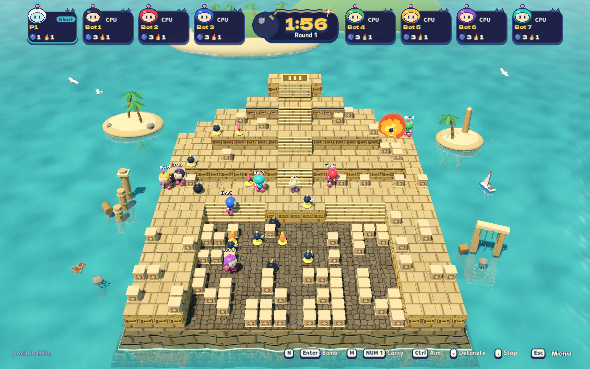

**[Download v0.44.1 for Apple Silicon](https://github.com/MCMike0399/bomberman-64-multiplayer/releases/tag/v0.44.1)** · [Release verification](docs/verification.md) · [Build from source](#build-from-source)

Windows EXE, Linux AppImage and Mac DMG downloads are pending the [three-platform release gates](docs/desktop-clients.md).

The current release includes six battle arenas, animated stage surroundings, refined water reflections and graphics presets, pointer aiming, and improved CPU rivals. All visuals and synthesized sounds are original. Eight-player support and numerical gameplay tuning are project adaptations; the original game supports four players. [Research and sources](docs/history/research.md).

## Play

Choose **Local Battle**, assign Human / CPU / Off to the eight roster seats, choose suits, then select an arena and rules. One human can play against up to seven CPUs. Easy, Medium and Hard change CPU decisions while keeping the same movement speed, resources and visible information as human players.

Two keyboard layouts are available. With one or two humans, gamepads can also control those seats. With three or more local humans, the first two use keyboards and connected gamepads fill the remaining seats.

| Character, front | Character, three-quarter view |
| --- | --- |
| 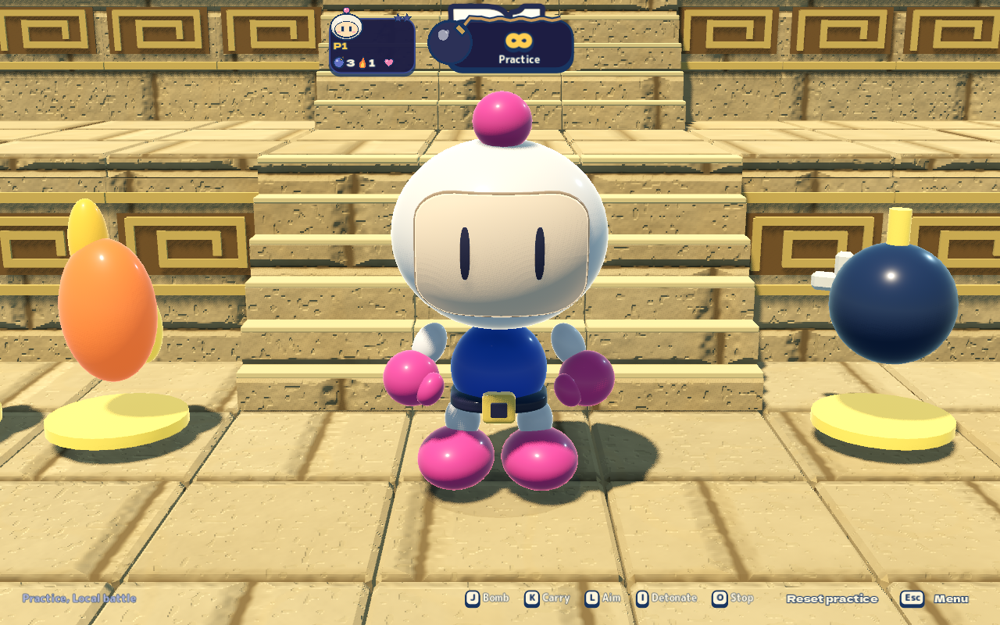 | 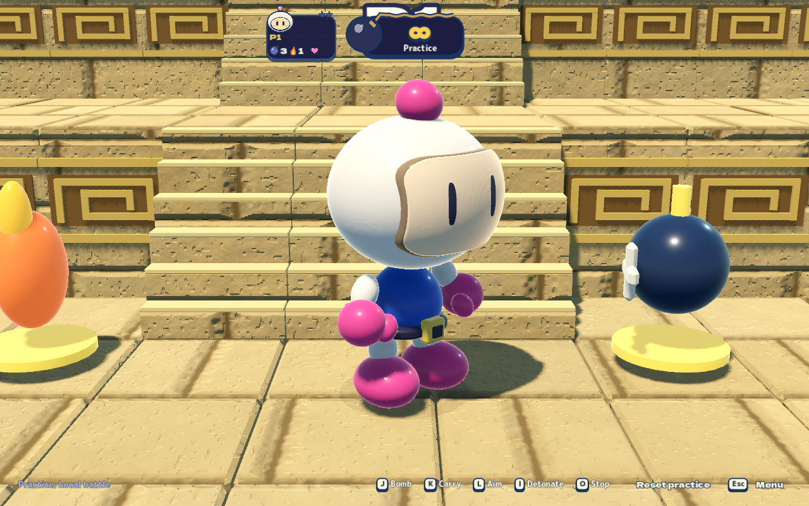 |

**Practice** lets one player explore without CPU opponents. **Tutorial** opens Circuit Garden’s replayable lessons on movement, bomb handling, equipment, terrain, rivals and hazards, with saved progress, retry and free practice. [Tutorial guide](docs/tutorial.md).

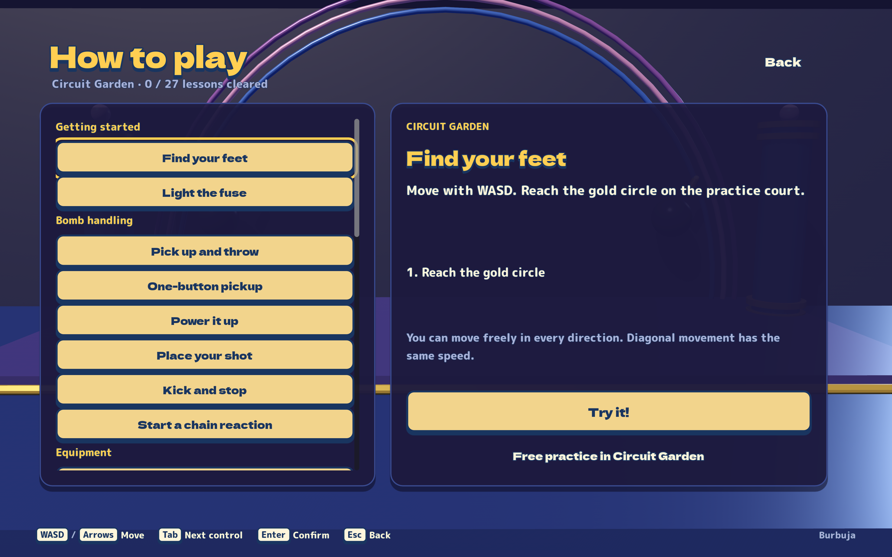

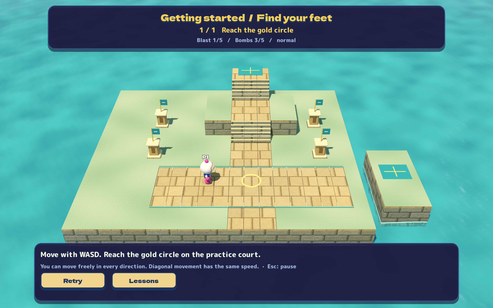

Normal battles default to **first to two wins**, **one minute of regular play**, then **one minute of sudden death**. The last survivor wins the round. Ghost comeback lets eliminated players interfere with living opponents; ghosts cannot handle bombs. Raised floors, stairs, lower passages and falling all affect movement and bomb trajectories.

## Arenas

All six battle arenas support local, practice and online sessions. Circuit Garden is the separate tutorial and free-practice arena.

| Arena | Layout and sudden death |
| --- | --- |
| **Sunken Temple** | A five-tier sandstone pyramid, broad stairs, lower courtyard and open water behind the summit. Rising water floods the lower ground first. |
| **[Rock Garden](docs/rock-garden.md)** | Enclosed lawn, five round columns, cross-shaped paving and sixteen breakable boulders. Falling fireballs replace closing walls. |
| **[Up & Down](docs/up-and-down.md)** | Suspended upper ring, green crown, middle piers, lower reward deck and six purple stairways with real underpasses. Water rises from below. |
| **[Top Rules](docs/top-rules-research.md)** | Two-story castle with three raised lanes, a central crosswalk, four green staircases and a red lower court. Side walls close inward. |
| **[Blizzard Battle](docs/blizzard-battle.md)** | Snowfield with sixteen violet ice cones, changing diagonal wind and animated snow. Avalanches advance from both sides. |
| **[Greedy Trap](docs/greedy-trap.md)** | Upper court and narrow middle ring above a turquoise reward chamber, four inner stairways and two upper exits. Sliding walls compress the arena. |

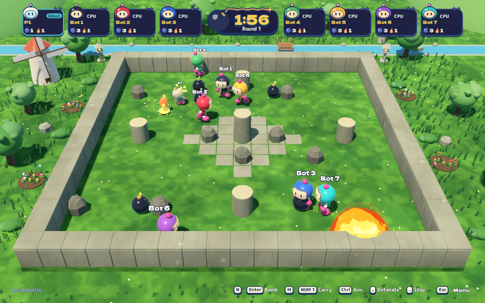

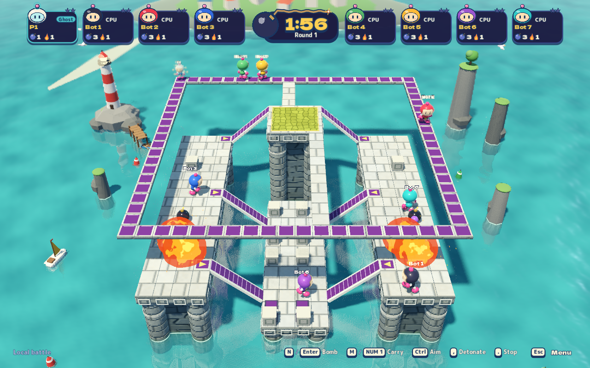

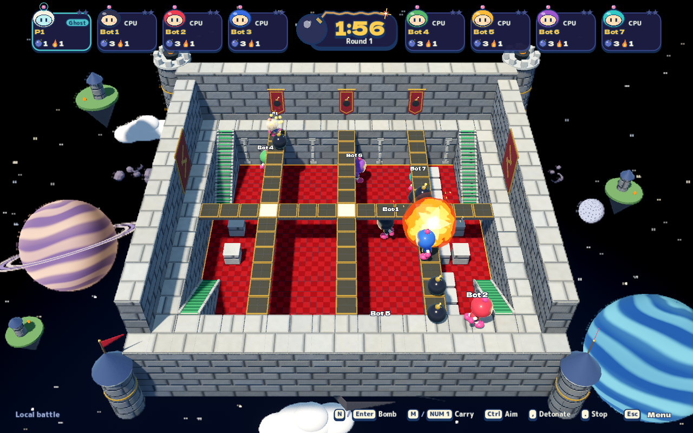

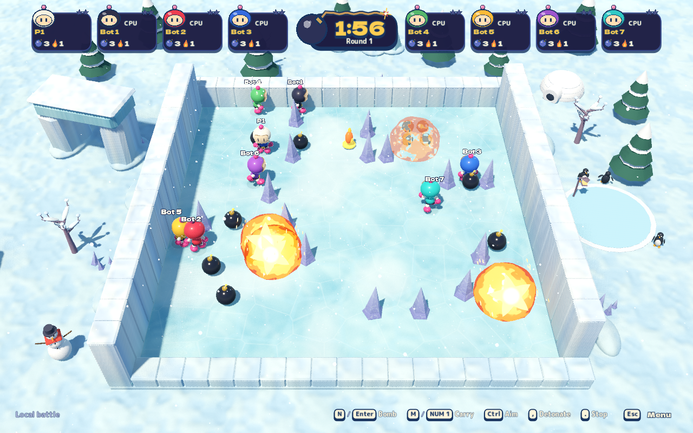

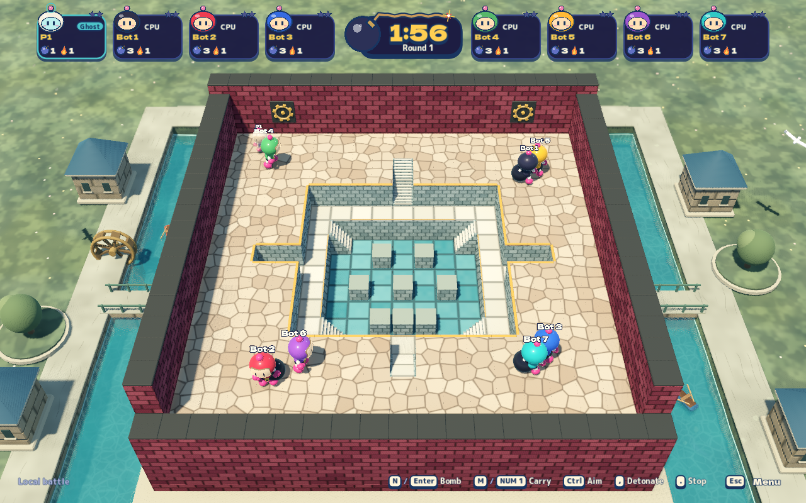

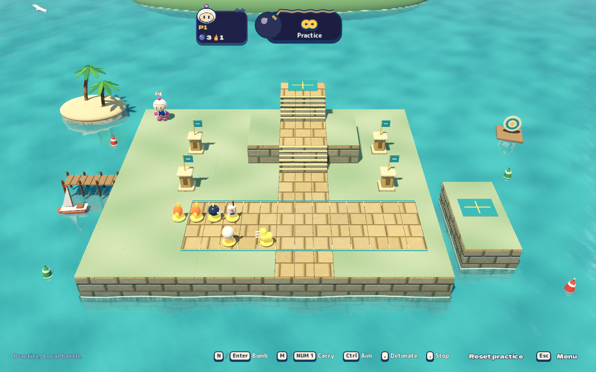

<a id="screenshots"></a>

## Graphics and screenshots

Choose **Settings → Graphics → High** for the highest preset: full selected 3D resolution, 2× MSAA, 4096-pixel contact-hardening shadows, higher-quality ambient occlusion, indirect light bounce and scene reflections in the water. Clear refracting shallows, caustics, toy-like materials, painterly terrain, and depth of field and haze outside the playable arena create the diorama look. Medium is the default and keeps the clear water, glow and contact shading at native resolution; Low renders 75% of the 3D pixels without decorations or effects. [Preset details and limits](docs/graphics-research.md).

Settings also provides **Display mode** and **Resolution**, saved automatically for the next launch. Windowed mode fits the chosen window size to your display; fullscreen adjusts 3D resolution while keeping menus sharp. Only sizes that fit your screen are listed, and Settings shows the resulting 3D render size.

**Settings → Performance metrics** or **F3** toggles a compact top bar with FPS, frame/process/physics timing, video memory and draw calls. The choice is saved on this device. CPU temperature shows **N/A** because Godot does not expose a portable temperature sensor.

**Local lighting** offers Morning, Midday, Afternoon and Night. Online rounds use the server’s lighting; graphics quality remains your local preference.

Living scenery brings wind-swept plants to Rock Garden, planets and drifting asteroids to Top Rules, and a glacier, frosted trees and snowfall to Blizzard Battle. [Explore the stage worlds](docs/living-stage-worlds.md). Settings also lets you set a frame-rate cap.

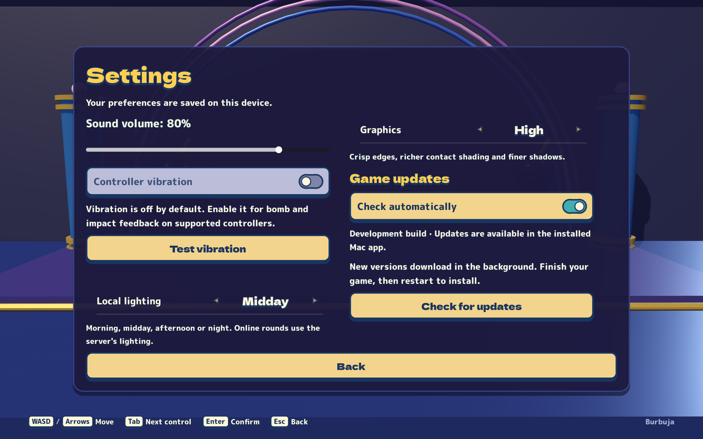

The arena screenshots show the latest shipped scenery in High using the ordinary battle camera, captured in a macOS VM with Metal Forward+. Menu, tutorial and explosion images are from the earlier v0.31 gallery on an Apple M5 Pro. [Capture provenance](docs/screenshots.md) · [Living scenery](docs/living-stage-worlds.md). Historical videos retain their original versions and settings: [walking](docs/videos/walk-personality.mp4), [precision aiming](docs/videos/precision-aim.mp4), and [CPU difficulties](docs/videos/ai-difficulties.mp4).

## Bombs and equipment

Tap the primary button to place a bomb near your feet, then move away. A fresh press beside a bomb kicks it; walking back into a resting bomb after leaving it also kicks it. Hold carry to lift, tap primary to pump up to three levels, and release carry to throw. Holding primary after placement can also lift the same bomb. Timed fuses pause while carried and resume after release.

Explosions expand through spherical distance with cover occlusion. The reticle and dotted arc forecast the shared static trajectory, including terrain, cover, fuse expiry and water or void endpoints. Moving opponents can interrupt the forecast. Pointing with the mouse or right stick places the landing target directly, compensating for raised or lowered ground; precision aiming nudges it in arena directions. Charging increases blast power without moving an aimed target.

Black bombs are the starting type. A bomb slot holds **Red**, **Remote** or **Bouncing** equipment; a separate ability slot holds **Heart** or **Focus**. Replacing equipment drops the previous item for others. Red bombs have larger blue blasts and penetrate breakable cover. Remote bombs wait for their owner’s detonation command. Bouncing bombs ricochet and rebound after charged throws. Focus speeds charging and assists neutral aiming; deliberate aim takes priority. A heart absorbs one blast; water remains lethal.

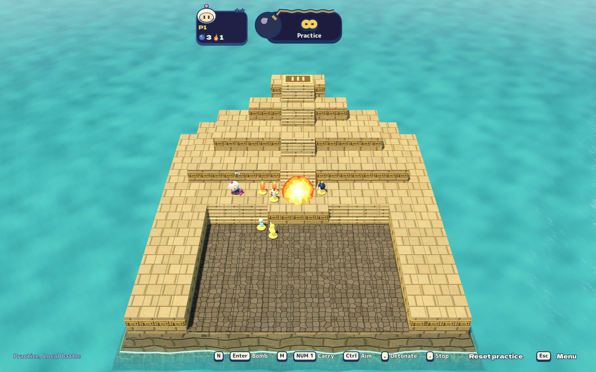

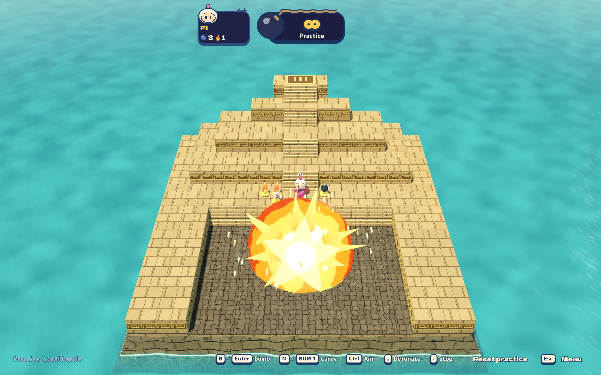

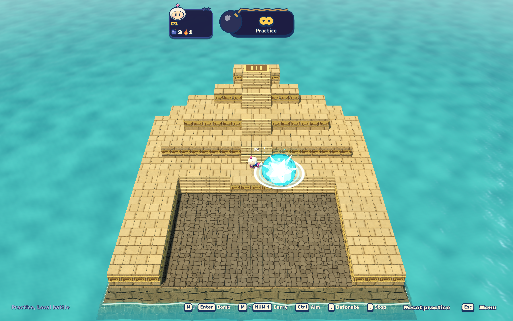

Bomb and flame counters start at **0 upgrades**: two active bombs and base blast strength. Collect Bomb Up and Fire Up to increase them.

**Advanced settings** controls block amount, independent item drop chance (40% default), item lifetime (20 seconds), blast and bomb stack caps (five each), temporary effect duration (10 seconds), and enabled items. Default drops favor capacity/fire upgrades (60%), temporary effects (30%) and bomb types (10%). Tiny, Big, Haste and Slow share one temporary-effect slot. Practice on Sunken Temple and Circuit Garden starts with six expiring training pickups; Reset Practice rolls a fresh cache.

## Controls

| Action | Keyboard 1 | Keyboard 2 | Xbox | Switch 2 | PS5 |
| --- | --- | --- | --- | --- | --- |
| Move | WASD | Arrows | Stick / D-pad | Stick / D-pad | Stick / D-pad |
| Bomb / kick / pump | J or left click | N or Enter | A | A or B | Cross |
| Hold carry / release throw | K or right click | M or Numpad 1 | LB or X | L or Y | L1 or Square |
| Point the throw while carrying | Mouse / trackpad | — | Right stick | Right stick | Right stick |
| Precision aim while carrying | L (Shift alias on Mac/Linux) | Ctrl | RT | ZR | R2 |
| Remote detonation | I or R | Comma or Backspace | B | X | Circle |
| Stop kicked bombs | O | Period or Numpad 3 | RB | R | R1 |
| Game menu | Esc | Esc | Menu | + | Options |

While carrying, move the mouse or tilt the right stick to place the landing ring and keep walking: the mouse picks the spot under the cursor, and right-stick tilt picks direction and distance (letting go keeps the target). For fine nudges, hold the aim modifier to plant your feet and steer with WASD, the left stick or the D-pad. Staggered diagonal key releases keep the diagonal heading, so diagonal throws work from the keyboard. On Switch, holding Y and tapping B also readies/pumps a bomb. Keyboard 2 additionally supports numpad 0 / 1 / 2 / 3 for bomb / carry / remote / stop.

Menus accept WASD/arrows, Enter to confirm and Esc to return. Tab / Shift+Tab moves focus; shoulder buttons switch columns. Start / Menu / + / Options focuses the primary action without activating it. Switch uses printed **A to confirm, B to go back**. **F11** or **Alt+Enter** toggles fullscreen. Local play pauses in the game menu; online rounds continue.

**Controls & Controller Test** shows connected pads and live inputs. Vibration is off by default and can be enabled/tested in Settings. The optional macOS adapter supports one Switch 2 Pro controller over USB; Switch 2 Bluetooth is not implemented by that adapter. Xbox and DualSense use Godot’s normal backend. [Controller setup and evidence](docs/history/controller-research.md).

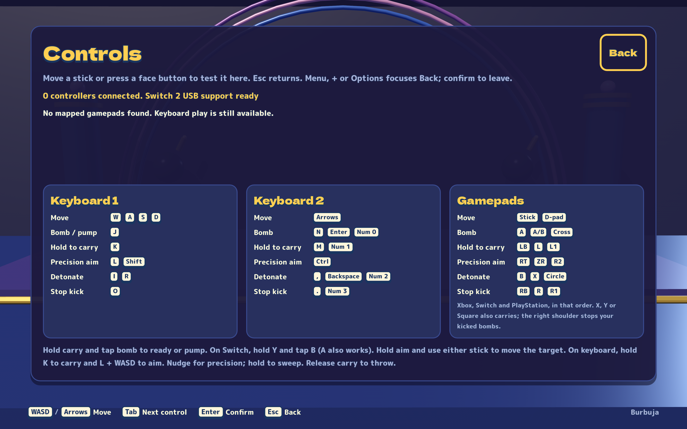

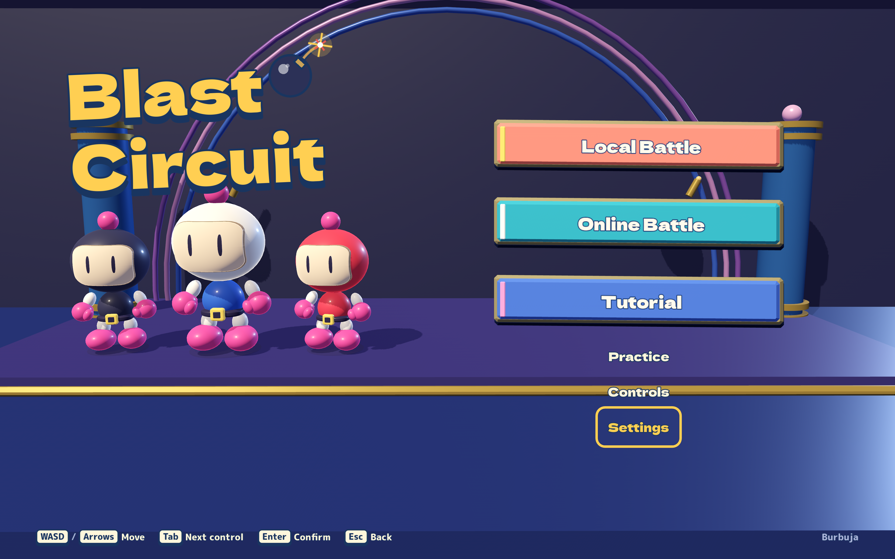

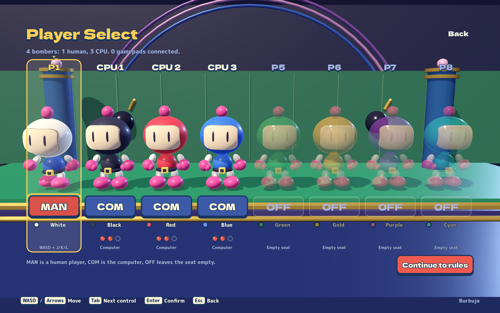

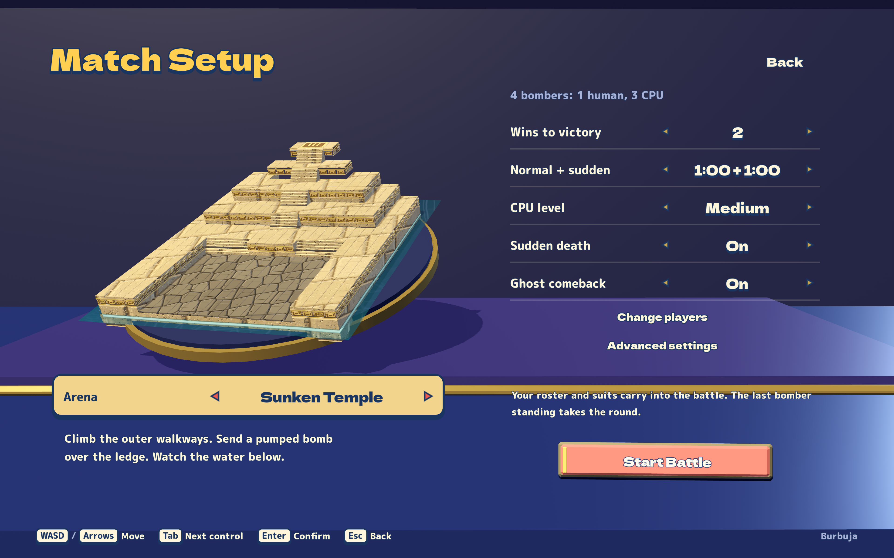

## Online battle

Use **Online Battle** with `https://blast.burbuja-lab.dev`, then choose **Play online**, **Create private room** or **Join with code**. Quick Play uses shared rules and an automatic one-minute countdown with at least two connected people. Player changes restart the minute; below two, it cancels. Anonymous players cannot start early or edit the rules. Private rooms wait for their owner to start. Each online instance controls one human seat. See [matchmaking policy and source/release status](docs/smart-multiplayer.md).

Create a room, use **Copy code**, and have other players join with that code. The leader can edit room settings before starting. After results, everyone returns to the same room; leadership transfers if the leader leaves. Your name and server address are saved between launches; choose your suit before joining. Private hosting offers **Automatic**, **Server only** and **Player hosted**. Automatic chooses dedicated or qualified player authority using capacity and measured routes. Server only keeps authority on the cluster. Automatic and Server only support one human with CPUs; Player hosted needs two humans.

The shared service runs independently of players’ computers. Peer rooms support direct/relay connections and return-to-lobby host takeover. [Peer hosting](docs/peer-hosting.md) · [Adaptive rooms](docs/smart-multiplayer.md) · [Server hosting](docs/online-server.md).

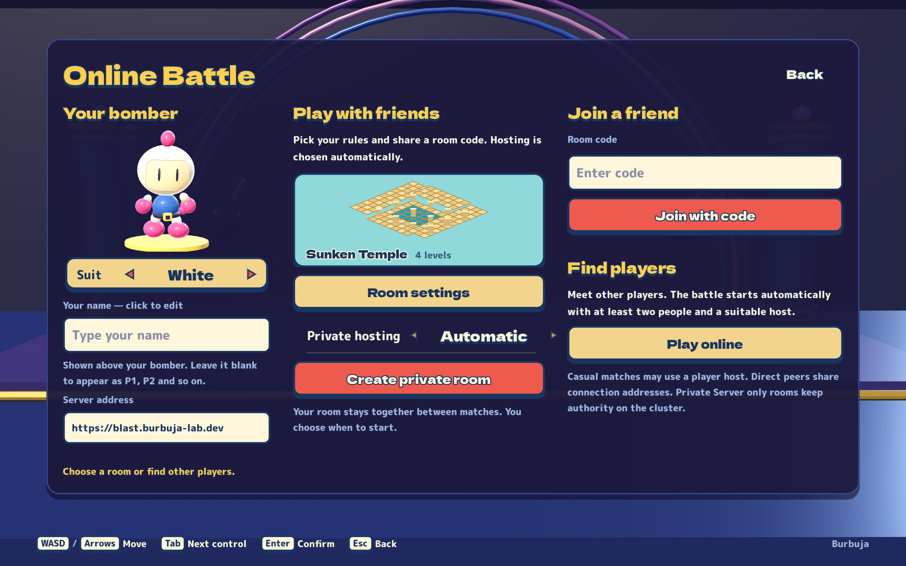

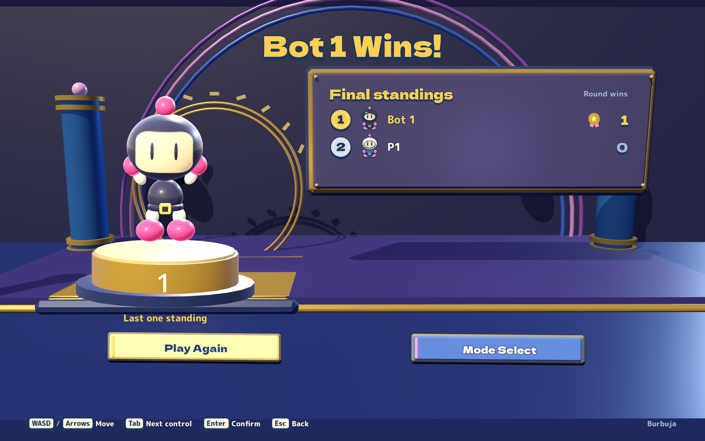

## Desktop downloads and updates

Choose your download from the [GitHub release page](https://github.com/MCMike0399/bomberman-64-multiplayer/releases/latest): install the Windows `.exe`, make the Linux `.AppImage` executable and run it, or open the Mac `.dmg` and copy the app to Applications. Windows/Linux target x64; Mac targets Apple Silicon. The game and .NET runtime are bundled. Local play needs neither the editor nor a server. Display mode and resolution are remembered; first launch uses fullscreen.

**Settings → Game updates** checks for signed GitHub releases automatically. When an update is ready, leave your room and choose **Restart to update**. A failed launch restores the previous app. [Update details](docs/automatic-updates.md).

Windows uses Vulkan with DirectX 12 startup recovery/fallback, Linux uses Vulkan and Mac uses Metal. Windows Settings offers Auto, Vulkan and DirectX 12 for the next launch; a DirectX 12 Start-menu shortcut is also available. The Mac app opts into Game Mode for eligible fullscreen play; macOS controls activation. Mac signing remains ad-hoc, without notarization; Windows executables are not Authenticode signed. Release signatures authenticate the downloads. [Desktop requirements and verification](docs/desktop-clients.md) · [Mac packaging](docs/macos-app.md).

### Linux launch help

After downloading, allow execution in your file manager (Properties → Executable as program), or run:

```sh
chmod +x Blast-Circuit-linux-x64.AppImage
./Blast-Circuit-linux-x64.AppImage
```

If launching from the file manager produces no window, run it in a terminal to see the runtime message. If FUSE is unavailable, use the built-in extraction path:

```sh
./Blast-Circuit-linux-x64.AppImage --appimage-extract-and-run
```

Install the FUSE package appropriate to your distribution/runtime if you prefer mounting. Keep the AppImage in a folder you own so signed updates can replace it. The Linux client and updater use invariant .NET globalization and do not require a system ICU installation; ordinary native OS/GPU dependencies still apply.

### Windows network permission

Windows may ask to allow Blast Circuit through the firewall for direct peer connections. Allow only networks you trust; server relay remains available when direct connections are blocked. A standard user may need an administrator to change firewall rules.

If an earlier denial blocks direct connections, open Windows Defender Firewall with Advanced Security → Inbound Rules. Find the **Block** rules for your Blast Circuit installation and ask an administrator to remove those specific rules, then retry and allow trusted networks. Do not disable the firewall or remove unrelated rules.

Switch 2 Pro over USB uses the bundled macOS adapter and is supported on macOS only. Windows/Linux still support other mapped gamepads. Windows uses **L** for keyboard precision aim so normal play does not require the five-Shift accessibility shortcut.

## Build from source

Install **Godot 4.7.2 .NET**, matching export templates for standalone packaging, and the **.NET 10 SDK**. Both local and online builds require a separately supplied, authorized kernel checkout; its source is not distributed in this repository.

```bash
KERNEL_REPOSITORY="<your-authorized-kernel-git-url>" ./tools/dev/bootstrap-kernel.sh
python3 tools/networking/bootstrap_webrtc.py
dotnet build Bomberman64Multiplayer.csproj --nologo -m:1
./tools/dev/client.sh
```

The bootstrap script owns the exact dependency pin. Open `project.godot` in the .NET editor and press F5 as an alternative. For a windowed source launch:

```bash
./tools/dev/client.sh --windowed -- --display-windowed
```

To build the optional Switch 2 USB backend and a standalone Mac app:

```bash
./tools/controllers/bootstrap-sdl.sh
python3 tools/packaging/package-macos.py
```

For development networking, start the independent server in another terminal and enter `http://127.0.0.1:18496` in the client:

```bash
./tools/dev/server.sh
```

Use `./tools/dev/server.sh --urls http://0.0.0.0:18496` for a reachable LAN listener. Docker is optional. Native desktop C# is the target; there is no browser build.

## Verification and development

[Architecture](docs/architecture.md) explains the simulation/client/presentation boundaries. [AGENTS.md](AGENTS.md) and the [agent handoff guides](docs/agents/README.md) contain current decisions, debugging and delivery rules.

Local development and CI share the QA orchestrator:

```bash
python3 tools/qa/run.py --profile public
python3 tools/qa/run.py --profile managed
python3 tools/qa/run.py --profile headless
python3 tools/qa/run.py --profile graphical
python3 tools/qa/run.py --profile package
```

`public` works without the private dependency. Other profiles require the pinned kernel. Graphical checks use real viewport captures in an isolated macOS desktop; headless checks establish simulation behavior. [Playtest commands and scripting](tools/playtest/README.md) · [CI](docs/ci.md) · [Current verification receipts](docs/verification.md).

## License

[MIT](LICENSE), copyright 2026 MCMike0399. The adapted simulation retains its [upstream MIT notice](src/Bomber.Game/Simulation/LICENSE); bundled fonts use the [SIL Open Font License](docs/licenses/README.md). No original game ROM, Nintendo/Hudson artwork, reference footage, private kernel source, credentials or raw playtest traces are distributed here.
