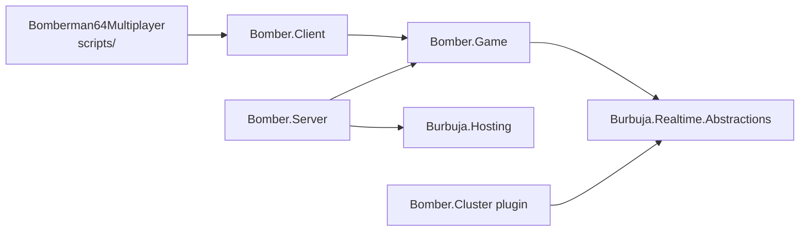

# Codebase map

Read this before adding, moving or renaming files. It answers where code lives,
which naming rules Godot and .NET impose, and how to extend each area without
breaking imports, exports, packaging or tests. [Architecture](../architecture.md)
owns runtime boundaries; the branch guides own behavior and tuning.

## Top level

The repository root is the Godot project root (`res://`). Folders that contain a
`.gdignore` are invisible to Godot's importer and are never exported.

| Path | Contents | Godot |
| --- | --- | --- |
| `project.godot`, `export_presets.cfg`, `icon.svg` | Engine settings, autoloads, the `macOS Metal` export preset (version/build live here) | Root |
| `Bomberman64Multiplayer.csproj`, `.sln` | Godot C# project; compiles `scripts/**/*.cs` and references `Bomber.Client` | Root |
| `Directory.Build.props` | Shared `net10.0`, nullable and implicit-using defaults for every project here | — |
| `scenes/` | `main.tscn`, the only scene; menus, arenas and models are built in code | Imported |
| `scripts/` | Godot presentation and input code, by feature (below) | Imported |
| `assets/` | Fonts with OFL notices; `testing/scenarios.json`, the shared playtest catalog | Imported |
| `src/` | Pure .NET assemblies: no Godot types | Ignored |
| `tests/` | Executable managed suites, network smoke and the capacity probe | Ignored |
| `tools/` | Python/shell tooling with colocated `test_*.py` contracts | Ignored |
| `deploy/` | Compose/Docker files for server and cluster hosts | Not a resource |
| `docs/` | Agent guides, current reference docs, `history/` evidence, media | Not a resource |
| `native/`, `artifacts/`, `burbuja-kernel/` | Local SDL build, outputs, pinned external kernel (all Git-ignored) | Ignored |

## Assemblies and dependency direction

| Project | Owns | Never contains |
| --- | --- | --- |
| `src/Bomber.Game` | Rules and authority: `Simulation/` (`BlastSession` partials, stages, throw/flood/power-up rules, `Ai/`), `LocalMatch`, options, rooms, realtime registration | Godot, transport, rendering |
| `src/Bomber.Client` | `ISession`, local/network sessions, lobby/party status, input policies, signed updates | Godot types |
| `src/Bomber.Server` | Independent ASP.NET host registering the `blast` game | Game rules |
| `src/Bomber.Cluster` | Optional pressure-aware placement plugin with `plugin.json` | Game rules |
| `scripts/` | Screens, rendering, audio, devices, harness | Authority decisions |

Assembly and namespace prefixes are deliberate: `Bomber.*` is pure .NET and
`BlastCircuit.*` is Godot presentation. Keep the `Bomber.*` assembly names; the
server package, cluster plugin manifest, CI receipts and deployed hosts use them.

## Godot scripts by feature

Folder names are snake_case; each namespace mirrors its folder in PascalCase.

| Folder | Namespace | Owns |
| --- | --- | --- |
| `app/` | `BlastCircuit.App` | `GameRoot` composition root (+ `Sessions`/`Preferences` partials), display-mode autoload, saved preferences |
| `arena/` | `BlastCircuit.Arena` | `ArenaView` snapshot reconciliation, terrain, camera rig, lighting, snapshot interpolation |
| `arena/models/` | `BlastCircuit.Arena.Models` | Procedural bomber, bomb and power-up models |
| `arena/effects/` | `BlastCircuit.Arena.Effects` | Explosions, kick/exit effects, throw preview, reticle, first-use warmup |
| `rendering/` | `BlastCircuit.Rendering` | Shared geometry/material caches and graphics presets |
| `audio/` | `BlastCircuit.Audio` | Original PCM synthesis (also linked into `Bomber.Audio.Tests`) and playback |
| `input_devices/` | `BlastCircuit.InputDevices` | `ControllerHub` autoload, controller profiles, SDL Switch 2 USB backend, keyboard bindings |
| `ui/` | `BlastCircuit.UI` | Theme, icons, prompt bar and reusable stamped controls |
| `ui/menu/` | `BlastCircuit.UI.Menu` | `ArcadeMenu` (partials per screen), backdrop, roster, previews |
| `ui/hud/` | `BlastCircuit.UI.Hud` | Battle HUD, player tokens and fuse clock |
| `updates/` | `BlastCircuit.Updates` | In-game update offer at safe menu boundaries |
| `testing/` | `BlastCircuit.Testing` | `PlaytestDriver` harness and catalog-driven `*Playtest.cs` journeys |

`input_devices` avoids a `BlastCircuit.Input` namespace, which would shadow
`Godot.Input` inside every `BlastCircuit.*` file. The harness ships inside the
game assembly so packaged apps can run `package-smoke`; it only attaches when
playtest arguments are present.

## Naming rules that the engine enforces

- One Godot node class per file, and the file name must equal the class name
  exactly (case-sensitive). Godot binds scripts by file path: the source
  generator only emits `ScriptPath` for the declaration in the matching file.
- Split a large class with `Class.Concern.cs` partials beside it; they share the
  class namespace. Keep fields and initialized properties in the main file so
  field-initialization order stays in one place.
- Commit `.uid` sidecars and move them with their scripts. Godot creates one for
  each new script during an editor import; commit it with the script.
- Godot's exported PCK is case-sensitive while macOS/Windows file systems are
  not. Use lowercase paths in `res://` references and rename case-only via a
  temporary name (`git mv a tmp && git mv tmp A`).

## Where large classes are split

| Class | Main file | Partials |
| --- | --- | --- |
| `BlastSession` | settings, state, IGameSession callbacks, helpers | `Rounds`, `Input`, `Movement`, `Kicks`, `BombActions`, `BombTravel`, `ThrowAim`, `Explosions`, `Loot`, `Eliminations`, `Ghosts`, `Grapple`, `BodyContacts`, `Bots`, `BotNavigation`, `Presentation`, `Snapshots`, `AiTestHooks` |
| `ArcadeMenu` | fields, layout helpers, screen switching | `Setup`, `Online`, `Results`, `Settings` |
| `GameRoot` | lifecycle, navigation, input dispatch, `_Process` | `Sessions`, `Preferences` |
| `PlaytestDriver` | harness, capture, trace and input helpers | one `*Playtest.cs` per journey family |
| `Bomber.Game.Tests` | `Program.cs` dispatch and tally | `GameFixtures` plus themed `*Checks.cs` |

## Recipes

**Authority rule or bot behavior.** Change the owning `BlastSession` partial or
rule class in `src/Bomber.Game/Simulation`, add a red managed check, then follow
[gameplay and AI](gameplay-and-ai.md). New simulation files keep the MIT
adaptation header used by their neighbours.

**Presentation script.** Add `public partial class Name : NodeType` as
`scripts/<feature>/Name.cs` with the folder's namespace, build, run the editor
import once, and commit `Name.cs.uid`.

**Autoload or scene.** Update `project.godot` (`run/main_scene`, `[autoload]`)
and the scene's `ext_resource` path; keep the `uid=` attribute. Non-resource
files that must ship need an `include_filter` entry in `export_presets.cfg`.

**Playtest journey.** Register it in `assets/testing/scenarios.json` and add a
`scripts/testing/*Playtest.cs` partial. See [testing](testing-and-delivery.md#extend-the-harness-with-meaningful-gameplay).

**Managed check.** Add it to the matching themed `tests/Bomber.Game.Tests/*Checks.cs`
or create one. Keep the suite's completion footer intact; QA parses it.

**Tool.** Place it under `tools/<area>/` with `test_*.py` beside it. A new area
needs adding to the public profile's folder list in `tools/qa/run.py`.

## Moving files safely

1. `git mv` the file with its `.uid`; never recreate it.
2. Update `project.godot`, `.tscn` `ext_resource` paths, csproj links
   (`Bomber.Audio.Tests` links `scripts/audio/SoundSynth.cs`), `export_presets.cfg`
   filters and tool paths (`git grep` the old path).
3. Build, then run `python3 tools/qa/run.py --profile public` (includes the
   Markdown link/anchor check) and the area's completion gate.
4. On a checkout with an existing `.godot/` cache, the first editor import after
   pulling a move logs autoload errors for the old paths, which fails QA's
   `godot-resource-import` step once. Deleting `.godot/` (a regenerable cache)
   or running the import a second time clears it; fresh CI checkouts are clean.

## 2026-10-24 layout migration

Older notes and receipts may cite pre-restructure paths:

| Before | After |
| --- | --- |
| `Scenes/Main.tscn` | `scenes/main.tscn` |
| `scripts/GameRoot.cs`, `DisplayModeController.cs`, `PlayerPreferences.cs` | `scripts/app/` |
| `scripts/ArenaView.cs`; `scripts/Rendering/` stage, camera, lighting, motion | `scripts/arena/` |
| `scripts/Rendering/` models, effects, art helpers, audio | `scripts/arena/models/`, `scripts/arena/effects/`, `scripts/rendering/`, `scripts/audio/` |
| `scripts/Input/`, `scripts/PlayerControls.cs` | `scripts/input_devices/` |
| `scripts/UI/` | `scripts/ui/`, `scripts/ui/menu/`, `scripts/ui/hud/` |
| `scripts/Testing/` (`Bomber.Testing`), `scripts/Updates/` | `scripts/testing/` (`BlastCircuit.Testing`), `scripts/updates/` |
| `scripts/*.sh` | `tools/dev/*.sh` |
| `tools/package-macos.py`, `tools/cleanup-macos-builds.py` | `tools/packaging/` |
| `tools/party-relay.sh`, `tools/prepare-party-server.py` | `tools/party/` |
| `docs/iteration*.md` and early research notes | `docs/history/` |
