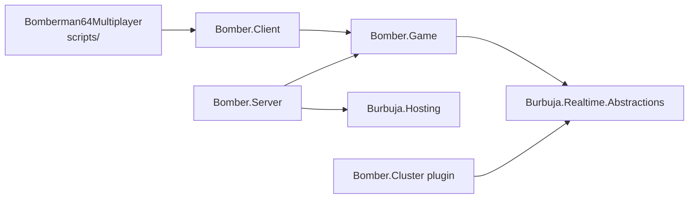

# Codebase map

Read this before adding, moving or renaming files. It answers where code lives,
which naming rules Godot and .NET impose, and how to extend each area without
breaking imports, exports, packaging or tests. [Architecture](../architecture.md)
owns runtime boundaries; the branch guides own behavior and tuning.

## Top level

The repository root is the Godot project root (`res://`). Folders that contain a
`.gdignore` are invisible to Godot's importer and are never exported.

| Path | Contents | Godot |
| --- | --- | --- |
| `Release.props` | Canonical version/build/protocol identity; shared assembly metadata | Root |
| `project.godot`, `export_presets.cfg`, `icon.svg` | Engine settings, autoloads, the `macOS Metal` export preset (version/build synchronized from `Release.props`) | Root |
| `Bomberman64Multiplayer.csproj`, `.sln` | Godot C# project; compiles `scripts/**/*.cs` and references `Bomber.Client` | Root |
| `Directory.Build.props` | Shared `net10.0`, nullable and implicit-using defaults for every project here | — |
| `scenes/` | `main.tscn`, the only scene; menus, arenas and models are built in code | Imported |
| `scripts/` | Godot presentation and input code, by feature (below) | Imported |
| `assets/` | Fonts with OFL notices; `testing/scenarios.json`, the shared playtest catalog | Imported |
| `src/` | Pure .NET assemblies: no Godot types | Ignored |
| `tests/` | Executable managed suites, network smoke and the capacity probe | Ignored |
| `tools/` | Python/shell tooling with colocated `test_*.py` contracts | Ignored |
| `deploy/` | Compose/Docker files for server and cluster hosts | Not a resource |
| `docs/` | Agent guides, current reference docs, `history/` evidence, media | Not a resource |
| `native/`, `artifacts/`, `burbuja-kernel/` | Local SDL build, outputs, pinned external kernel (all Git-ignored) | Ignored |

## Assemblies and dependency direction

| Project | Owns | Never contains |
| --- | --- | --- |
| `src/Bomber.Game` | Rules and authority (folders below): match hosts/options, online registration and rooms, tutorial course, simulation | Godot, transport, rendering |
| `src/Bomber.Client` | Engine-facing sessions, peer transport, input policies, signed updates (folders below) | Godot types |
| `src/Bomber.Server` | Independent ASP.NET host registering the `blast` game | Game rules |
| `src/Bomber.Cluster` | Optional pressure-aware placement plugin with `plugin.json` | Game rules |
| `scripts/` | Screens, rendering, audio, devices, harness | Authority decisions |

Assembly and namespace prefixes are deliberate: `Bomber.*` is pure .NET and
`BlastCircuit.*` is Godot presentation. Keep the `Bomber.*` assembly names; the
server package, cluster plugin manifest, CI receipts and deployed hosts use them.

## Pure .NET assemblies by feature

Folders are PascalCase and each namespace mirrors its folder
(`src/Bomber.Game/Simulation/Stages` is `Bomber.Game.Simulation.Stages`).
A file holds one top-level type; a small record or enum that only describes
its owner's inputs/results may stay beside it (`ThrowProjection` in
`BombThrowRules.cs`, `RosterSlot` in `LocalRoster.cs`).

| Folder | Namespace | Owns |
| --- | --- | --- |
| `Bomber.Game/Matches/` | `Bomber.Game.Matches` | `MatchOptions`/`AdvancedRules`/`PlayerInput`, `PlayerNames`, and the authority hosts outside the kernel: `LocalMatch` (deterministic local clock) and `PeerMatch` (elected player host) |
| `Bomber.Game/Online/` | `Bomber.Game.Online` | Kernel registrations (`BomberRealtimeGame`, public/peer/adaptive room games, `WaitingRoomMatchmaker`), `OnlineProtocol` release admission, `RoomRules` validation |
| `Bomber.Game/Online/Rooms/` | `Bomber.Game.Online.Rooms` | Persistent room sessions: `PartySession`, `PeerRoomSession`, `AdaptiveRoomSession`, `RoomHostQuality` |
| `Bomber.Game/Tutorial/` | `Bomber.Game.Tutorial` | Lesson catalog shared by authority and the lesson browser |
| `Bomber.Game/Simulation/` | `Bomber.Game.Simulation` | `BlastSession.cs`, the authority, and its MIT `LICENSE` covering this folder |
| `Bomber.Game/Simulation/BlastSession/` | `Bomber.Game.Simulation` (partials) | `Players/` input, movement, contacts, grapple, ghosts, eliminations; `Bombs/` actions, travel, kicks, aim, explosions; `Bots/`; `Items/` loot; `Rounds/` rounds, tutorial, Blizzard and meteor events; `Snapshots/` state and presentation output |
| `Bomber.Game/Simulation/State/` | `Bomber.Game.Simulation.State` | Mutable entities and per-tick values: `BlastPlayer`, `BlastBomb`, `BlastItem`, `BlastHazard`, `BlastMeteor`, `SoftBlockGrid`, `InputState`, `RoundPhase`, `BombState` |
| `Bomber.Game/Simulation/Stages/` | `Bomber.Game.Simulation.Stages` | Immutable terrain: `StageLayout`, `CellDef`, `CellKind`, `CoverArea`, and `BlastStages` with one `BlastStages.<Arena>.cs` partial per arena |
| `Bomber.Game/Simulation/Rules/` | `Bomber.Game.Simulation.Rules` | Stateless shared rules: `BombThrowRules`, `BlastGeometry`, `FloodRules`, `PowerUpRules`, `BlizzardRules` |
| `Bomber.Game/Simulation/Ai/` | `Bomber.Game.Simulation.Ai` | Internal bot helpers: navigation graph, timed danger field, difficulty profiles |
| `Bomber.Client/Sessions/` | `Bomber.Client.Sessions` | `ISession`, `LocalSession`, `NetworkSession` (`Http`/`Socket`/`Peer` partials), settings, lobby/party status, `LocalRoster`, `PresentationCursor` |
| `Bomber.Client/Peer/` | `Bomber.Client.Peer` | `IPeerLink`, `PeerRoomClient`, frame rules and packet codec |
| `Bomber.Client/Controls/` | `Bomber.Client.Controls` | Input policies, controller seat bindings, local layouts, menu stick navigation |
| `Bomber.Client/Updates/` | `Bomber.Client.Updates` | Signed update checks and the macOS installer |

`Controls` deliberately avoids an `Input` namespace segment, for the same
reason as `input_devices` below. `Bomber.Server` and `Bomber.Cluster` are small
enough to stay flat.

## Godot scripts by feature

Folder names are snake_case; each namespace mirrors its folder in PascalCase.

| Folder | Namespace | Owns |
| --- | --- | --- |
| `app/` | `BlastCircuit.App` | `GameRoot` composition root (+ `Sessions`/`Preferences` partials), display-mode autoload, saved preferences |
| `arena/` | `BlastCircuit.Arena` | `ArenaView` (+ `Snapshots`/`ThrowPreviews`/`Presentation`/`Tutorial` partials), camera rig, lighting, snapshot interpolation |
| `arena/stages/` | `BlastCircuit.Arena.Stages` | `TempleStageView` terrain builder with one partial per arena |
| `arena/models/` | `BlastCircuit.Arena.Models` | Procedural bomber, bomb and power-up models |
| `arena/effects/` | `BlastCircuit.Arena.Effects` | Explosions, kick/exit effects, throw preview, reticle, first-use warmup |
| `rendering/` | `BlastCircuit.Rendering` | Shared geometry/material caches and graphics presets |
| `audio/` | `BlastCircuit.Audio` | Original PCM synthesis (also linked into `Bomber.Audio.Tests`) and playback |
| `input_devices/` | `BlastCircuit.InputDevices` | `ControllerHub` autoload, controller profiles, SDL Switch 2 USB backend, keyboard bindings |
| `ui/` | `BlastCircuit.UI` | Theme, icons, prompt bar and reusable stamped controls |
| `ui/menu/` | `BlastCircuit.UI.Menu` | `ArcadeMenu` (partials per screen), backdrop, roster, previews |
| `ui/hud/` | `BlastCircuit.UI.Hud` | Battle HUD, player tokens and fuse clock |
| `updates/` | `BlastCircuit.Updates` | In-game update offer at safe menu boundaries |
| `testing/` | `BlastCircuit.Testing` | `PlaytestDriver` harness, `ScenarioCatalog`, scripted runner |
| `testing/journeys/<area>/` | `BlastCircuit.Testing` (partials) | Catalog-driven `*Playtest.cs` journeys: `combat`, `input`, `matches`, `menus`, `online`, `rendering`, `stages` |

`input_devices` avoids a `BlastCircuit.Input` namespace, which would shadow
`Godot.Input` inside every `BlastCircuit.*` file. The harness ships inside the
game assembly so packaged apps can run `package-smoke`; it only attaches when
playtest arguments are present.

## Layout rules checked by the public profile

[`tools/ci/source_layout.py`](../../tools/ci/source_layout.py) runs in
`public_checks.py` and fails when:

- a `src/` or `scripts/` file's namespace does not mirror its folder;
- a file is not named after a type it declares (top-level `Program.cs` excepted);
- a partial file does not use its main class file's namespace. C# requires one
  namespace per class, so a class with many partials may group them in concern
  subfolders (`Simulation/BlastSession/Bombs/`, `testing/journeys/stages/`) while
  keeping the main file's namespace. This is the only exception to mirroring;
- `scripts/` folders are not lowercase snake_case or `src/` folders not PascalCase;
- a `src/` file uses Godot;
- any source or test folder holds more than 20 C# files. Group by concern rather
  than raising the limit.

Test executables use the global namespace; their folders mirror the authority
concerns (`tests/Bomber.Game.Tests/{Bombs,Players,Bots,Items,Rounds,Snapshots,Stages,Rooms,Fixtures}`).

## Naming rules that the engine enforces

- One Godot node class per file, and the file name must equal the class name
  exactly (case-sensitive). Godot binds scripts by file path: the source
  generator only emits `ScriptPath` for the declaration in the matching file.
- Split a large class with `Class.Concern.cs` partials beside it; they share the
  class namespace. The harness keeps its older convention: `PlaytestDriver`
  partials are named `*Playtest.cs` (no class of that name exists). Keep fields and initialized properties in the main file so
  field-initialization order stays in one place.
- Commit `.uid` sidecars and move them with their scripts. Godot creates one for
  each new script during an editor import; commit it with the script.
- Godot's exported PCK is case-sensitive while macOS/Windows file systems are
  not. Use lowercase paths in `res://` references and rename case-only via a
  temporary name (`git mv a tmp && git mv tmp A`).

## Where large classes are split

| Class | Main file | Partials |
| --- | --- | --- |
| `BlastSession` | settings, state, IGameSession callbacks, helpers | In `BlastSession/`: `Players/` (`Input`, `Movement`, `BodyContacts`, `Grapple`, `Ghosts`, `Eliminations`), `Bombs/` (`BombActions`, `BombTravel`, `Kicks`, `ThrowAim`, `Explosions`), `Bots/` (`Bots`, `BotNavigation`, `BotObjectives`, `AiTestHooks`), `Items/` (`Loot`), `Rounds/` (`Rounds`, `Tutorial`, `Blizzard`, `Meteors`), `Snapshots/` (`Snapshots`, `Presentation`) |
| `BlastStages` | `Get` dispatch and `Fill` helper | one per arena: `SunkenTemple`, `RockGarden`, `UpAndDown`, `TopRules`, `BlizzardBattle`, `GreedyTrap`, `CircuitGarden` |
| `NetworkSession` | fields, connect/lobby setup, input, dispose | `Http`, `Socket`, `Peer` |
| `ArenaView` | fields, lifecycle, stage/lighting setup, `_Process` | `Snapshots`, `ThrowPreviews`, `Presentation`, `Tutorial` |
| `TempleStageView` | shared terrain build, height queries and Sunken Temple | `Blizzard`, `CircuitGarden`, `GreedyTrap` (+ `GreedyExterior`), `RockGarden`, `TopRules`, `UpAndDown`; decorative `Scenery` plus one `<Arena>Exterior` per arena (`SunkenTemple`, `RockGarden`, `UpAndDown`, `TopRules`, `Blizzard`, `CircuitGarden`, which also holds Greedy Trap water life) |
| `ArcadeMenu` | fields, layout helpers, screen switching | `Setup`, `Online`, `Results`, `Settings`, `Tutorial`, `Navigation` |
| `GameRoot` | lifecycle, navigation, input dispatch, `_Process` | `Sessions`, `Preferences`, `Tutorial` |
| `PlaytestDriver` | harness, capture, trace and input helpers | `ScenarioCatalog`, `ScriptedPlaytest`; one `journeys/<area>/*Playtest.cs` per journey family |
| `Bomber.Game.Tests` | `Program.cs` dispatch and tally | `Fixtures/GameFixtures` plus themed `<concern>/*Checks.cs` |

## Recipes

**Authority rule or bot behavior.** Change the owning `BlastSession` partial under
`Simulation/BlastSession/<concern>/` or the rule class in `Simulation/Rules/`, add a
red managed check, then follow
[gameplay and AI](gameplay-and-ai.md). New simulation files keep the MIT
adaptation header used by their neighbours.

**Presentation script.** Add `public partial class Name : NodeType` as
`scripts/<feature>/Name.cs` with the folder's namespace, build, run the editor
import once, and commit `Name.cs.uid`.

**Autoload or scene.** Update `project.godot` (`run/main_scene`, `[autoload]`)
and the scene's `ext_resource` path; keep the `uid=` attribute. Non-resource
files that must ship need an `include_filter` entry in `export_presets.cfg`.

**Playtest journey.** Register it in `assets/testing/scenarios.json` and add a
`scripts/testing/journeys/<area>/*Playtest.cs` partial. See [testing](testing-and-delivery.md#extend-the-harness-with-meaningful-gameplay).

**Managed check.** Add it to the matching themed `tests/Bomber.Game.Tests/<concern>/*Checks.cs`
or create one in the concern folder that mirrors the authority partial it covers. Keep the suite's completion footer intact; QA parses it.

**Arena.** An arena spans the same seams in each layer, so mirror an existing
one such as Rock Garden: `Simulation/Stages/BlastStages.<Arena>.cs` (id constant
and builder, registered in `BlastStages.Get`), stage-only authority events in
`BlastSession/Rounds/`, `scripts/arena/stages/TempleStageView.<Arena>.cs`,
optional `scripts/rendering/ArtMaterials.<Arena>.cs`, then
`tests/Bomber.Game.Tests/Stages/<Arena>Checks.cs` and
`scripts/testing/journeys/stages/<Arena>Playtest.cs`.

**Tool.** Place it under `tools/<area>/` with `test_*.py` beside it. A new area
needs adding to the public profile's folder list in `tools/qa/run.py`.

## Moving files safely

1. `git mv` the file with its `.uid`; never recreate it.
2. Update the namespace to mirror the new folder (partials keep their class's
   namespace), then the `using` directives of every consumer.
3. Update `project.godot`, `.tscn` `ext_resource` paths, csproj links
   (`Bomber.Audio.Tests` links `scripts/audio/SoundSynth.cs`; `Bomber.Release.Probe`
   links `src/Bomber.Game/Online/OnlineProtocol.cs`), `export_presets.cfg`
   filters and tool paths (`git grep` the old path).
4. Build, then run `python3 tools/qa/run.py --profile public` (includes the
   Markdown link/anchor and source layout checks) and the area's completion gate.
5. On a checkout with an existing `.godot/` cache, the first editor import after
   pulling a move logs autoload errors for the old paths, which fails QA's
   `godot-resource-import` step once. Deleting `.godot/` (a regenerable cache)
   or running the import a second time clears it; fresh CI checkouts are clean.
6. On macOS, a case-only folder rename leaves the old-cased directory on disk if
   it still holds untracked files such as `.DS_Store`. Git then writes the new
   files into it, and the export can store a wrong-cased path the PCK cannot
   resolve. After pulling, `ls scenes scripts` should show only lowercase
   folders; move stray untracked files and remove leftover `Scenes/`,
   `scripts/UI/`, `scripts/Testing/`, `scripts/Rendering/` or `scripts/Updates/`.

## 2026-10-26 source restructure

Behavior-preserving: no rule, tuning, wire format or assembly name changed.
Notes and receipts dated before it may cite these paths and namespaces:

| Before | After |
| --- | --- |
| `src/Bomber.Game/*.cs` (`Bomber.Game`) | `Matches/`, `Online/`, `Online/Rooms/`, `Tutorial/` with matching namespaces |
| `Simulation/BlastSim.cs` (13 types) | one file per type in `Simulation/State/` and `Simulation/Stages/` |
| `Simulation/BlastSession.<Concern>.cs` | `Simulation/BlastSession/<Group>/BlastSession.<Concern>.cs` (namespace unchanged) |
| `Simulation/BlastStages*.cs`; stage builders inside `BlastStages.cs` | `Simulation/Stages/`, one `BlastStages.<Arena>.cs` per arena |
| `Simulation/{BombThrowRules,BlastGeometry,FloodRules,PowerUpRules,BlizzardRules}.cs` | `Simulation/Rules/` (`Bomber.Game.Simulation.Rules`) |
| `src/Bomber.Client/*.cs` (`Bomber.Client`) | `Sessions/`, `Peer/`, `Controls/` with matching namespaces |
| `NetworkSession.cs`, `ArenaView.cs` | main file plus concern partials beside it |
| `scripts/arena/TempleStageView*.cs` | `scripts/arena/stages/` (`BlastCircuit.Arena.Stages`) |
| `scripts/testing/*Playtest.cs` | `scripts/testing/journeys/<area>/` |
| `tests/Bomber.Game.Tests/*.cs` | `tests/Bomber.Game.Tests/<concern>/` |

## 2026-10-24 layout migration

Older notes and receipts may cite pre-restructure paths:

| Before | After |
| --- | --- |
| `Scenes/Main.tscn` | `scenes/main.tscn` |
| `scripts/GameRoot.cs`, `DisplayModeController.cs`, `PlayerPreferences.cs` | `scripts/app/` |
| `scripts/ArenaView.cs`; `scripts/Rendering/` stage, camera, lighting, motion | `scripts/arena/` |
| `scripts/Rendering/` models, effects, art helpers, audio | `scripts/arena/models/`, `scripts/arena/effects/`, `scripts/rendering/`, `scripts/audio/` |
| `scripts/Input/`, `scripts/PlayerControls.cs` | `scripts/input_devices/` |
| `scripts/UI/` | `scripts/ui/`, `scripts/ui/menu/`, `scripts/ui/hud/` |
| `scripts/Testing/` (`Bomber.Testing`), `scripts/Updates/` | `scripts/testing/` (`BlastCircuit.Testing`), `scripts/updates/` |
| `scripts/*.sh` | `tools/dev/*.sh` |
| `tools/package-macos.py`, `tools/cleanup-macos-builds.py` | `tools/packaging/` |
| `tools/party-relay.sh`, `tools/prepare-party-server.py` | `tools/party/` |
| `docs/iteration*.md` and early research notes | `docs/history/` |
