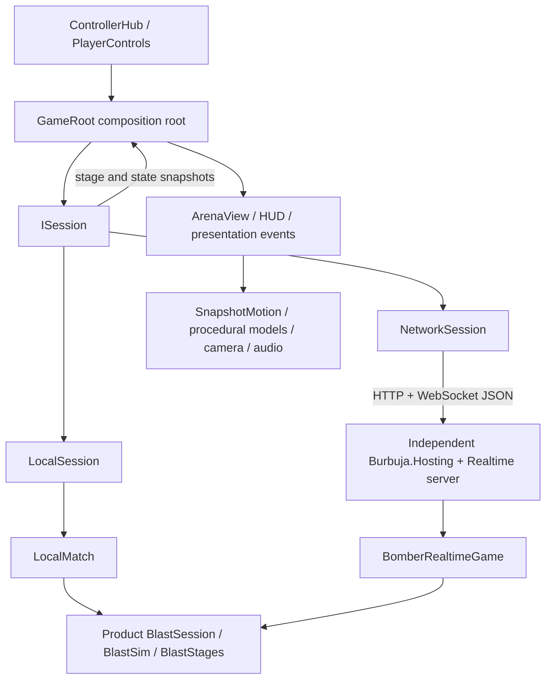

# Architecture

Current architectural overview at the v0.18 runtime baseline. For maintenance
procedures and the reasons behind decisions, start at the [agent handoff](agents/README.md).
Exact constants, protocols and dependency pins remain in source/configuration.

## Authority, transport and presentation

| Module | Owns | Dependency boundary |
|---|---|---|
| `src/Bomber.Game` | Match options/rosters, local authority adapter, realtime registration and game rules | Kernel realtime contracts; no Godot rendering |
| `src/Bomber.Client` | `ISession`, local accumulator, HTTP/WebSocket lobby/reconnect/input handling, bounded message handoff, input policies | Game and .NET APIs; no Godot dependency |
| `src/Bomber.Server` | Independent ASP.NET executable and registration of the `blast` game | Game and Burbuja.Hosting |
| `src/Bomber.Cluster` | Optional pressure-aware placement plugin for the public cluster | Kernel core/realtime abstractions |
| `scripts/input_devices` | Device/focus/menu handling and physical-to-semantic intent (`ControllerHub`, `PlayerControls`) | Godot plus client input policies |
| `scripts/app` (`GameRoot`) | Screen/session lifecycle, input dispatch, accepted messages and HUD composition | Session interface and presentation |
| `scripts/arena` (`ArenaView`) | Accepted entity reconciliation, terrain, camera, lighting, motion and presentation event routing | Godot; never authority for hits/wins/items |
| `scripts/arena/models`, `arena/effects`, `rendering`, `audio` | Original procedural models, effects, shared geometry/materials/presets and synthesized audio | Render state only |
| `scripts/ui` (`menu`, `hud`) | Shared stamped controls, menu screens and battle HUD | Interaction state; emits intent to `GameRoot` |
| `scripts/testing` | Catalog-driven playtest harness shipped in the game assembly | Drives ordinary input and sessions |

Folder layout, naming rules and partial-class seams are in the [codebase map](agents/codebase-map.md).

`ISession` exposes advancement, input submission, message draining, status/join
code and disposal. `LocalSession` and `NetworkSession` implement that seam.
`LocalMatch` adapts the kernel session context to deterministic local time and
randomness. `BomberRealtimeGame` registers the same product simulation online.
Game-specific bomb, terrain, collision and bot fixes belong in `Bomber.Game`,
not the generic kernel. The adapted simulation retains its MIT notice.

The ignored external `burbuja-kernel` checkout supplies hosting/contracts. Restore
it with the checked-in bootstrap tools and current pin; preserve the public/private
boundary. [Trusted CI and dependency handling](ci.md) explains provisioning.

## Simulation and messages

Each session has one sequential owner. Authority runs at 30 Hz and emits complete
snapshots every other tick (15 Hz). Local play uses bounded accumulator catch-up;
the online kernel supplies its fixed-tick lobby loop. Bots use the session's seeded
random source and ordinary semantic input. Ready, Fight, Hurry and RoundOver are
separate phases; UI screen state is also separate from authority phase.

Authority owns continuous movement, tier/ramp support and falls, placement/kicks,
carrying/pumping/throws/aim, spherical blasts and occlusion, chains, destructible
cover, upgrades, body contacts, recovery/grapples/ghosts, flood, scores and outcomes.
Static stage messages describe cells, ramps and spawns; state messages carry
accepted entities, soft-block bits, acknowledgements and presentation events.

Input expresses direction and semantic primary/carry/remote/aim intent. Network
messages use the kernel application protocol, not Godot RPC. The current input
payload includes `x`, `z`, `a`, `b`, `r` and optional `aim`; inspect serialization
and backward-compatible defaults before extending it. Clients never submit accepted
positions, hits, item ownership or winners.

The client uses `HttpClient` for identity/queue/lobbies and `ClientWebSocket` for
realtime. Reservations can identify another owning server; the client honors it
and rejects an insecure socket downgrade from HTTPS. Movement is sent at 30 Hz
while bounded action transitions are retained. Off-thread receives hand detached
JSON to a bounded buffer: stale state can coalesce while stage/control messages
remain ordered. Godot drains this buffer on its own thread.

Disconnect clears human commands; the kernel retains a seat for its reconnect
grace. Reconnect uses the existing guest identity/reservation, not persistent
accounts or saved-match recovery. A joining human replaces the bot in its assigned
seat while the match stays within eight total participants. A mid-match join is
marked ghost/pending-round-start rather than becoming an immediately living
competitor; the next round initializes participation.

## Motion and presentation

Player roots use `SnapshotMotion`: a tick-stamped interpolation buffer with roughly
100 ms playback delay, bounded samples, starvation hold and discontinuity snaps.
This replaced the earlier per-arrival smoothing described in old iteration notes.
Facing is smoothed separately. Other entities retain their own presentation paths.
There is no prediction/rollback reconciliation; reliable ordered WebSocket delivery
still requires adverse-network measurements before Internet responsiveness claims.

`ArenaView` advances root motion and feeds actual rendered planar travel into the
character gait. `BomberModel` separates hip/leg motion from a waist-pivot upper
body; hands and carried-bomb socket share transforms. Original meshes and sounds
are generated by code, with cached geometry/material/audio resources. Timed
presentation events drive action poses/cues, independently of gameplay mutation.

`TempleStageView` builds surfaces from authoritative cells. Tier height converts
through `HeightScale` (currently 1.35) consistently across entities, bombs, water
and previews. Upward cliff faces block traversal; directed downhill edges permit
ordinary falls. Visual stone, foundation and water detail do not create support.
`BattleCameraRig` fits terrain/character bounds and applies shake relative to that
fit. Forward+/Metal, shadows, SSAO and MSAA are presentation configuration, not
proof of performance or macOS Game Mode. [Visual maintenance guide](agents/visuals-and-animation.md).

Throw preview and authoritative static travel share `BombThrowRules`, including
swept collision, terrain support, water/void and fuse outcomes. Dynamic actors and
future water changes remain outside the advisory forecast. Only local controlled
carriers receive markers; screen-space endpoints remain visible over cover and
are gated by Match plus Fight/Hurry, with explicit cleanup before Results.

## Product seams

- **Bomb actions/travel:** separate session partials own primary hold/edges,
  contextual kicks, motion/fuse transitions, precision intent and grapples.
  These remain one authority, not independently mutable competing services.
- **Terrain/rewards:** immutable stage definitions and crossing rules feed both
  movement and navigation. `FloodRules`, `PowerUpRules` and the loot partial own
  flood curves, inventory modes/caps and deterministic cover rewards.
- **AI:** cached terrain edges and lobby-owned reusable search buffers use timed
  hazards and ordinary collision. Difficulty profiles vary decisions, not physical
  ability. Progress-aware recovery handles body/centering/neutral deadlocks; goals
  expire on arrival and attack utility can justify necessary ramp detours.
- **Roster:** `LocalRoster` validates Human/CPU/Off seats and orders humans before
  CPUs for runtime bindings; appearance follows the reordered seat. Online cosmetic
  appearance is validated for the authenticated sender and does not alter physics.
- **Screens:** Modes, Roster, Setup, Online, Lobby, Match and Results have explicit
  lifecycles. Match binding lifetime does not imply that menu navigation is disabled
  on Lobby/Results. Lobby information comes from actual server events.
- **UI:** shared native focusable controls, stamped keycaps, portrait tokens and a
  fuse clock sit over live 3D menu stages. Match and menu reuse the same character.
- **Practice:** one local human, clear training paths, unlimited time and a fixed
  learning cache. Reset creates a fresh match. Practice success is not proof that
  ordinary covered battle layouts work; no network debug-spawn API is exposed.

Keep these seams deep enough that a bug can be tested at its owner. Prefer a
focused helper/partial when it isolates a real rule over a pattern hierarchy that
adds indirection without separate policy or lifetime. Keep transport DTOs, Godot
nodes and authority entities distinct; pair a pure test with an actual journey
when the failure crosses their boundary.

## Independent server and scaling limits

The intended server runs independently on the user's hardware; Godot connects to
its lobby/socket endpoints. Docker/Compose is not required. `Bomber.Server` registers
this game on Burbuja.Hosting; another kernel host needs equivalent registration.
Local play needs no server. The canonical QA profiles create an owned ephemeral
loopback server rather than treating a stale developer listener as fresh evidence.

Standalone hosts retain configured in-process capacity and least-loaded placement.
The public cluster adds the optional `Blast.Cluster` placement plugin and the kernel's
Redis/Valkey backplane: primary first, then an eligible fallback, with each match's
authority and sockets staying on one node. Capacity settings are not throughput
benchmarks. See [cluster operations](cluster-hosting.md) for shared signing, routing,
resource ceilings and verification. No deployment follows merely from building a ZIP.

The [shared online service](online-server.md) serves all users from a maintained
server address. Each cluster node uses the verified portable runtime plus explicit
deployment plugins. An operator tunnel establishes service behavior only. The former same-Wi-Fi
relay setup is a conditional historical path in the
[party guide](online-party.md).

## Verification and delivery

Managed executables test rules/client/AI/audio; network smoke uses real independent
HTTP/WebSocket clients, mixed bots, reconnect and input behavior. Godot journeys
exercise actual scenes and ordinary input. `assets/testing/scenarios.json` is the
single Python/C# catalog, and receipts validate exact completed coverage and hash.
Headless geometry/state checks and graphical pixels/recordings answer different
questions. [Testing and delivery](agents/testing-and-delivery.md) owns the workflow.

The tested Mac app is self-contained and ad-hoc signed. Normal launch is fullscreen;
QA defaults windowed. After verified installation, identity-checked cleanup leaves
one app at `~/Applications/Blast Circuit.app`, retaining ZIPs and receipts. The
public boundary excludes kernel source, private configuration, raw traces and
reference artwork; distributed art/audio is original with required notices.
