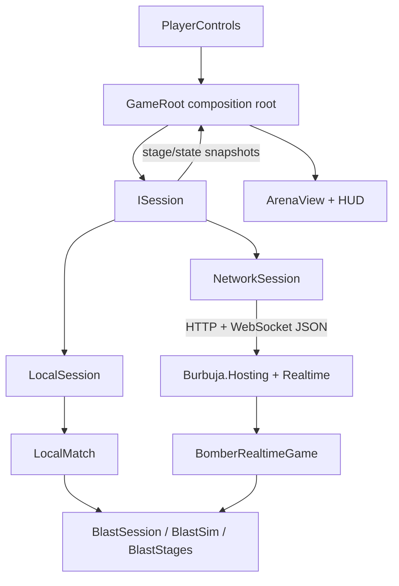

# Architecture

The design separates authoritative rules, session transport, and Godot presentation. Local practice and the online server instantiate the same simulation. A renderer consumes stage/state messages and sends movement/button intent; it never decides hits, wins or item ownership.

## Modules and ownership

| Module | Responsibilities | Dependencies |
|---|---|---|
| `src/Bomber.Game` | Match options, validated local roster, fixed-step authority adapter and realtime game registration | Kernel realtime contracts; product-owned Blast simulation |
| `src/Bomber.Client` | `ISession`, local accumulator, network authentication/lobbies, reconnect, input sequencing, bounded message handoff | `Bomber.Game`, .NET HTTP/WebSocket APIs; no Godot dependency |
| `src/Bomber.Server` | Independent ASP.NET executable, configuration and registration of the `blast` game | `Bomber.Game`, `Burbuja.Hosting` |
| `scripts/GameRoot.cs` | Godot composition root, match menu, session lifecycle, input dispatch and HUD | Session interface and presentation |
| `scripts/PlayerControls.cs` | Two keyboard layouts and gamepad intent | Godot input and `PlayerInput` value type |
| `scripts/ArenaView.cs` | Procedural stage/entity geometry, lighting, visual smoothing and effects | Godot; decoded snapshots |

`ISession` is the engine-facing seam: `Advance`, `SendInput`, `DrainMessages`, connection status, join code and disposal. `LocalSession` and `NetworkSession` implement it. The session module can be exercised without starting Godot; the simulation can be exercised without starting a server.

`LocalMatch` adapts the kernel's `ISessionContext` interface to local players and deterministic time/randomness. `BomberRealtimeGame` implements `IRealtimeGame`; the online host registers it through dependency injection. The kernel owns authentication, reservations, lobby lifecycle, matchmaking, server placement, transport and rate limits. Game-specific rules stay in the game layer.

The first iteration linked the kernel example. This iteration makes the adapted simulation product-owned so terrain, AI, and combat fixes belong to this game:

- `src/Bomber.Game/Simulation/BlastSession.cs`
- `src/Bomber.Game/Simulation/BlastSim.cs`
- `src/Bomber.Game/Simulation/BlastStages.cs`

Source baseline: kernel revision `b0758339984bbeead1b3d1236f31e980aaa5f20e`, MIT license in `burbuja-kernel/LICENSE`. The source checkout must still be present for kernel contract and hosting references. The server is this product's executable; it does not modify the generic kernel or run its example host. Simulation source retains provenance and the upstream MIT notice.

## Simulation and game flow

A single owner calls each session sequentially. Authority ticks at **30 Hz** and emits complete snapshots every other tick (**15 Hz**). Local play uses an accumulator with bounded catch-up after a paused window. The online kernel supplies its own fixed-tick lobby loop and load accounting. Bot decisions run inside the authority with the session's seeded random source.

The match has ready, fight, hurry and round-over phases. Authority owns continuous planar movement, terrain tiers/ramps, bomb placement/kicks/carrying/pumping/throws, spherical blasts and occlusion, chain reactions, destructible blocks, items, stun/ghost state, round scoring and match completion. Static stage data describes cells, tier/ramp transitions and spawns. State snapshots carry current entities and a compact soft-block grid.

The original publisher manual does not specify the exact equations or constants. This implementation's fuse, radii, movement and bot policy are project choices. Eight participants extends the original four-player battle mode. [Research](research.md) records sources and known differences.

## Transport and responsiveness

The client uses .NET `HttpClient` for guest identity, queue and lobby operations, and `ClientWebSocket` for the kernel application protocol. It does not depend on Godot RPC or Godot's high-level multiplayer wire format. A reservation may identify a different owning server; clients honor that returned address. HTTPS connections reject a downgrade to an insecure socket.

Client input looks like `{t:"input",s:sequence,d:{x,z,a,b,r}}`. Authority normalizes and validates movement; clients cannot submit positions or hits. Server envelopes carry `{t,k,d}`, where `k` is the authoritative tick. Snapshots include per-player input acknowledgements. The network adapter sends current movement at 30 Hz and preserves bounded button transitions; it avoids a growing queue of obsolete movement commands. The handoff buffer coalesces state snapshots while retaining stage/control messages within a fixed capacity.

Network receives run outside the engine thread. They hand detached JSON messages to a bounded buffer; Godot drains it on its own thread. `ArenaView` smooths entities toward the latest authoritative positions. There is **no client prediction, rollback, or reconciliation replay**, and this smoothing is not a timestamp-buffered interpolation system. TCP/WebSocket's reliable ordered delivery can delay newer snapshots behind lost packets. Internet play needs latency/loss measurement before making responsiveness claims.

Disconnects clear authoritative human movement, and the kernel holds a seat for its reconnect grace. The client attempts reservation/socket reconnect with the same guest identity; this is not a persistent-account or save/resume system. A late human takes their kernel seat and replaces any bot occupying that slot, keeping the arena within eight participants.

## Scaling and deployment boundary

The independent host currently enables one in-process lobby server with capacity for eight lobbies and least-loaded placement. This is configuration, not an eight-lobby throughput benchmark. Every lobby has its own simulation state and bounded transport buffers. Single-authority ownership keeps the game loop free of cross-thread shared mutable entities.

The generic kernel can expose multiple lobby servers and use its Redis/Valkey backplane for a multi-node fleet. Placement and fleet routing are kernel concerns; they do not require adding network details to bombs or players. Scaling requires configuring node/server identities, public socket addresses, shared guest signing keys and the backplane plugin. See the kernel's [realtime guide](../burbuja-kernel/docs/realtime-lobbies.md) and [Redis plugin guide](../burbuja-kernel/plugins/Burbuja.Plugins.Realtime.Redis/README.md).

The intended deployment is an independent kernel host on the user's own server hardware, with Godot clients connecting to its lobby and WebSocket endpoints. The product does not require Docker or Compose. `Bomber.Server` registers the game on `Burbuja.Hosting`; an existing generic kernel host needs the equivalent game registration.

This product has been exercised on one local server. Multi-node operation, failover, distributed load, TLS/public hosting and production capacity have not been verified here. No external infrastructure was provisioned.

## Evidence and remaining work

The executable game checks cover deterministic bot replay, participant limits, terrain, fuse/explosion behavior, input handling and round reset. Client contract checks exercise local sessions and transport serialization. Network smoke uses separate real WebSocket clients for 2–8 humans, private codes, authoritative movement, reconnect and server bots. The Godot smoke mode loads and runs the actual scene; it complements the plain C# checks.

The game uses original procedural meshes and effects. The client now has articulated procedural characters, walking/carrying/stun poses, synthesized original sound cues, destructible-cover debris, and warm sandstone/water materials. Broader physical-controller coverage, accessibility, gameplay balancing and adverse-network testing remain further work. Neither tests nor this architecture document claim exact reproduction of the original game's undocumented behavior.

## Sunken Temple geometry and presentation

`sunken-temple` is an original 21×23-cell reconstruction of the supplied reference composition. Tier 1 forms the island, tier 0 the recessed cobbled court, and tiers 2–4 the rear pyramid. Broad stair cells connect these surfaces. The rear shrine occupies real hard cells rather than placing invisible decoration in a walkable route. Destructible cover is limited and important approaches remain open.

The authority computes continuous surface height on ramps. Radius-aware movement rejects discontinuous terrain edges; bot searches use the same crossing rules. Explosions use three-dimensional distance and sample intervening terrain/cover before removing destroyed blocks. Presentation scales authoritative height consistently by 1.35 and builds visible steps from the same cell descriptors.

`ArenaView` owns snapshot reconciliation and delegates terrain to `TempleStageView`, shared mesh construction to `ArtGeometry`, materials to `ArtMaterials`, articulated characters to `BomberModel`, and procedural audio to `BattleAudio`. The fitted perspective camera exposes the courtyard walls and stair risers while keeping playable bounds clear of the HUD. Desktop uses Forward+ (Metal on macOS), soft shadows, ambient occlusion and MSAA. Rendering does not modify authoritative positions or hit outcomes.

The UI has separate modes, setup, online connection, lobby, match and results screens. Lobby information comes from actual kernel events; there is no pretend ready/start handshake. Local practice permits one human, clear paths and no match time limit. Eight-seat matches keep the compact portrait strip above the playfield.

## Playtest and failure evidence

`tools/playtest/run.py` launches the real Godot executable and optionally manages a local kernel process. `scripts/Testing/PlaytestDriver.cs` uses the composition root's normal sessions and injects movement/button intent. UI checks exercise actual engine input. Route assertions observe position and altitude; they do not teleport players. Every scenario records assertions, detached state snapshots, screenshots when graphical, and runtime logs. The runner rejects nonzero engine exits, missing reports, assertion failures, timeouts and engine/script errors.

`--scenario script --script <file.json>` lets another agent specify navigation, held inputs, bounded movement goals, captures and state checks. Failure bundles live in unique folders under `artifacts/playtest/`; this keeps the exact failure witness separate from a later passing rerun. Headless runs explicitly disable image evidence. See the [harness guide](../tools/playtest/README.md) for commands and the script schema.

## Iteration-three gameplay modules

The simulation now separates bot behavior into `BlastSession.Bots.cs` and `Simulation/Ai`. Immutable navigation edges are cached; each lobby owns reusable search arrays, shared opponent/cover observations and timed danger fields. Predicted chain reactions and flood safety use the same blast/terrain rules as authoritative movement. Reaction profiles change decision timing without changing a player's physical capabilities. There is no external model call in the tick loop. [AI tests and measurements](../tests/Bomber.Ai.Tests/README.md) document both gains and CPU tradeoffs.

`FloodRules` owns the Pyramid-inspired water curve and `PowerUpRules` owns drop weights, caps and inventory reset. Temple snapshots publish `hurryMode`, `waterLevel`, `waterStartsIn`, `waterRiseRate` and `hurryStartsIn`; other maps retain columns. Bots forecast the same water curve. Exact constants are documented project tuning informed by the [original manual and inspected gameplay footage](gameplay-research.md).

Bomb snapshots now identify owner and carrier, pump count and effective level. Player snapshots include accepted pump and pickup serials. `BombModel` animates growth and fuse feedback; `BomberModel` supplies the lift/pump/throw pose and carry socket; `PowerupModel` gives each upgrade a distinct silhouette. Visual attachment never changes authoritative positions or hit results. A new match clears dynamic presentation state while static terrain can be reused.

The engine harness checks actual model scale, active pumping pose, accepted inputs, inventory, flood height and survival. Training pickups exist only in local practice and use ordinary collection rules. Practice reset rebuilds a fresh match; there is no network debug-spawn or teleport command.

## Roster and presentation polish

`LocalRoster` validates and serializes eight editable Human/CPU/Off seats. Runtime seats are deliberately ordered humans first, then CPUs; color choices are reordered with them, so disabled or interleaved seats cannot change control bindings. `MatchOptions.PlayerAppearances` is validated and cloned at the authority boundary.

Online appearance commands contain only an index, `{t:"appearance",d:{index:0}}`. The authority binds changes to the authenticated sender, validates indices 0–7 and sends current choices to joining and reconnecting players. Match snapshots and final scores include appearance independently of slot; this is cosmetic state and does not affect simulation randomness or outcomes.

`ArcadeBackdrop` owns a live 3D menu stage. Mode and roster characters use the same world, light and floor, so their shadows and perspective agree. `RosterSelection` retains native focusable controls and exposes diagnostics from those actual visible models. `ArcadeModeButton` keeps native Button semantics while rendering a solid beveled plaque and eased selection response. Menu viewports suspend drawing when hidden. `CharacterPreview` remains for isolated online/winner previews. All scenes reuse `BomberModel`; its cached egg/pear meshes, animations and appearance updates are independent of match simulation. `BattleCameraRig` fits terrain and standing-character bounds after stage or viewport changes, preserves a perspective view, and adds shake relative to the fitted offset. `DisplayModeController` owns fullscreen shortcuts separately from match input.

## Controller input boundary

`InputPolicy` is engine-independent: it rejects non-finite axes, applies a radial stick deadzone, normalizes accepted direction to unit speed and resolves D-pad, stick and keyboard precedence without adding vectors. The authoritative server still owns movement, collision, bomb edges and speed limits.

`MatchControllerBindings` reserves a controller identity for each eligible human seat for the duration of a match. Device-list reordering never transfers control between players. A unique reconnect can recover its seat under a new runtime ID; ambiguous replacements remain unassigned. The API supports explicit assignment, while the current UI requires restarting a match to resolve that ambiguous case.

`ControllerHub` adapts Godot devices and the optional native USB backend to the same canonical events. It owns short-tap latches, action release gates at match entry/focus restoration, per-seat hotplug changes and family-aware prompts. `PlayerControls` reads physical keyboard keys and delegates policy to the hub. The live tester consumes face-button navigation so testing an action does not accidentally leave the screen. Native device IDs use a separate range; the controller harness exercises that range as well.

`SdlGamepadBackend` loads a separate, input-only SDL library on the engine thread, opens only the Switch 2 Pro USB VID/PID, preserves queued button edges, and releases its handles on shutdown. The macOS build keeps bulk initialization and nonexclusive HID reports separate. Xbox/DualSense stay on Godot's backend. Generated libraries are ignored, preserve upstream notices, and are not part of the independent server. [Controller research](controller-research.md) records the source pins, macOS patches and wireless limitations.

## Accepted presentation events

`BlastSession.Presentation` publishes a monotonic per-match sequence and at most 128 recent immutable event records alongside snapshots. Accepted drops, held creation, lifts, kicks, pumps, throws, blasts, eliminations/respawns and round/flood transitions use the same local/server path without consuming simulation randomness. Continuous contact with a blocked bomb is deduplicated; the movement segment closes the former gap between bomb collision and kick detection. Final accepted actions are flushed before the match-ended envelope.

`PresentationCursor` baselines the first state, consumes newer sequence numbers once in order, ignores older snapshots, and resets on a new match or reconnect. `ArenaView` owns presentation dispatch, while `ExplosionView`, `ExitEffect` and `BattleAudio` own their visual/audio lifetimes. The new game server is required for complete event cues; older snapshots retain only the older inferred placement/pump/blast/hurry fallback.

Blast visuals use authoritative radius and hazard age, with a visible danger boundary while active and a nonhazardous dissipating tail. Small/medium/large effects differ in billow geometry and timing; dense chains reduce decorative lobes while retaining the boundary. Audio uses cached original PCM, bounded voice starts and local gain. Starting/leaving a match stops old voices. The graphical presentation scenario records actual mixer samples, checks cue deduplication, exercises real actions and verifies effect cleanup; pure audio tests inspect generated clips separately.

## macOS packaging

`tools/package-macos.py` derives an ARM64 template from the installed official Universal 2 template, exports the solution and self-contained managed runtime, adds native controller libraries/notices, and applies/verifies a local ad-hoc signature. Exporter log errors are failures even when the process exits zero. `ControllerHub` selects source-tree libraries in the editor and bundle-relative libraries in exported builds. The app harness omits the source path and runs from its evidence directory.

`model-profile` is an inspection scenario: normal inputs rotate the actual authoritative player, and a temporary camera captures four sides of that player's real rendered model. It checks torso/helmet mesh depth, then restores the normal camera. It does not spawn a substitute character or change game state directly.

## Recovery, carries and menu input roles

`BlastSession.Grapple` owns finite knockdowns, rate-limited victim input effort, paired carry relationships and thrown-player physics. Snapshots expose recovery/holder/airborne state; accepted presentation events explain hits and releases. Both sides of a hold are detached on leave/reset/death, and disconnect releases safely. Bot recovery uses ordinary inputs. Numerical tuning is centralized in the grapple partial module; no client can set a stun timer or holder.

`MenuStickNavigation` converts sampled held axes into deliberate steps with engage/release hysteresis, diagonal stability and repeat timing. It is independent of report frequency. `GameRoot.ScreenName` owns `ControllerHub.MenuNavigationEnabled`, separately from the lifetime of gameplay bindings; retained online lobby or results sessions therefore do not disable visible menu navigation. Switch synthetic regressions use the exact native-publication helper used by SDL reports, while physical observations stay separately labeled.

`ArcadeRuleDial` retains native Godot focus/action semantics for stage/rule arrows. The setup stage preview builds the same authority cells through `TempleStageView`; it does not load a screenshot or invented collision map. The visual water/foundation are presentation-only and never expand walkable authority terrain.

## Iteration-nine control and physics boundaries

`SnapshotMotion` interpolates a bounded envelope-tick sample queue with a continuously advancing playback clock. A 100 ms buffer absorbs uneven packet arrivals without resetting interpolation; a bounded 1.15× catch-up prevents backlog growth, starvation holds until buffered again, and discontinuities snap. It does not extrapolate or predict. Smooth facing and distance-driven stride remain cosmetic. Ghost rider presentation follows its host; ghost nuisance strength, expiry and shake-off stay authoritative.

`BlastSession.BombActions` centralizes primary-hold candidate/latch behavior and full-circle front-placement validation. A primary-lifted bomb throws on the carry press; legacy carry release remains supported. Rolling collision is substepped at the faster continuous-vector kick speed. `CanWalk` supplies directed downward graph edges while `CanCross` preserves strict ramp connectivity; falling is distinct from thrown-player recovery.

AI planning uses the actual valid forward bomb location and ordinary orientation/tap/retreat inputs, rather than planning an underfoot bomb and accidentally kicking the real one away. Outcome tests require blasts, destroyed cover and drops. Nintendo per-device action buttons now follow printed A/B/X; Xbox/PlayStation remain unchanged.

## Body contacts and kick impacts

`BlastSession.BodyContacts` resolves height-aware player circles after movement/flight and before rider synchronization. Alternating pair order and repeated terrain-aware corrections share pressure through crowds. Tangential travel survives; idle/stunned yielding is capped across all neighbors per tick. Ghosts and carried players do not become blocking bodies. Released, overlapping holds receive full separation repair.

Bomb travel sweeps the full radius in short increments. The launch hop is presentation height and does not permit a shot through walls; accepted player impact enters the existing authoritative flight/recovery system through a capped impulse helper. Billiard transfer retains both fuses. Remote authority verifies its owner remains able to command it; orphaned remotes resume the ordinary fuse and publish `remote-fuse`. A wall impact alone does not change remote mode.
