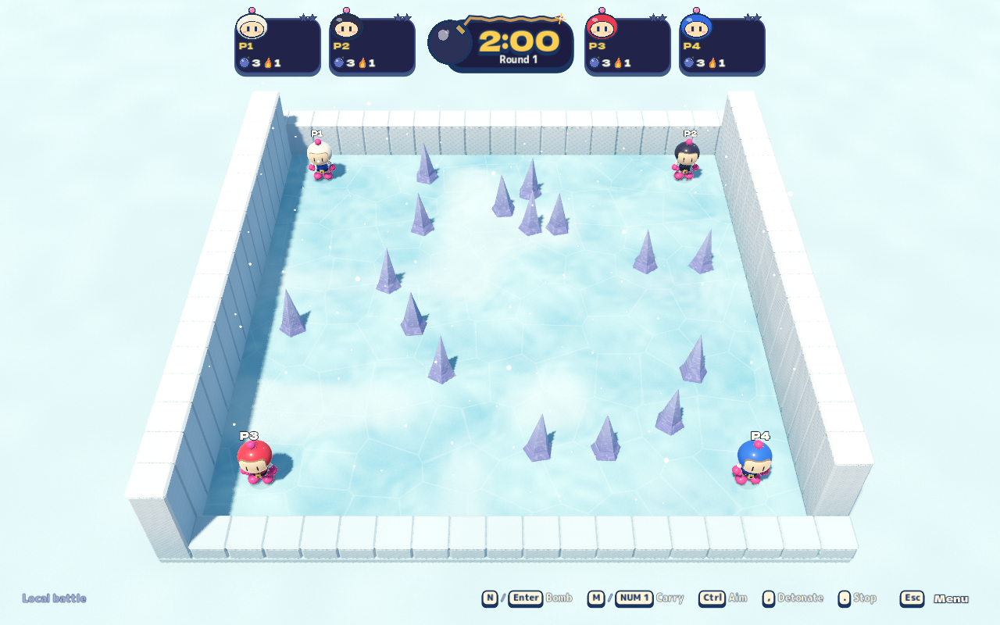
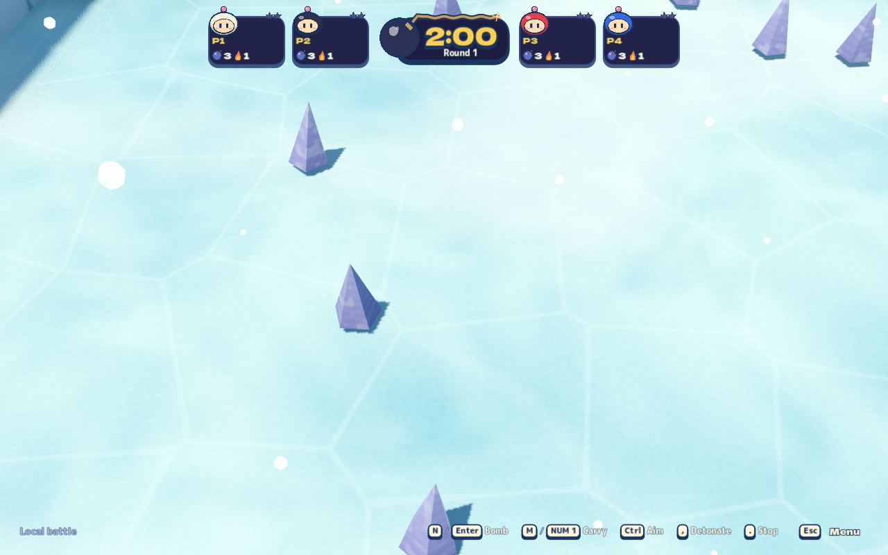
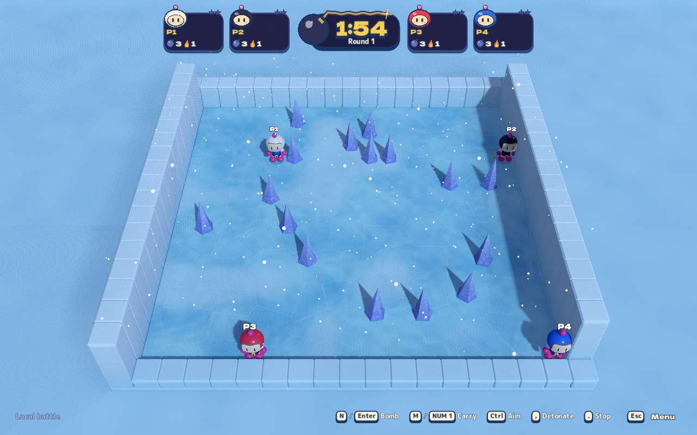
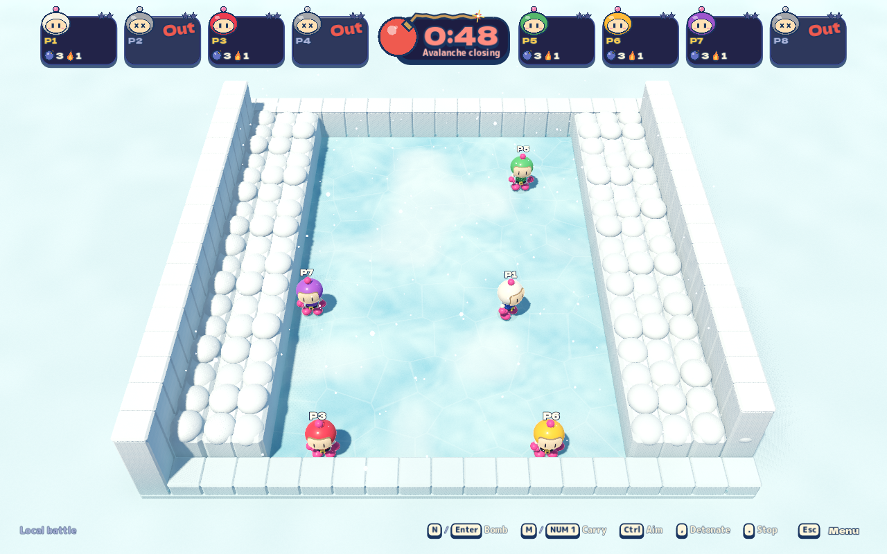
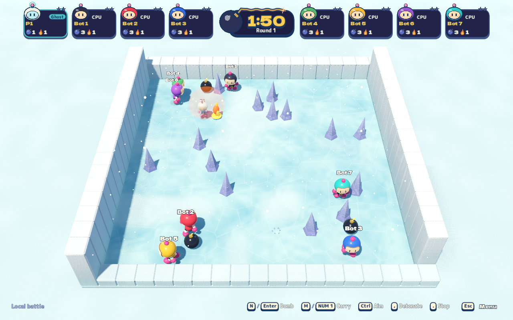
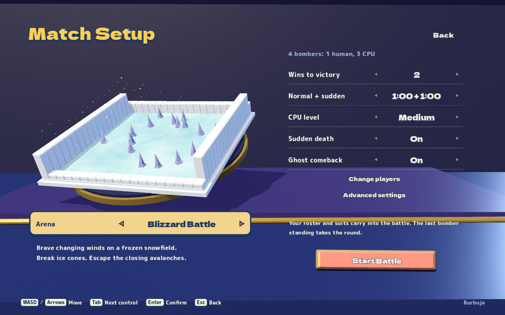

# Blizzard Battle verification

2026-10-25. Tested implementation: `5d07394b72b029115fcdd201d74c049b767e7a99`,
an unreleased Blizzard build using Godot 4.7.2 .NET / .NET 10, integrated with
main `158cd3c` and its v0.30 gameplay/menu changes. The
[stage contract](blizzard-battle.md) separates original references from project
physics, dimensions and eight-player tuning. [Research](blizzard-battle-research.md)
includes the supplied screenshot, official guidebook and normal/sudden-death footage.

## Verified behavior

- Canonical **public** gate passed all ten steps, including public boundaries,
  documentation links, tooling contracts and audio.
- Canonical **managed** gate passed: **2,844** game integration checks,
  **344** client/session checks, **78** focused AI checks, **19** original audio
  cues and **23** cluster checks. The expanded AI soak passed **60** cases across
  five battle arenas, three difficulties, three/seven CPUs and two seeds.
  Blizzard accounts for twelve cases, with 17–97 bombs observed per case and
  a maximum safe-exit idle window of 6.87 seconds against the existing 12-second limit.
- The managed gate also passed real server WebSocket smoke, including a Blizzard
  room receiving advancing authoritative weather, protocol rejection, advanced
  settings, peer hosting and migration; forced adaptive relay and **36** real
  local fleet checks passed. These were task-owned loopback servers.
- Final **core-headless** completed **1,278** assertions with zero runtime errors.
  The focused managed map checks now include ten cases, with tall-spire
  projectile obstruction/landing, blast shielding and cover-height transport.
  Native geometry checks require spire tops at 1.755 render units, matching
  accepted collision. Other arenas retain their prior cover heights.
- Before the size correction, a signed export passed a fresh **peer-rooms**
  retry (**19** assertions) and **adaptive-rooms** (**9**). The updated build
  separately passed the matching managed network/fleet gate, including the real
  Blizzard room carrying its 1.3-unit cover height, and the native online journey.
- The initial **recorded Metal map journey**, before the spire enlargement, passed **84** assertions with **12**
  captures, **zero runtime errors and zero runtime warnings**. It covers native
  arena selection, four-player opening, actual snow motion and local pause,
  Low/Medium/High settings, night lighting, ordinary wind-affected aiming and
  throws, real cone destruction/loot collection, bilateral avalanche elimination
  with a center survivor and eight-player CPU combat.
- Its 30 FPS recording is **60.1 seconds / 1,803 fully decoded frames**, at 1×
  playback speed. Full-resolution captures and two contact sheets spanning the
  recording were visually inspected. The clip includes ordinary menu/settings
  transitions. It is fixed-step gameplay evidence, not real-time GPU throughput.

The user requested larger violet spires after the first screenshots. The
updated spires are over twice as tall, with broader bodies and .94-unit bases.
The screenshots below are replaced with captures of that updated build.

The final **eight-journey Metal regression** on the larger-spire build passed
**1,084 assertions / 96 captures**, with **zero runtime errors or warnings**.
Its exact completed order was `first-use-rendering`, `blizzard-battle`,
`graphics-settings`, `stage-lighting`, `setup`, `framing`, `asset-audit`, `network`.
This includes Low/Medium/High across all six stages, all four lighting profiles,
real setup navigation, both framing aspect ratios, actual asset geometry and
online play. The 1920×1200 isolated desktop passed the 1600×1000 window check;
no window/focus assertion was weakened. The integrated menu-navigation
headless regression also passed **198** assertions with no runtime errors
or warnings.

## Screenshots from the verified export

These are exact 1280×800 game captures, without image edits. The opening, night,
avalanche and CPU images use the ordinary battle camera. The detail image uses
an explicitly temporary inspection camera. The menu image shows the actual
arena selector and shared miniature.

## Retained failures and limits

The initial missing-stage topology regression failed before implementation.
Native shader compilation then caught the obsolete `CLEARCOAT_GLOSS` identifier;
Godot 4.7 requires `CLEARCOAT_ROUGHNESS`. A separate red geometry check caught
coplanar foundation/ice tops; the foundation now stays below the ice. Both were
corrected before the verified captures above.

A broad graphical attempt stopped at the existing 1600×1000 window-resize check
on a 1600×1000 guest display. A later run passed graphics and lighting before
revealing a setup-fixture dependency on the preceding arena selection; the
fixture now configures its own default starting settings while retaining the
native interactions. A dedicated 1920×1200 guest is used for subsequent
runs. One guest startup exceeded the unchanged 180-second RPC readiness budget;
the next focused recording reached the real Metal renderer and passed. These
failed receipts remain available locally and are not counted as passing runs.

The final integrated headless core passed with no runtime errors and a nonfatal
engine-exit warning about fourteen ObjectDB instances; this warning is retained
in its raw receipt. The final graphical run had no warnings.

An earlier complete headless profile passed core, peer and adaptive journeys.
A later repeat passed the final core but timed out while a replacement peer host
rebuilt direct channels. The exact-export transport retry passed both journeys;
no timeout or production host-lease policy was weakened. The timeout's cause was
not isolated, and the failed receipt is retained.

Graphical testing used an isolated macOS 26.6.2 desktop with Apple Paravirtual
Metal Forward+, without taking host focus. This establishes rendering and
synthetic native input, not physical-controller coverage, bare-metal GPU timing
or undocumented original-game numerical physics. Visual inspection is not user
approval of the art.

During final QA, main advanced with heavier falls, proactive AI, item-density
tuning, three collectible bomb types and new menu navigation. The merge retains
both that intent and Blizzard wind/cover height. The deterministic wind journey
uses an ordinary zero-cover battle so it does not override the new randomized
practice seed policy. Removed Fast-bomb motion scaling stays removed. Online
revision 5 rejects v0.30/revision-4 clients before they see an unsupported arena.

Raw references, traces, screenshots and recordings remain in ignored
`artifacts/blizzard/`. The shared service was not deployed. Online protocol
revision **4** requires a coordinated client/server release.
