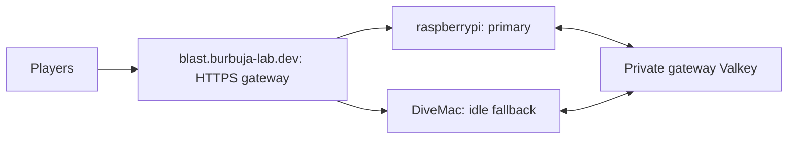

# Public cluster operations

The shared service is `https://blast.burbuja-lab.dev`. Players use that address for
Quick Play and private rooms. A previously saved custom server address remains a
device-local choice.

Since 2026-11-13 the only game node is the owned **workstation** (`blast-workstation`,
route `/nodes/workstation`); see [workstation hosting](workstation-ci.md). The
raspberrypi primary and DiveMac fallback described below are stopped and retained
for rollback; their two-node procedures are historical. `Blast.Cluster` registers the `blast-primary-fallback` placement policy.
For adaptive rooms it first ranks available execution capacity compatible with
the requested hosting preference, then uses the configured node order. Empty
coordination slots alone do not imply capacity to run another match. The kernel filters full/draining
servers and owns atomic capacity claims; HTTP gateway ordering alone does not
implement lobby placement.



A dedicated match runs on its room’s owning node; a peer match runs on a qualified
player with that same node providing signalling and reserved relay fallback. The common API shares guest identity,
join codes and matchmaking through a dedicated authenticated Valkey backplane.
Reservations route sockets to `/nodes/pi/realtime/v1/connect` or
`/nodes/divemac/realtime/v1/connect`. The gateway strips only that node prefix.
It permits player endpoints and rejects the operator/kernel administration surface.

The coordinator lives on the gateway, so losing the Pi does not also remove the
fallback's lobby directory. Existing matches on a healthy node continue when the
other game node fails. Matches on a failed node are lost; this is new-room failover,
not live match migration. The gateway/coordinator remains a single failure domain.

## Resource and service boundaries

The checked-in [Compose template](../deploy/cluster/compose.yaml) limits each game
worker to one CPU, 384 MiB including swap, 256 processes/threads and low relative
CPU priority. These are ceilings, not reserved memory. Lobby limits are explicit
per-node operator configuration and must come from measured workloads.

Native, supervised game tunnels expose only the game origin and the authenticated
backplane. The Pi has its own game-tunnel credential, with no SSH private key or
general access credential. Existing SSH tunnels, network routing, native services
and unrelated Docker stacks are independent.

Private deployment state lives in each operator's `Developer/blast-circuit-cluster`
directory: `.env`, `relay.env`, the Compose file, verified `runtime` and two plugin directories. The Pi
uses a user systemd `blast-relay` service; the Mac uses launchd
`dev.burbuja.blast-relay`. The game container is `blast-cluster-server-1`.
The gateway owns dedicated `blast-relay` and `blast-backplane` systemd services.
Never print secret environment files or full container inspection output.

## Build and update

Keep both nodes on the same verified portable server runtime and kernel revision.
The image supplies ASP.NET, curl and the nonroot account; the exact verified CI
runtime is mounted read-only at `/app`. Verify the runtime inventory, not merely
the base image tag. Pre-create `runtime/plugins/Realtime.Redis` and
`runtime/plugins/Blast.Cluster` for the child mounts. The worker writes its
ephemeral framework keys under its home directory, outside the runtime mount.
Build optional plugins from that exact source, separately from the portable server:

```sh
dotnet publish burbuja-kernel/plugins/Burbuja.Plugins.Realtime.Redis -c Release -m:1 -o artifacts/cluster-plugins/Realtime.Redis
dotnet publish src/Bomber.Cluster -c Release -m:1 -o artifacts/cluster-plugins/Blast.Cluster
dotnet run --project tests/Bomber.Cluster.Tests
```

Transfer only runtime DLLs, dependency/runtime JSON and reviewed `plugin.json`
manifests; exclude PDBs, private source, test files and host configuration. Retain
SHA-256 inventories, the server release metadata and the kernel commit with the
deployment receipt. Neither plugin is implicitly enabled in an ordinary standalone
server. Cluster hosts mount both plugins and select the policy explicitly.

`BLAST_NODE`, `BLAST_REGION`, `BLAST_ROUTE`, `BLAST_MAX_LOBBIES`, the verified image
and backplane connection differ by host. Both nodes share the guest-signing and
operator credentials. The backplane address points to each node's own protected
tunnel, so neither worker depends on reaching the other worker. Resolve current
tailnet addresses when a service needs an explicit bind or container host mapping.

Before an update, query the authenticated local `/realtime/v1/servers` fleet view,
drain the target, and wait for its hosted rooms to empty. A public lobby list hides
private rooms and cannot establish idleness. Update only that node's game runtime,
preserving private configuration, plugin mounts and resource ceilings. Verify health,
registration, hashes and an actual public client match before updating the other node.
Keep the prior image/configuration for rollback. Do not restart unrelated services.

Cluster sockets opt in to WebSocket compression, with compression history disabled
between messages. Older clients/servers may decline negotiation. The protocol's
uncompressed input-size limit remains enforced. Credentials travel in HTTP/upgrade
requests, outside game frames. See the kernel's opt-in compression contract and
[Microsoft's transport guidance](https://learn.microsoft.com/en-us/aspnet/core/fundamentals/websockets?view=aspnetcore-10.0#compression).

## Adaptive execution limits

From v0.29, `BLAST_MAX_LOBBIES` limits coordination rooms independently of
`BLAST_SIMULATIONS` (active dedicated matches) and `BLAST_PEER_MATCHES` (active
player-hosted matches with relay fallback reserved). Only `blast-room` and
`blast-online` accept production reservations, so legacy modes cannot bypass
these limits. Peer capacity defaults to zero until guarded hardware measurements
pass. Keep the established physical CPU/memory ceilings during rollout.
[Adaptive rooms](smart-multiplayer.md) defines selection and recovery.

The verified v0.29.1 configuration is Pi **8 rooms / 2 simulations / 1 peer** and
DiveMac **1 room / 1 simulation / 0 peers**. The existing 1-CPU/0.5-CPU and
384-MiB ceilings remain unchanged. [Measured loads and qualification limits](smart-multiplayer-release-029.md#measured-operating-limits) distinguish room
capacity from simultaneous gameplay and retain the busy fallback limitation.


## Capacity and failure checks

### Pressure-aware placement extension

`Blast.Cluster` 1.3.0 takes pressure advice from one of two sources, never both.
The file source below is the default and is unchanged. The kernel source is
described under [Kernel pressure source](#kernel-pressure-source-opt-in).

With the file source it reads `BlastCluster:AdmissionFile`, configured as
`/run/blast-admission/placement.json`. The host mounts the **directory**
`./admission` read-only, so atomic file replacements become visible inside Docker
(a single-file bind would retain the old inode). The document contains Unix
`at` and `excludedServers`. Fresh exclusions filter placement before the kernel
makes its atomic capacity claim. They also defer new simulation/relay claims inside existing rooms, while
preserving active claims and permitting releases. They do not alter operator
drains, move active matches, or change configured CPU/memory limits. Empty exclusions restore
the normal primary-first policy, even while the fallback still hosts rooms.

The private Burbuja host monitor observes CPU, thermal/power state, memory reserve
and protected-service health. Three consecutive bad samples defer new rooms;
six healthy samples restore preference. `tools/cluster/admission_publish.py`
publishes those recommendations on both game hosts. Its source inventory remains
private. Heavy transcription runs on the compute host, and its offline training
workers lower priority while transcription or realtime demand needs headroom.

A missing, corrupt, oversized, future-dated or older-than-90-second placement
snapshot falls back to the existing measured, resource-capped placement policy.
Thus the monitor is not a new availability dependency for the game. Heavy file
compute uses a separate fail-closed admission policy because its input can wait.
Manual drains remain authoritative throughout monitoring failure or recovery.

### Kernel pressure source (opt-in)

Setting `BLAST_KERNEL_PRESSURE=true` enables the kernel's cluster module inside
the game server (`Cluster:Enabled`, role `all`, `Cluster:Http=false`). The server
then reads its own load and reaches the same verdict in process: processors
busy (85% of the host's processors), memory low (under 768 MiB available on the
host), or a thermal zone at or above `BLAST_MAX_TEMPERATURE_C` (default 78).
Three pressed readings defer new rooms and new simulation/relay claims; six
clear readings restore them. Nothing is written, copied or parsed, and none of
the cluster's HTTP surface is added to the game listener.

The rules that matter are the same as for the file: an unknown or stale verdict
excludes nothing, active claims are preserved, releases are always permitted,
and a manual drain stays authoritative. `tests/Bomber.Cluster.Tests` proves each
of them for both sources.

What it does not yet cover, compared with the private host monitor:

- **Protected-service health.** The kernel source does not know whether another
  service on the host is down. Keep the file source where that signal matters.
- **Another host's verdict.** With one game host there is no peer to exclude.
  With several, each host needs a kernel cluster controller to learn the others'
  verdicts; until one is deployed, a host excludes only itself.

The node id and the realtime server id must be the same value, which they are
in every deployment here (both come from `BLAST_NODE`).

Rollback is `BLAST_KERNEL_PRESSURE=false`: the file source is read again.

Verified 2026-11-15 on the published server with the plugin loaded: with the
module off or calm a room is created; with pressure forced room creation
answers `503 no_capacity`; the cluster paths on the listener answer 404. The
same result was reproduced in a Linux container limited to 1 CPU and 768 MiB,
which is where a processor-limit defect in the kernel was found and fixed
before this pin. It has not run on a production host.

Update the matching server and plugins together when Kernel contracts change,
one drained/empty node at a time. Preserve credentials and measured physical
ceilings, and back up the old runtime, plugins and Compose file. Before promotion, run `dotnet run --project tests/Bomber.Cluster.Tests`
and the public/managed QA profiles; verify both public sockets after installation.
`tools/cluster/placement-probe.mjs` verifies one owned private room and waits for
its **60-second empty-room retirement**, not merely seat removal. A zero-player
room still consumes capacity during that timeout, especially on a one-room node.

The 2026-10-24 extension passed 19 placement checks and the public/managed suites.
Public probes verified the updated fallback and primary, forced-pressure overflow
to the fallback, and recovery to the primary. An early overflow probe correctly
received no-capacity while its previous empty fallback probe room still owned the
only slot; subsequent checks retained that failure and waited for retirement.

The capacity probe uses real HTTP reservations, eight participants per room and
normal authoritative inputs. It exercises all three stages, maximum permitted rule
caps, repeated action edges at the client's actual 30 Hz cadence, and optional Hard
CPUs. Deaths, pickups and rematches remain real. Maximum configured item caps do
not prove all players simultaneously acquired maximum inventory; receipts retain
actual bombs, blasts, items, living players and accepted event counts.

```sh
dotnet build tests/Bomber.Performance.Probe -c Release -m:1
python3 tools/cluster/guard.py --output artifacts/capacity/pi-2x8 --hosts pi -- \
  dotnet tests/Bomber.Performance.Probe/bin/Release/net10.0/Bomber.Performance.Probe.dll \
  --capacity https://blast.burbuja-lab.dev artifacts/capacity/pi-2x8.json 120 2 8 0 pi
```

Repeat with `1 7` for one client plus seven Hard CPUs per room, and with the
fallback region/host. Increase room counts only after the previous stage and its
guard pass. Run generators off the game host. The guard records service identities,
HTTP/DNS response times, memory, swap, thermal and container health, and stops only
its child generator when a threshold or observation fails. A separate monitor SSH
connection avoids competing with diagnostic game traffic in a shared SSH stream.
Each host must first have a private `Developer/blast-circuit-cluster/monitor.json`
listing the existing endpoints and systemd units to protect; start from the
[generic example](../deploy/cluster/monitor.example.json). Keep personal service
inventories out of Git. An absent/invalid monitor configuration fails the run.

Receipts distinguish decoded snapshot bytes from actual network traffic, generation
gaps from delivery gaps, and a rejected load from a passing capacity stage. Warmup
is excluded from timing distributions. The probe fails above 150 ms p99 generation
or 300 ms p99 delivery gaps, on protocol errors, missing gameplay, wrong placement,
or failed seat cleanup. The `--direct-node` diagnostic bypasses public socket routing
and must never be presented as public-endpoint evidence.

After capacity tests, verify primary preference, overflow at the configured limit,
fallback during an owned game-node stop, surviving matches on the other node, and
primary preference after recovery. Do not stop an entire machine or its other
services to simulate a game-node failure. Final resource limits and measured results
belong in the dated verification receipt, not extrapolations from idle lobby counts.
