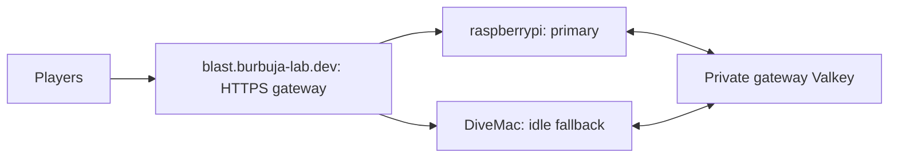

# Public cluster operations

The shared service is `https://blast.burbuja-lab.dev`. Players use that address for
Quick Play and private rooms. A previously saved custom server address remains a
device-local choice.

The primary node is **raspberrypi**; **DiveMac** keeps a small idle worker ready for
overflow. `Blast.Cluster` registers the `blast-primary-fallback` placement policy.
It always chooses the first eligible configured server, including when the primary
returns while the fallback still has matches. The kernel filters full/draining
servers and owns atomic capacity claims; HTTP gateway ordering alone does not
implement lobby placement.



Each match runs entirely on its owning node. The common API shares guest identity,
join codes and matchmaking through a dedicated authenticated Valkey backplane.
Reservations route sockets to `/nodes/pi/realtime/v1/connect` or
`/nodes/divemac/realtime/v1/connect`. The gateway strips only that node prefix.
It permits player endpoints and rejects the operator/kernel administration surface.

The coordinator lives on the gateway, so losing the Pi does not also remove the
fallback's lobby directory. Existing matches on a healthy node continue when the
other game node fails. Matches on a failed node are lost; this is new-room failover,
not live match migration. The gateway/coordinator remains a single failure domain.

## Resource and service boundaries

The checked-in [Compose template](../deploy/cluster/compose.yaml) limits each game
worker to one CPU, 384 MiB including swap, 256 processes/threads and low relative
CPU priority. These are ceilings, not reserved memory. Lobby limits are explicit
per-node operator configuration and must come from measured workloads.

Native, supervised game tunnels expose only the game origin and the authenticated
backplane. The Pi has its own game-tunnel credential, with no SSH private key or
general access credential. Existing SSH tunnels, network routing, native services
and unrelated Docker stacks are independent.

Private deployment state lives in each operator's `Developer/blast-circuit-cluster`
directory: `.env`, `relay.env`, the Compose file, verified `runtime` and two plugin directories. The Pi
uses a user systemd `blast-relay` service; the Mac uses launchd
`dev.burbuja.blast-relay`. The game container is `blast-cluster-server-1`.
The gateway owns dedicated `blast-relay` and `blast-backplane` systemd services.
Never print secret environment files or full container inspection output.

## Build and update

Keep both nodes on the same verified portable server runtime and kernel revision.
The image supplies ASP.NET, curl and the nonroot account; the exact verified CI
runtime is mounted read-only at `/app`. Verify the runtime inventory, not merely
the base image tag. Pre-create `runtime/plugins/Realtime.Redis` and
`runtime/plugins/Blast.Cluster` for the child mounts. The worker writes its
ephemeral framework keys under its home directory, outside the runtime mount.
Build optional plugins from that exact source, separately from the portable server:

```sh
dotnet publish burbuja-kernel/plugins/Burbuja.Plugins.Realtime.Redis -c Release -m:1 -o artifacts/cluster-plugins/Realtime.Redis
dotnet publish src/Bomber.Cluster -c Release -m:1 -o artifacts/cluster-plugins/Blast.Cluster
dotnet run --project tests/Bomber.Cluster.Tests
```

Transfer only runtime DLLs, dependency/runtime JSON and reviewed `plugin.json`
manifests; exclude PDBs, private source, test files and host configuration. Retain
SHA-256 inventories, the server release metadata and the kernel commit with the
deployment receipt. Neither plugin is implicitly enabled in an ordinary standalone
server. Cluster hosts mount both plugins and select the policy explicitly.

`BLAST_NODE`, `BLAST_REGION`, `BLAST_ROUTE`, `BLAST_MAX_LOBBIES`, the verified image
and backplane connection differ by host. Both nodes share the guest-signing and
operator credentials. The backplane address points to each node's own protected
tunnel, so neither worker depends on reaching the other worker. Resolve current
tailnet addresses when a service needs an explicit bind or container host mapping.

Before an update, query the authenticated local `/realtime/v1/servers` fleet view,
drain the target, and wait for its hosted rooms to empty. A public lobby list hides
private rooms and cannot establish idleness. Update only that node's game runtime,
preserving private configuration, plugin mounts and resource ceilings. Verify health,
registration, hashes and an actual public client match before updating the other node.
Keep the prior image/configuration for rollback. Do not restart unrelated services.

Cluster sockets opt in to WebSocket compression, with compression history disabled
between messages. Older clients/servers may decline negotiation. The protocol's
uncompressed input-size limit remains enforced. Credentials travel in HTTP/upgrade
requests, outside game frames. See the kernel's opt-in compression contract and
[Microsoft's transport guidance](https://learn.microsoft.com/en-us/aspnet/core/fundamentals/websockets?view=aspnetcore-10.0#compression).

## Capacity and failure checks

The capacity probe uses real HTTP reservations, eight participants per room and
normal authoritative inputs. It exercises all three stages, maximum permitted rule
caps, repeated action edges at the client's actual 30 Hz cadence, and optional Hard
CPUs. Deaths, pickups and rematches remain real. Maximum configured item caps do
not prove all players simultaneously acquired maximum inventory; receipts retain
actual bombs, blasts, items, living players and accepted event counts.

```sh
dotnet build tests/Bomber.Performance.Probe -c Release -m:1
python3 tools/cluster/guard.py --output artifacts/capacity/pi-2x8 --hosts pi -- \
  dotnet tests/Bomber.Performance.Probe/bin/Release/net10.0/Bomber.Performance.Probe.dll \
  --capacity https://blast.burbuja-lab.dev artifacts/capacity/pi-2x8.json 120 2 8 0 pi
```

Repeat with `1 7` for one client plus seven Hard CPUs per room, and with the
fallback region/host. Increase room counts only after the previous stage and its
guard pass. Run generators off the game host. The guard records service identities,
HTTP/DNS response times, memory, swap, thermal and container health, and stops only
its child generator when a threshold or observation fails. A separate monitor SSH
connection avoids competing with diagnostic game traffic in a shared SSH stream.
Each host must first have a private `Developer/blast-circuit-cluster/monitor.json`
listing the existing endpoints and systemd units to protect; start from the
[generic example](../deploy/cluster/monitor.example.json). Keep personal service
inventories out of Git. An absent/invalid monitor configuration fails the run.

Receipts distinguish decoded snapshot bytes from actual network traffic, generation
gaps from delivery gaps, and a rejected load from a passing capacity stage. Warmup
is excluded from timing distributions. The probe fails above 150 ms p99 generation
or 300 ms p99 delivery gaps, on protocol errors, missing gameplay, wrong placement,
or failed seat cleanup. The `--direct-node` diagnostic bypasses public socket routing
and must never be presented as public-endpoint evidence.

After capacity tests, verify primary preference, overflow at the configured limit,
fallback during an owned game-node stop, surviving matches on the other node, and
primary preference after recovery. Do not stop an entire machine or its other
services to simulate a game-node failure. Final resource limits and measured results
belong in the dated verification receipt, not extrapolations from idle lobby counts.
