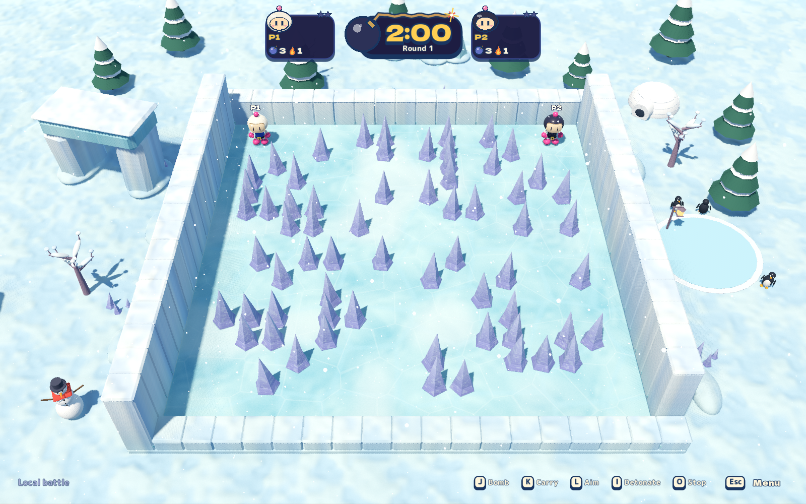
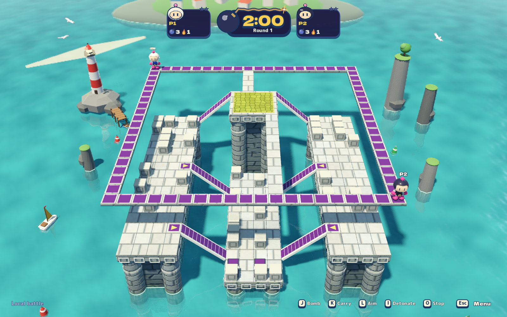
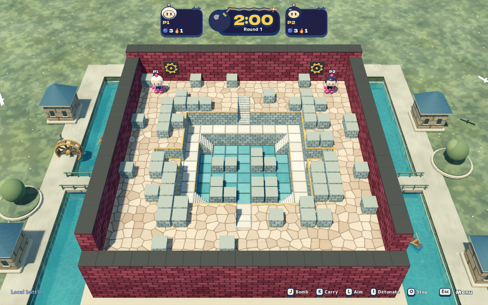
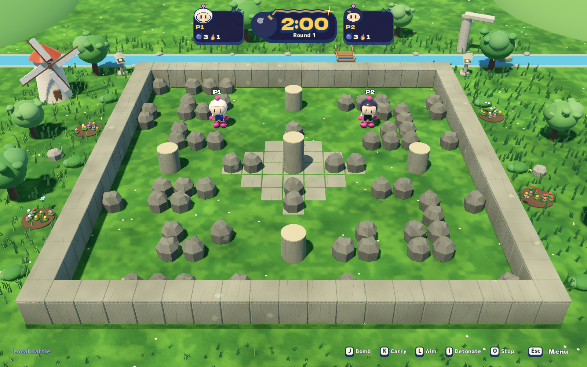
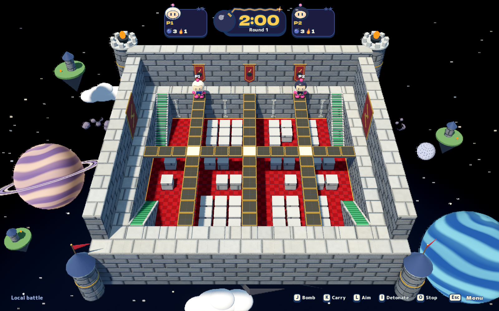
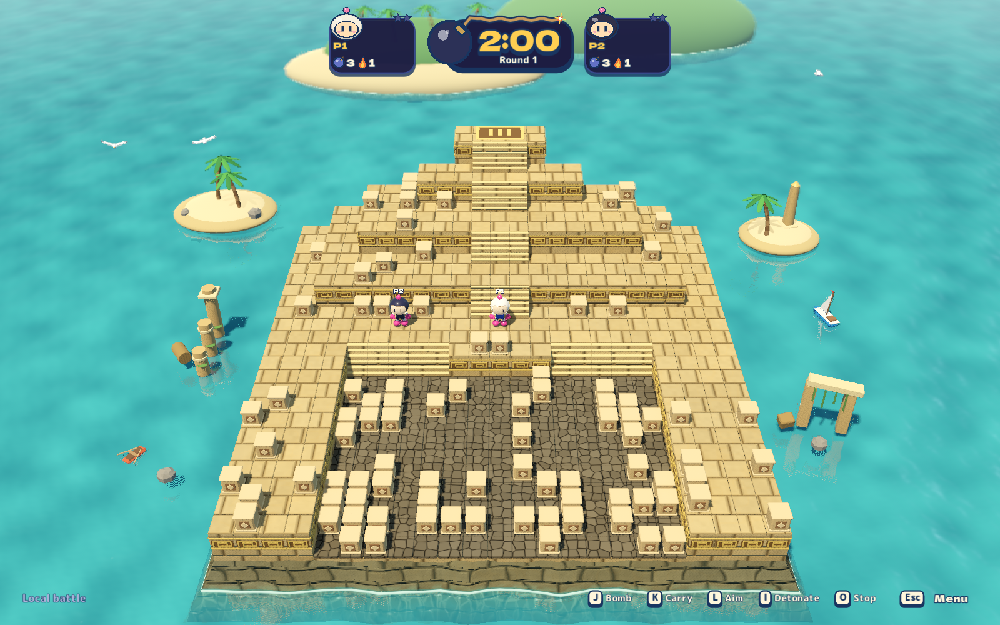

# Denser battle cover

The 2026-10-27 pass expands the five sparse battle arenas using Pyramid's
regional cover as a reference. The user's follow-up explicitly preserves areas
that should remain empty, especially Up & Down's upper routes. These budgets
are Blast Circuit gameplay tuning, not reconstructed original-game counts.

| Arena | Previous → new default | Placement and protected space |
| --- | --- | --- |
| Pyramid / Sunken Temple | 90 → 90 | Existing lower-court clusters and ascent lanes remain the reference. |
| Rock Garden | 16 → 64 | Four seeded boulder groves and a smaller central cluster. Clear perimeter loop, inner spawn avenues and paired central cross routes. |
| Up & Down | 12 → 36 | Twelve blocks on each middle pier and twelve on the low deck, sampled independently within safe floors beside clear aisles. No blocks on the upper ring, crown, bridges, underpasses or flight crossings. |
| Top Rules | 12 → 48 | Four lower-court stockpiles. Upper perimeter, all bridges, stairs and the lower through-routes remain clear. |
| Blizzard Battle | 16 → 64 | Independent random samples within four quadrants. Clear perimeter loop and central cross; no mirrored coordinates. |
| Greedy Trap | 8 → 64 | Four random upper stockpiles totaling 52 blocks and a random twelve-block bottom cache. Clear perimeter loop, upper stair approaches, entire middle ring and bottom cross. |

Circuit Garden remains a cover-free teaching arena. Practice on every battle map
also remains empty. The existing Advanced block percentage scales the full
authored budget. Item probabilities, collision dimensions, terrain, spawns,
flooding and CPU policy keep their existing rules. Local and network sessions
use the same authoritative layouts; this PR does not deploy them.

## Verification

The full game suite passes **3,945 integration checks**; the 72-case CPU soak
passes across six arenas, three difficulties, three/seven CPUs and two seeds.
It observes real block destruction and pickups on every arena, with a maximum
open stationary interval of 3.67 seconds (12-second liveness bound).


`dotnet run --project tests/Bomber.Game.Tests -- --cover-layout` covers all six
battle arenas, seeds 0–31 and 0/25/50/75/100% block settings. It checks seeded
repeatability, full budgets, empty practice, spawn clearance, ramp approaches
and protected routes independently of the placement candidate sets. Height-aware
navigation must reach the key lower courts/piers from every spawn, including
Top Rules' lower passages. Each spawn also needs an open route at least four
cells away. This caught a sealed Rock Garden corner during development; the
perimeter loop and connecting spawn avenues retain that regression.

All six battle maps vary at full density across seeds; Up & Down, Blizzard
Battle and Greedy Trap also require variation within each individual reward
region. The former fixed, mirrored Blizzard banks and fixed Up & Down shelves
are withdrawn. Ordinary local starts and replays now draw fresh seeds; the
playtest driver pins seed 64 explicitly for reproducible QA.
The existing stage journeys exercise actual walking, bomb destruction, loot
collection, CPU combat and sudden death. `cover-layout` additionally captures
every full layout from the ordinary battle camera at High, with two human seats
and no bots to destroy the cover before the capture. Its deterministic loot
fixture uses 100% upgrade-only drops; opening cover itself is the default layout.
Each map is also captured at seed 9876 and must have a different full layout.
Three unpinned local starts separately verify that ordinary play generates fresh
layouts without a caller-supplied seed.

```sh
python3 tools/qa/run.py --profile managed
python3 tools/qa/run.py --profile headless
python3 tools/playtest/run.py --scenario cover-regression
```

The six-journey `cover-regression` run passes **680 assertions**, with **85
captures**, zero runtime errors and zero warnings, using a freshly rebuilt
self-contained app. It includes actual bomb/loot cycles, navigation, CPU combat
and sudden death for every changed arena. The 29-journey headless core passes
1,799 assertions; its separate peer/adaptive room journeys also pass.

Graphical verification uses the isolated macOS Metal desktop. These checks
establish the observed layouts and bounded gameplay behavior, not user approval
of pacing or art.

## Reviewed battle views

Unedited 1600×1000 High/Midday captures from the ordinary battle camera. Each
pair uses identical settings with different seeds. The [manifest](images/denser-cover/manifest.json)
records source hashes, seeds and image checksums. Pyramid's budget/layout policy
remains the reference and also varies by seed.

### Blizzard Battle

| Seed 64 | Seed 9876 |
| --- | --- |
|  |  |

### Up & Down

| Seed 64 | Seed 9876 |
| --- | --- |
|  |  |

### Greedy Trap

| Seed 64 | Seed 9876 |
| --- | --- |
|  |  |

### Rock Garden

| Seed 64 | Seed 9876 |
| --- | --- |
|  |  |

### Top Rules

| Seed 64 | Seed 9876 |
| --- | --- |
|  |  |

### Pyramid reference

| Seed 64 | Seed 9876 |
| --- | --- |
|  |  |
