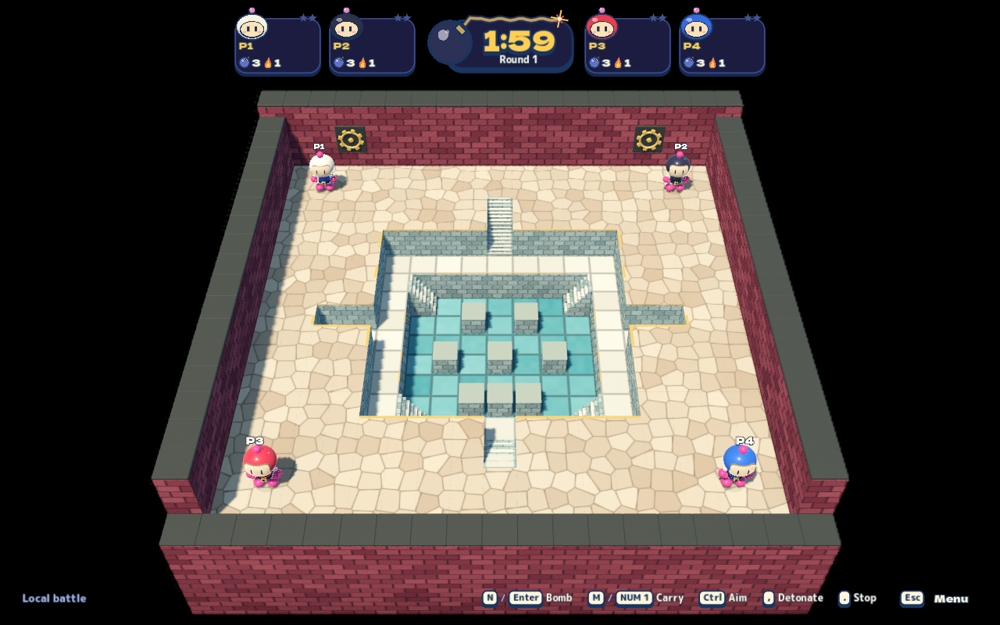
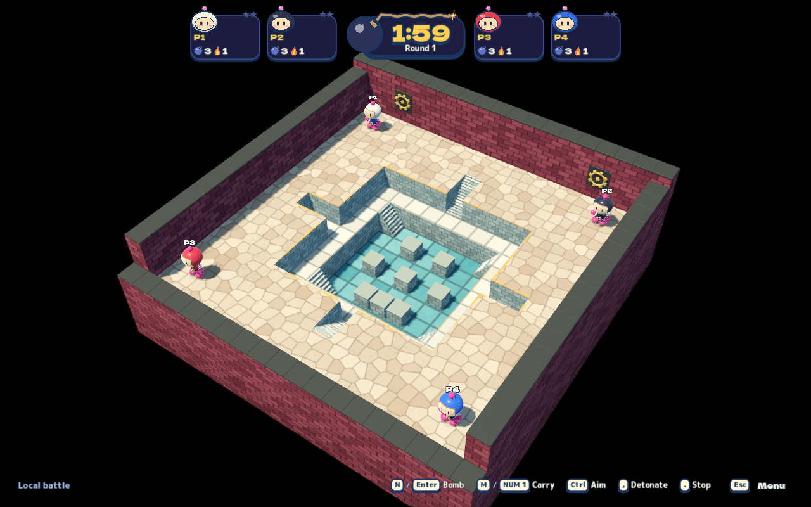
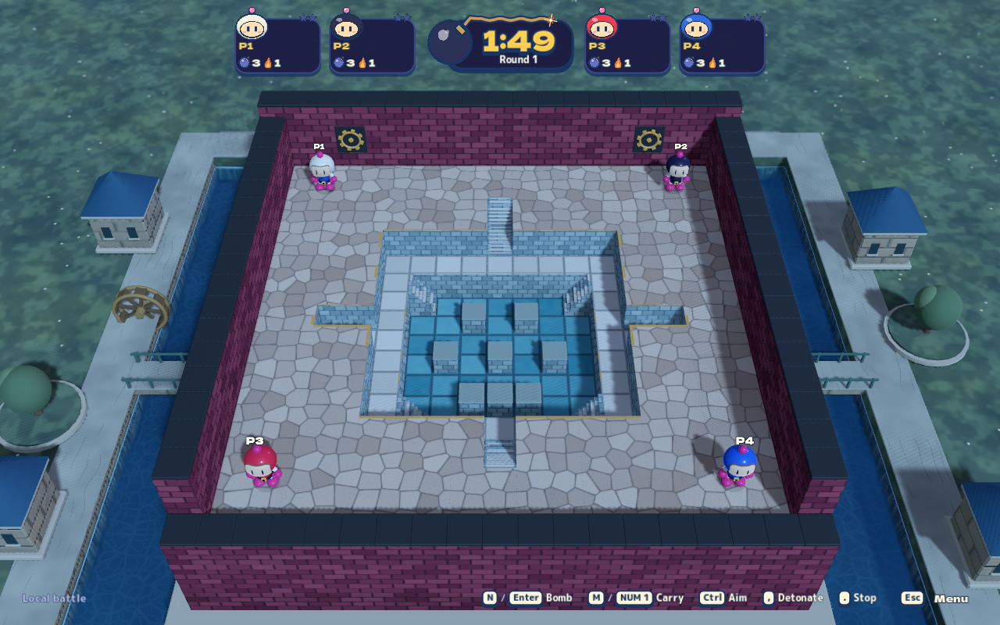
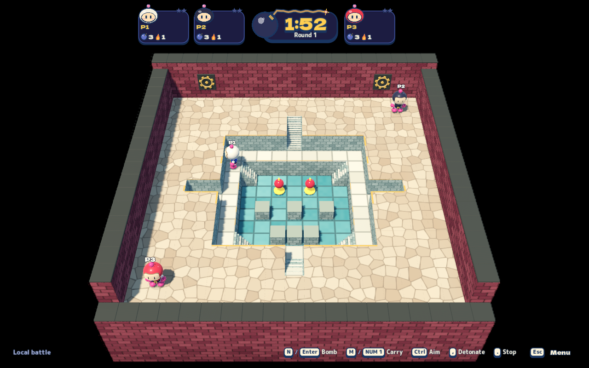
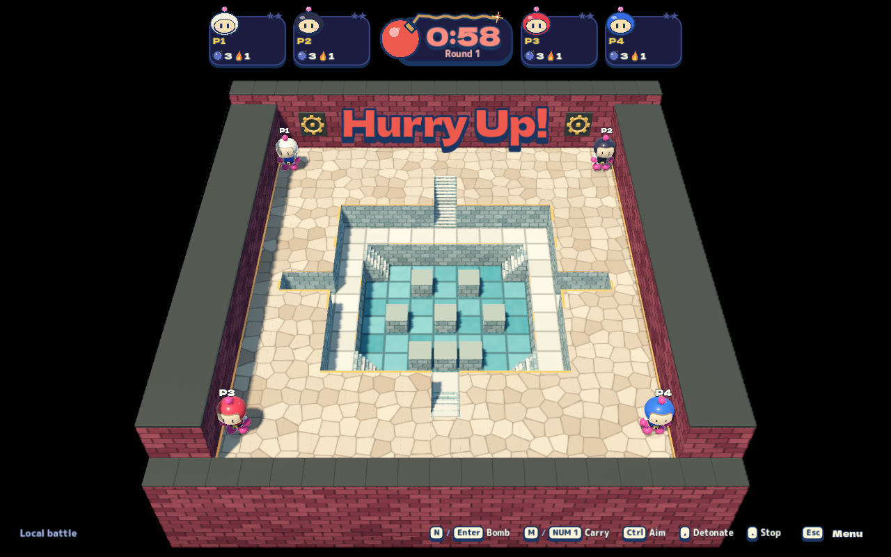
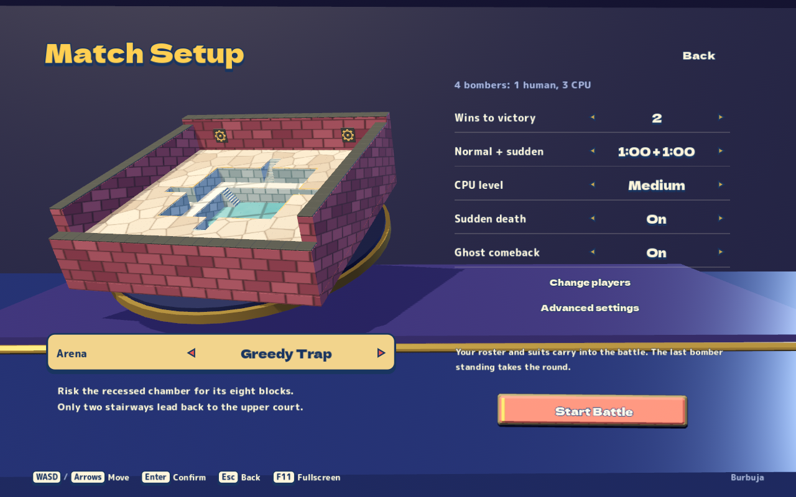

# Greedy Trap

Greedy Trap recreates the three-level reward-pit composition of Bomberman 64's
fourth battle arena with independently authored meshes and procedural textures.
[Reference research](greedy-trap-research.md) records the supplied screenshot,
publisher manual, official guidebook and inspected gameplay timestamps.

## Stage contract

`BlastStages.GreedyTrap` is `greedy-trap`. Its 19×19 enclosure has a broad
tier-two court, a one-cell tier-one ring and a tier-zero turquoise chamber.
Two two-cell north/south stair flights connect court and ring. Four shorter
east/west-facing flights connect the ring and chamber at its corners. The side
pockets are middle-height dead ends. Bare lips permit ordinary downward falls;
upward travel uses stairs. There are no bridges or underpasses.

The first four starts occupy the upper-court quadrants. Four additional upper
starts support this project's eight-player battles. 64 destructible masonry
blocks form four random upper stockpiles (52 blocks) and a random bottom cache
(12 blocks). Spawn escape cells, a perimeter loop, both upper stair approaches,
the entire middle ring and the bottom cross remain clear. The normal regional-cover
path still honors Advanced block density,
item toggles, independent drop chance and item lifetime. Practice clears cover.
The chosen block coordinates are authored tuning, not recovered original data.

The manual describes a water tank, and footage shows living characters fighting
on its blue floor. Here the basin uses **opaque glazed teal paving**, with
ordinary dry-floor support and friction. It does not use the engine's lethal
water cells. This is an explicit visual adaptation rather than a claim about the
original collision classification or friction.

Hurry uses the existing symmetric closing-column authority, with the same
one-second cadence as Top Rules. The exact original speed was not recovered.
Crushing, bomb removal and CPU danger forecasting remain shared local/online
rules. Presentation settles burgundy crushing faces to accepted boundaries in
120 ms using snapshot interpolation. Solid compression volumes fill the entire
closed strip, hiding the replaced outer wall instead of leaving false outside lanes;
rear flywheels turn on each advance and amber inlays pulse during compression.
These mechanical accents are original art, not recovered original models.

## Presentation and integration

- `TempleStageView.GreedyTrap.cs` builds the court, recessed ring, stairs, walls,
  cover, flywheels and compression faces from the authoritative layout.
- `ArtMaterials.GreedyTrap.cs` supplies original world-space irregular cobbles,
  staggered burgundy brick, teal tiles, gray-green ashlar, pale ring paving and
  amber inlays. Fine grain/relief fades with pixel footprint and is disabled on
  Low; the same materials survive live quality changes.
- The normal battle camera uses the steeper enclosed-arena fit. The near wall
  is low, preserving the pit view. Inspection screenshots explicitly identify
  their temporary cameras; they do not replace gameplay framing checks.
- Local battle, Practice, room settings, the real 3D menu miniature and the
  compact online preview all expose the stage. Existing four lighting profiles,
  graphics presets, toy characters and effects remain shared.
- Online protocol revision **5** prevents older clients from accepting an arena
  their renderer/settings validator cannot support. Both clients and the
  independent server need this revision; this PR does not deploy a server.

## Reservoir setting (2026-10-25)

The user's follow-up replaces the black void with an original fortified reservoir
informed by Blue Resort's quays, waterways, blue roofs and rounded trees. Original
Greedy Trap footage supplies no exterior landscape; [background research](greedy-trap-background-research.md)
records the inspected gameplay/manual images and labels this extension explicitly.

`TempleStageView.GreedyExterior.cs` adds a broad foundation meeting the water,
pale quays, two lower causeways, four small slate-roofed towers, sparse round trees,
and a slowly turning waterwheel. Plain cream quay banks and the shared sky/haze keep the
surroundings quieter than the cream/red/teal arena. The outer reservoir reuses the
other maps' animated water: opaque on Low, refracting/caustic on Medium and High,
with the same morning/midday/afternoon/night profiles. The basin inside stays
opaque safe paving.

Everything is cosmetic and separate from the moving walls. Above-floor scenery
stays outside a margin around the playable grid; no collision bodies or new exits
are added. The exterior's root/water level stay fixed during compression. The
menu miniature hides the entire exterior node to preserve its display footprint.
The battle camera keeps its original playable-area fit and depth cues.

## Verification entrypoints

```sh
dotnet run --project tests/Bomber.Game.Tests -- --greedy-trap
dotnet run --project tests/Bomber.Ai.Tests -- --soak --stage=greedy-trap --output=artifacts/greedy-trap/ai-soak.json
python3 tools/playtest/run.py --scenario greedy-trap --headless
python3 tools/playtest/run.py --scenario greedy-trap
python3 tools/playtest/run.py --scenario greedy-trap-regression --start-server
```

The managed checks cover three-story topology, all six real stair routes,
separate starts, full/half/zero block budgets, legal CPU edges and timed crushing.
The focused AI soak covers three difficulties, three/seven CPUs and two seeds
(12 scenarios), with the same activity and safe-exit liveness checks as the
canonical 48-scenario existing-stage matrix.

The native journey selects the actual arena dial and Practice launch, checks
four/eight-player sessions, both camera aspect ratios, all quality presets,
lighting, ordinary stair traversal, actual bomb destruction and reward collection,
CPU explosions, settled wall/collision alignment, animation and crushing. It belongs to
`all`, `core-headless` and `stage-fidelity`. `greedy-trap-regression` also runs
first-use rendering first, setup, graphics, lighting, framing and real networking.
`greedy-trap-network` also checks actual server-owned and player-hosted rooms:
a second client receives this stage, ordinary upper/lower stair traversal and
a real bomb planted on the basin floor. Graphical runs use a windowed isolated
desktop by default.

## Validation receipts (2026-10-25)

Verified after integrating main through `158cd3c` (v0.30 release metadata),
preserving the reviewed bomb loadout, item density, CPU pursuit, falling physics
and menu navigation. Greedy Trap requires online protocol 6, following the
protocol-4 bomb-loadout change.

- Public profile: all repository/tooling/audio gates pass.
- Complete merged managed profile: **2,839 game checks, 341 client checks,
  78 AI checks**, the existing 48-case soak, audio/cluster suites, actual network
  smoke, protocol-3/4 rejection, adaptive relay, fleet checks and tested server
  packaging pass.
- Greedy Trap AI soak: **12 cases pass** across three difficulties, two seeds
  and three/seven CPUs. Maximum observed stationary window with a safe exit is
  **1.77 seconds**, below the existing 12-second limit. Every case produces
  movement and bombs; some have no pickups under the inherited independent
  40% drop rule. This is bounded liveness evidence, not a balance/fun rating.
- Merged headless core: **1,356 assertions**, no runtime errors/warnings.
  Menu navigation additionally passes **198 assertions**; that short headless
  run retains an ObjectDB teardown warning in its receipt.
- Focused exported online journey: **43 assertions / two captures**, both
  server-owned and player-hosted rooms, zero runtime errors/warnings.
- Final rebuilt standalone app: **all eight `greedy-trap-regression` journeys
  pass, 1,094 assertions / 105 captures**, Metal Forward+ in an isolated windowed
  macOS desktop. Coverage includes first-use preparation, the arena tour, setup,
  all-arena graphics presets, lighting, framing, ordinary online play and Greedy
  Trap in both hosting modes. The runner reports zero runtime errors/warnings;
  host observation reports no foreground/pointer changes or missing observations.

Raw receipts remain in ignored `artifacts/greedy-trap/`: `integration-public/`,
`integration-managed/`, `integration-ai-soak.json`, `integration-ai-soak.log`,
`integration-headless/`, `integration-menu-navigation/`, `network-rendered-final/`
and `merged-verified/`. The reservoir follow-up is verified separately by
`background-public/`, `background-headless/`, `background-visual/` and
`background-regression/`. Its final complete eight-journey export passes
**1,094 assertions / 105 captures**, with zero runtime errors/warnings and no host
foreground/pointer changes. New checks cover filled side margins, sky mode,
collision-free scenery bounds, the waterwheel, shared water quality/lighting,
stationary scenery during compression and the trimmed menu miniature.
Earlier source/graphical failures and the missing-wall-
crown red test remain there as diagnostic evidence; the final receipts supersede
those attempts.

Visual inspection covered normal/oblique/overhead views, Low/Medium/High, night,
actual bottom loot and later compression. Separate brick/cap depth planes prevent
coplanar flicker; solid compression volumes eliminate false outside lanes. The
native resize harness retains its actual size/transform stability requirement
with a longer bounded first-frame wait. The test controller publishes ordinary
network intent through the product adapter immediately, brakes at waypoints and
waits for three accepted snapshots after release before checking that the player
settled inside the target cell. It never edits authority positions or physics.

The loot screenshot uses configurable 100% drops and a Red-only pool to verify
actual destruction and collection. Default drop chances/weights remain inherited
from main. These results do not establish user artistic approval, native host GPU
throughput or physical controller coverage.

## Rendered gallery

Unedited Metal Forward+ captures from the rebuilt standalone app. The ordinary
battle camera is used except for the explicitly labelled oblique inspection.
The gameplay uses real inputs and authority; the loot and compression frames are
not fabricated stage/state fixtures.

Four-player opening, normal battle camera:



Oblique inspection camera, exposing all three stories:



Night lighting, normal battle camera:



Actual masonry destruction reveals equipment in the bottom chamber:



Timed side-wall compression, with pulsing inlays and moving flywheels:



Actual arena selection and shared 3D menu miniature:



## Pending-PR review corrections (2026-10-25)

The independent Blizzard-only branch also used protocol 5. Greedy Trap now
rejects that incompatible token with schema 6, including HTTP and peer hello
operator probes. Combined delivery must preserve both stage validators and use
the canonical release identity from the release pipeline.

The review retained a failing native stair-surface assertion, then raised tread
paving, court coping and brass sills 0.02 render units above their supports.
This removes coplanar faces without changing collision, steps or drop physics.
Shader cache fields follow the main partial's ownership convention.

## Fresh advisor refinement (2026-11-15, source candidate)

The fresh all-map review identified camouflage lawn beyond the canal and
charcoal wall caps as competing with the reservoir identity. Four existing
bank solids now use quiet cream quay paint; their geometry, masonry water
faces and .9-unit seam setback stay fixed. Both static and compressing wall
crowns use matching cream coping. The safe teal reward floor, all stairways,
canal waterline, wheel pedestal and shaft retain their original geometry.

The existing blue-roof houses gain warm window emission only at Night,
including Low. Day windows stay dark. They add no point lights or new props,
and live local/online lighting changes update the same retained materials.
Original Blue Resort colour/material context is recorded in
[the background research](greedy-trap-background-research.md); this is an
authored reservoir setting, not recovered Greedy Trap scenery.

Review with the existing `greedy-trap` native journey (all presets, lighting,
oblique views, dry basin traversal and closing walls), then matched seed-64
Midday opening/Night combat at Low, Medium and High. The source checkpoint
does not constitute visual acceptance or release qualification.

The candidate builds successfully (zero errors; NuGet's shared vulnerability
cache was sandbox-inaccessible). Headless `greedy-trap` passes 188 assertions,
including dry basin traversal, canal/wheel nonintrusion, authored crowns and
compression. It records zero runtime errors and one exit ObjectDB leak warning;
no pixels are claimed from this run. Mesh census and documentation links pass.

## Reservoir Counting House — second creative pass (2026-11-16)

The fresh High review rejected the broad cream ground because it erased the
fortress silhouette. The existing shared-water sheet now forms a continuous
teal reservoir; four distant pale bank solids and their long quay strips are
removed. Two short brick quays carry one larger counting house with a round
brass float-gauge window and one smaller plain house. Asymmetric low causeways
join these to the fort. The round tree trays are removed. The wheel is larger
in its existing plane, seated on the west wall via a fixed pedestal/shaft, with
one short sluice. Three small reservoir floats and the gauge float share a slow
pausable water clock. The dry reward chamber and every authoritative surface,
hazard, stair, footprint and camera remain unchanged.

High retains its actual water/reflection feature; Medium retains the exact
existing shared refraction shader. Low keeps the houses, gauge, wheel, floats
and opaque teal reservoir, with emissive Night windows and no new real lights.
No primitive capture domain changes were needed: new dimensions use owned
rounded boxes or transforms of existing pinned unit spheres/captured meshes.

Source/public checks pass. The focused headless Greedy journey passes 194
assertions, including the larger wheel's full rotational clearance, exterior
nonintrusion, all-preset shared-water policy/core counting house and ordinary
pause freezing both wheel and float. Its raw log retains 16 ObjectDB exit leaks
and no runtime errors. Build passes with the existing NuGet audit-cache access
warnings. Actual High/Medium/Low, Night, oblique and wheel/current-motion images
remain parent-owned qualification; these numeric checks do not approve the art.

The first native second-pass receipt passed 204 checks/20 captures, but actual
battle images hid the enlarged wheel behind the west wall. It is now moved to
the western front quarter and faces the camera with its XY wheel plane. A short
rear brick machine pier seats the pedestal/shaft; a connected channel feeds its
water ribbon. The east house quay moves inward to retain its frame margin.
Clearance now compares a full rotor revolution against the actual short quays,
rather than the removed narrow-canal bounds. No game-camera change is used.

The corrected source builds with `-m:1`; the rebuilt focused headless journey
passes 194 checks, 0 runtime errors and four ObjectDB exit warnings. An earlier
headless receipt launched after a failed parallel-worker build is not used as
qualification; the explicit single-node rebuild and fresh output are retained.
Native battle-camera wheel visibility remains the essential next check.

Root native review confirms the corrected wheel is visible from the gameplay
camera: `greedy-canal` passes 137 checks/9 captures and a full revolution on all
presets. The labelled close-inspection camera now targets the new complete
machine pier instead of the old upstream wheel position. This adjusts evidence
framing only; accepted geometry and the gameplay camera are unchanged.
