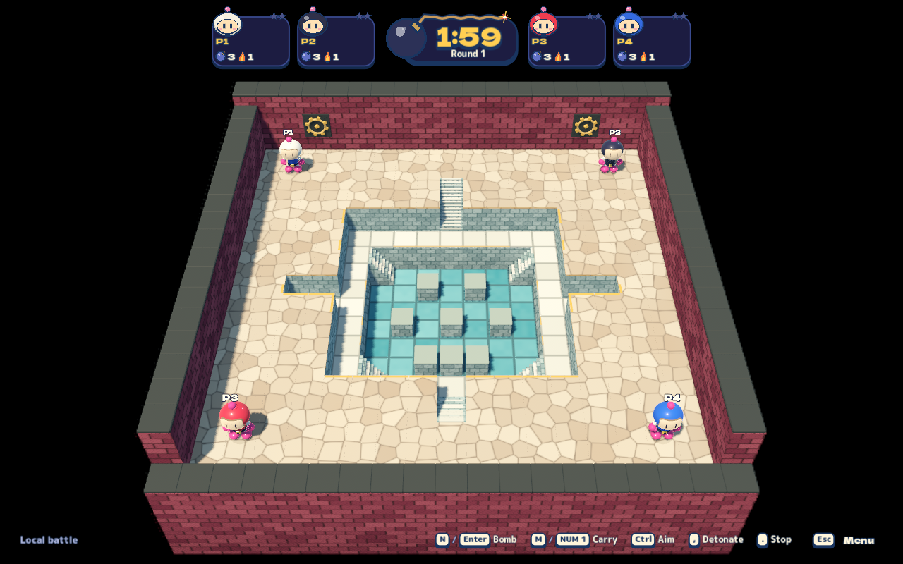
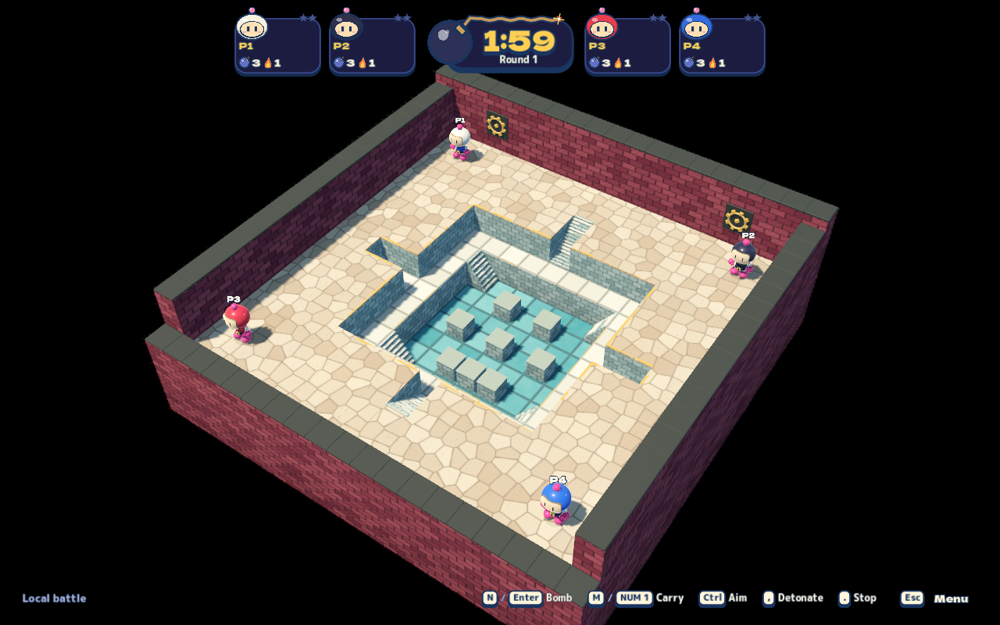
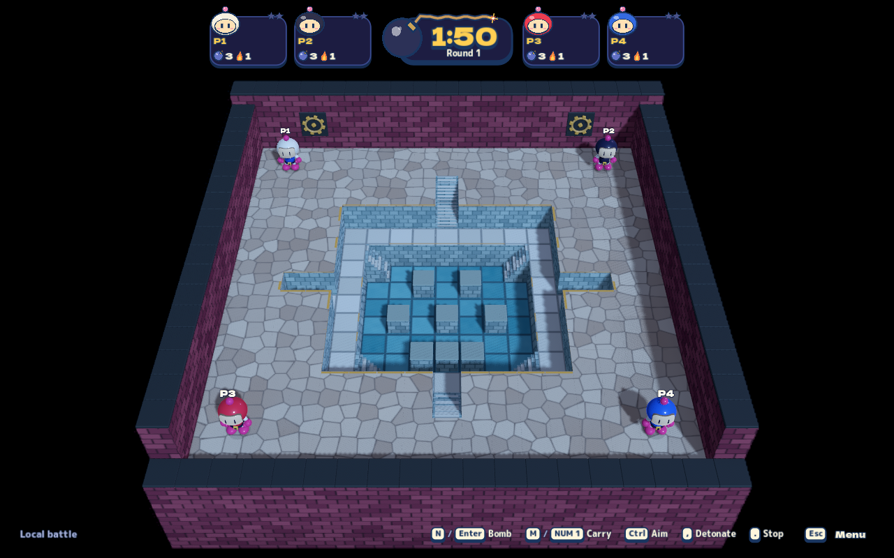
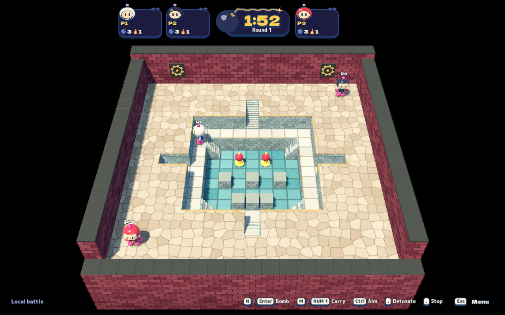
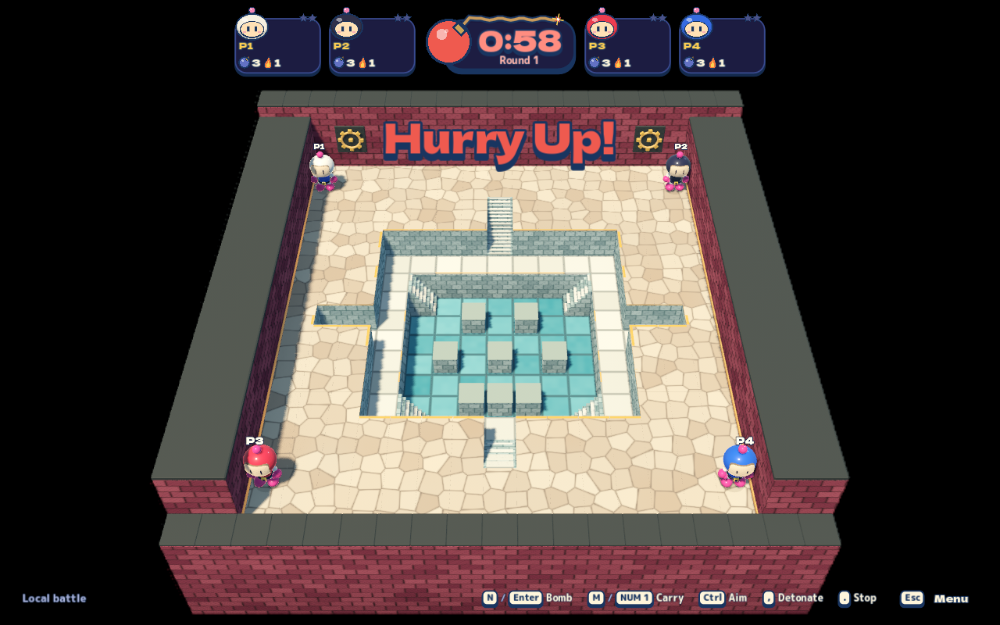
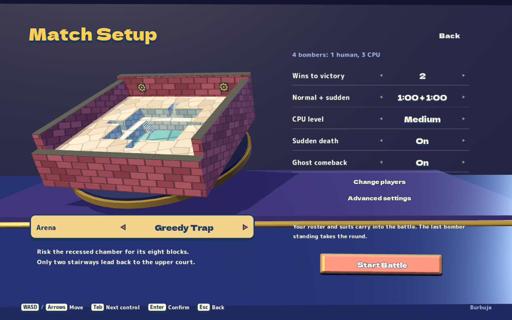

# Greedy Trap

Greedy Trap recreates the three-level reward-pit composition of Bomberman 64's
fourth battle arena with independently authored meshes and procedural textures.
[Reference research](greedy-trap-research.md) records the supplied screenshot,
publisher manual, official guidebook and inspected gameplay timestamps.

## Stage contract

`BlastStages.GreedyTrap` is `greedy-trap`. Its 19×19 enclosure has a broad
tier-two court, a one-cell tier-one ring and a tier-zero turquoise chamber.
Two two-cell north/south stair flights connect court and ring. Four shorter
east/west-facing flights connect the ring and chamber at its corners. The side
pockets are middle-height dead ends. Bare lips permit ordinary downward falls;
upward travel uses stairs. There are no bridges or underpasses.

The first four starts occupy the upper-court quadrants. Four additional upper
starts support this project's eight-player battles. Eight destructible masonry
blocks concentrate rewards below; spawn regions, stairs and the middle ring
remain clear. The normal regional-cover path still honors Advanced block density,
item toggles, independent drop chance and item lifetime. Practice clears cover.
The chosen block coordinates are authored tuning, not recovered original data.

The manual describes a water tank, and footage shows living characters fighting
on its blue floor. Here the basin uses **opaque glazed teal paving**, with
ordinary dry-floor support and friction. It does not use the engine's lethal
water cells. This is an explicit visual adaptation rather than a claim about the
original collision classification or friction.

Hurry uses the existing symmetric closing-column authority, with the same
one-second cadence as Top Rules. The exact original speed was not recovered.
Crushing, bomb removal and CPU danger forecasting remain shared local/online
rules. Presentation settles burgundy crushing faces to accepted boundaries in
120 ms using snapshot interpolation. Solid compression volumes fill the entire
closed strip, hiding the replaced outer wall instead of leaving false outside lanes;
rear flywheels turn on each advance and amber inlays pulse during compression.
These mechanical accents are original art, not recovered original models.

## Presentation and integration

- `TempleStageView.GreedyTrap.cs` builds the court, recessed ring, stairs, walls,
  cover, flywheels and compression faces from the authoritative layout.
- `ArtMaterials.GreedyTrap.cs` supplies original world-space irregular cobbles,
  staggered burgundy brick, teal tiles, gray-green ashlar, pale ring paving and
  amber inlays. Fine grain/relief fades with pixel footprint and is disabled on
  Low; the same materials survive live quality changes.
- The normal battle camera uses the steeper enclosed-arena fit. The near wall
  is low, preserving the pit view. Inspection screenshots explicitly identify
  their temporary cameras; they do not replace gameplay framing checks.
- Local battle, Practice, room settings, the real 3D menu miniature and the
  compact online preview all expose the stage. Existing four lighting profiles,
  graphics presets, toy characters and effects remain shared.
- Online protocol revision **5** prevents older clients from accepting an arena
  their renderer/settings validator cannot support. Both clients and the
  independent server need this revision; this PR does not deploy a server.

## Verification entrypoints

```sh
dotnet run --project tests/Bomber.Game.Tests -- --greedy-trap
dotnet run --project tests/Bomber.Ai.Tests -- --soak --stage=greedy-trap --output=artifacts/greedy-trap/ai-soak.json
python3 tools/playtest/run.py --scenario greedy-trap --headless
python3 tools/playtest/run.py --scenario greedy-trap
python3 tools/playtest/run.py --scenario greedy-trap-regression --start-server
```

The managed checks cover three-story topology, all six real stair routes,
separate starts, eight/half/zero block budgets, legal CPU edges and timed crushing.
The focused AI soak covers three difficulties, three/seven CPUs and two seeds
(12 scenarios), with the same activity and safe-exit liveness checks as the
canonical 48-scenario existing-stage matrix.

The native journey selects the actual arena dial and Practice launch, checks
four/eight-player sessions, both camera aspect ratios, all quality presets,
lighting, ordinary stair traversal, actual bomb destruction and reward collection,
CPU explosions, settled wall/collision alignment, animation and crushing. It belongs to
`all`, `core-headless` and `stage-fidelity`. `greedy-trap-regression` also runs
first-use rendering first, setup, graphics, lighting, framing and real networking.
`greedy-trap-network` also checks actual server-owned and player-hosted rooms:
a second client receives this stage, ordinary upper/lower stair traversal and
a real bomb planted on the basin floor. Graphical runs use a windowed isolated
desktop by default.

## Validation receipts (2026-10-25)

- Public profile: all ten repository/tooling/audio gates pass.
- Managed profile: 2,915 game integration checks, 338 client checks, 65 AI checks,
  the existing 48-scenario AI soak, cluster/audio suites, actual network smoke,
  adaptive relay, 36 fleet infrastructure checks and tested server packaging pass.
- Greedy Trap AI soak: all 12 cases pass; maximum observed stationary window
  with a safe exit is 1.60 seconds against the existing 12-second limit. Every
  case produces movement, bombs and pickups. This is bounded liveness evidence,
  not a rating of eight-player balance or fun.
- Latest client boundary/session suite: 339 checks pass, including a retained red
  regression for missing Greedy Trap wall crowns. Malformed peer terrain is rejected
  before rendering. The focused real-network headless journey passes 22 assertions
  across server-owned and player-hosted rooms using the final client.
- Canonical headless profile passes core gameplay (including Greedy Trap),
  peer-room and adaptive-room journeys with the rebuilt source.

Raw receipts remain under ignored `artifacts/greedy-trap/`: `public-final/`,
`managed-01/`, `headless-profile-01/`, `client-final.log`, `network-final/`,
`headless-focused-final/`, `ai-soak.json` and `ai-soak.log`.
The rebuilt standalone app passes the complete eight-journey
`greedy-trap-regression`: **1,050 assertions / 105 captures**, Metal Forward+ in
an isolated windowed macOS desktop. It covers first-use preparation, the map tour,
setup, all-arena graphics presets, lighting, framing, ordinary online play and
Greedy Trap in both server-owned and player-hosted rooms. The final runner reports
zero runtime errors/warnings; host observation reports no host foreground or
pointer changes and no missing observations. Receipt: `graphical-complete/`.

Visual inspection covered normal/oblique/overhead views, Low/Medium/High, night,
actual bottom loot and later compression. Separate brick/cap depth planes prevent
coplanar flicker; solid compression volumes eliminate false outside lanes. The
native resize harness retains its actual size/transform stability requirement
with a longer bounded first-frame wait. Network movement waits for real server
time rather than spending its frame budget before authority can advance.

Earlier failing receipts remain under the same ignored evidence root, including
the missing-wall-crown red test and pre-correction captures. A short standalone
headless run reported two ObjectDB teardown warnings; the full core run and final
exported graphical suite did not. These results do not establish user artistic
approval, native host GPU throughput or physical controller coverage.


## Rendered gallery

Unedited Metal Forward+ captures from the rebuilt standalone app. The ordinary
battle camera is used except for the explicitly labelled oblique inspection.
The gameplay uses real inputs and authority; the loot and compression frames are
not fabricated stage/state fixtures.

Four-player opening, normal battle camera:



Oblique inspection camera, exposing all three stories:



Night lighting, normal battle camera:



Actual masonry destruction reveals equipment in the bottom chamber:



Timed side-wall compression, with pulsing inlays and moving flywheels:



Actual arena selection and shared 3D menu miniature:


