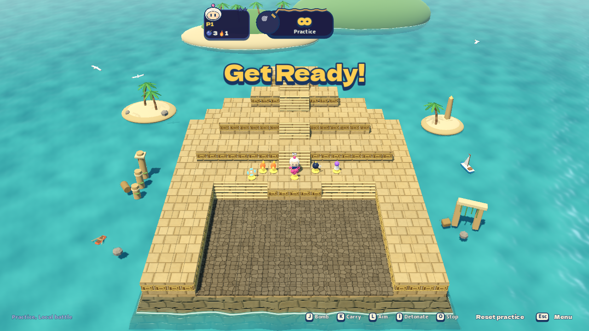
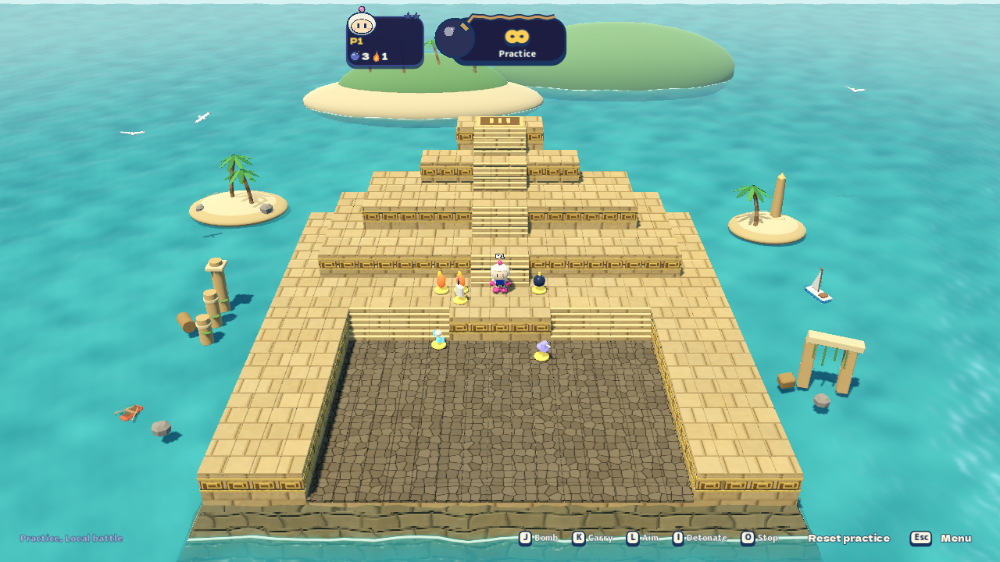
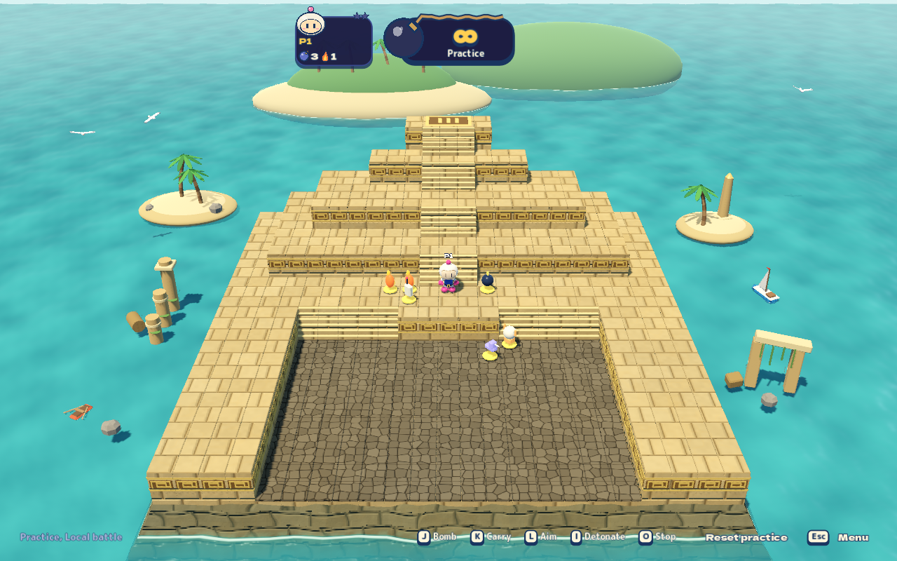
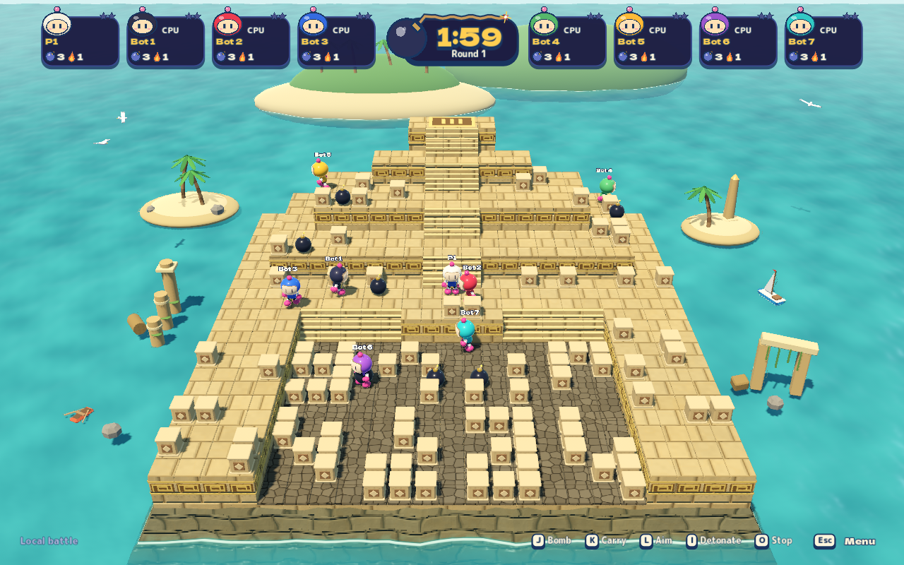

# Pyramid camera framing — 2026-10-27

Sunken Temple's tall rear terraces limited its camera fit vertically, leaving
sea across much of the horizontal view. The battle camera now uses a 30°
elevation instead of approximately 36.9°, allowing the existing fit to move
closer. Full playable terrain and standing-character headroom still fit inside
the same HUD-safe band. Other arenas keep their camera directions.

Real windowed captures from the rebuilt macOS export, rendered with Metal
Forward+ on the isolated Apple Paravirtual QA desktop:

| Window | Before: playable width | After: playable width |
| --- | --- | --- |
| 1280×720 (16:9) | 54.49% | 62.77% |
| 1280×800 (16:10) | 60.54% | 69.74% |

That is about 15.2% more horizontal coverage relative to the old view. At both
aspects, projected playable bounds remain at 14.5–89.0% of viewport height.
These measurements include standing headroom; they are not a count of terrain
pixels. The baseline capture includes the countdown banner; the updated journey
waits until it clears for the after captures. Both use the ordinary battle camera.

## Before, 16:9



## After, 16:9



## After, 16:10



## Verification

- `framing`: 57 assertions, 12 captures; every battle arena at 16:9 and 16:10.
- `graphics-settings`: 598 assertions, 27 captures; all seven stages at
  Low/Medium/High, including playable depth-of-field and haze bounds.
- `public` QA: all 11 steps passed.

Both graphical journeys used a rebuilt export and reported no runtime errors or
warnings. These are graphical correctness checks on the QA guest, not native
GPU performance measurements.

Reproduce the ordinary eight-player battle capture with:

```sh
python3 tools/playtest/run.py --scenario script --script tools/playtest/pyramid-framing.json
```

The eight-player script passed 4 assertions with 2 captures and no runtime errors
or warnings. The ordinary battle uses one human and seven CPUs; actors and cover
come from the real local session.


