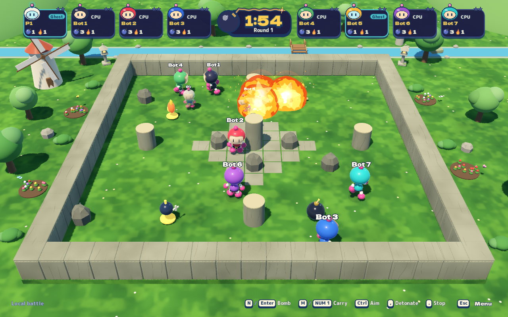
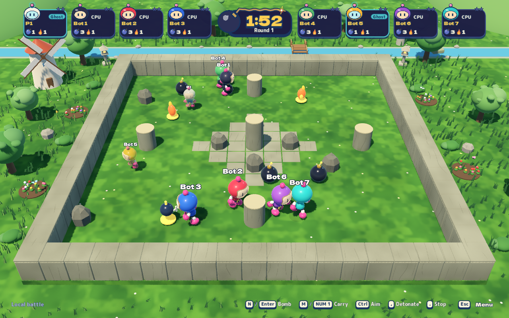
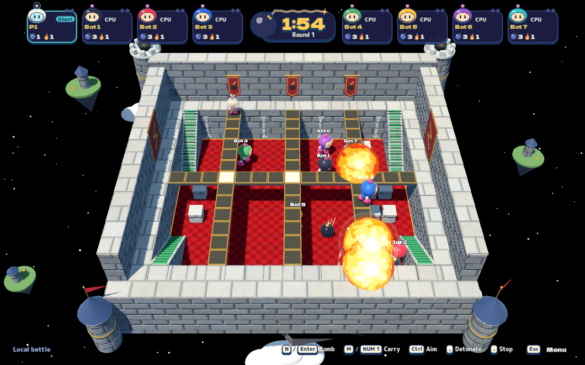
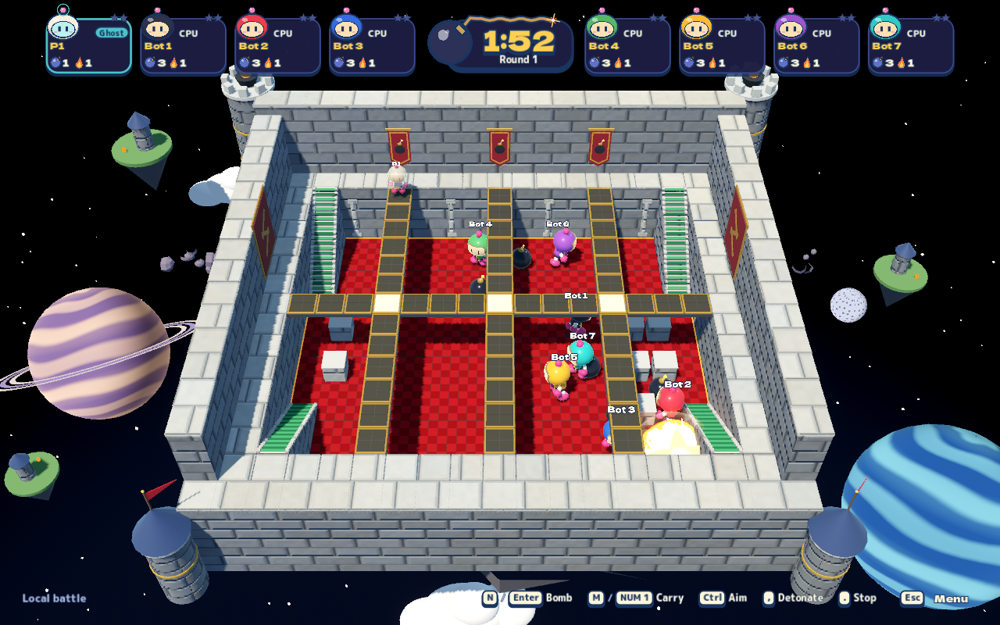
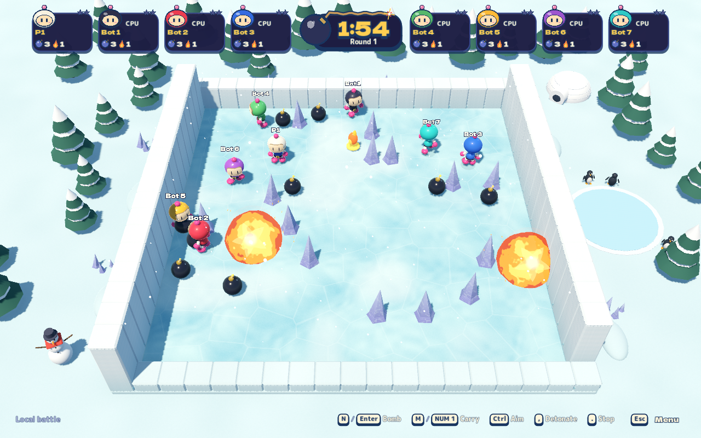
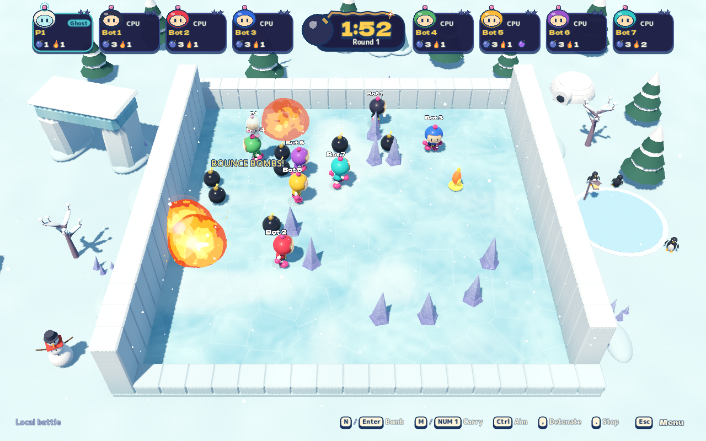
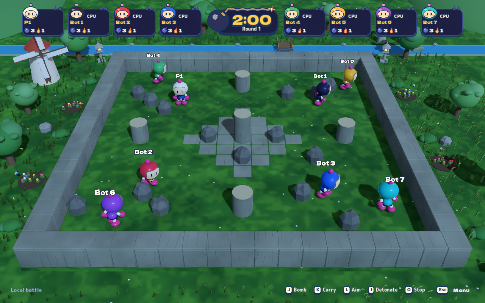
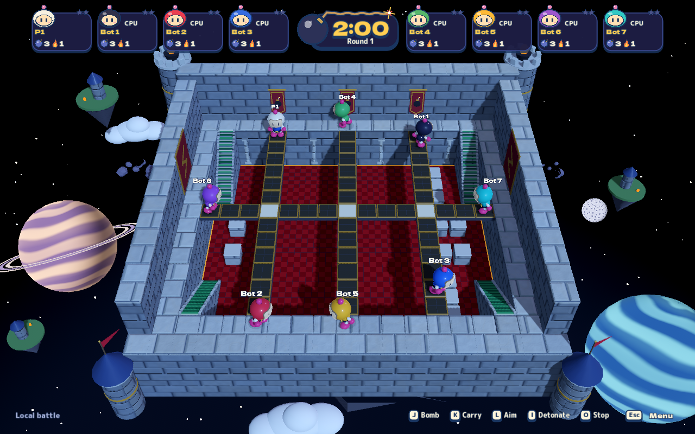
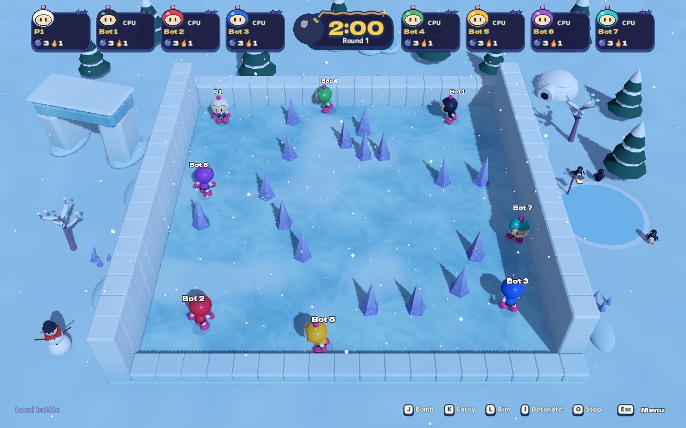
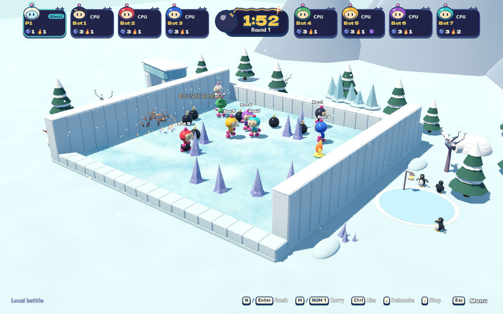

# Living stage worlds

Source work, 2026-10-27. The current lacquered figures, painterly materials,
High premium surfaces and water reflections are the starting point for this
pass. Three dry battle arenas gain stronger environmental life around their
existing playable courts. [Nintendo/Konami references and original adaptations](living-stage-worlds-research.md).

| Arena | Added life |
| --- | --- |
| Rock Garden | Rooted grass blades, fluttering leaf clusters, stronger canopy sway and drifting leaves, with world-space gusts connecting the plants. Existing High lawn shading continues across the playable grass. |
| Top Rules | A painted ringed planet, blue giant, cratered moon, slow tumbling asteroids and a faint nebula around the floating castle. Planet cloud bands drift; the moon and debris move outside the court. |
| Blizzard Battle | A sculpted glacier arch, hanging icicles, a frozen crown, bare frosted trees, a swaying warm lantern and smaller pine groves. A second bounded snowfall field carries accepted wind across the surrounding snowfield. |

The new props have no collision bodies. Low hides them with the existing scenery
policy; menu miniatures omit them. Local pause freezes the new transforms,
shader clocks and exterior snowfall. The water maps retain their existing art.
[Rendering contracts](agents/visuals-and-animation.md#living-stage-worlds-2026-10-27-source-work).

## High, ordinary battle camera


## Before and after, Medium

These are unaltered captures from real local sessions at 1280×800, with the same
stage, camera, preset and lighting. Harness waits differ, so actors, combat,
particles and ambient phase can differ. They compare environment composition;
they are not pixel-equivalence or performance evidence.

| Arena | Before | After |
| --- | --- | --- |
| Rock Garden |  |  |
| Top Rules |  |  |
| Blizzard Battle |  |  |

## Night and glacier establishing view

| Rock Garden, Night | Top Rules, Night | Blizzard Battle, Night |
| --- | --- | --- |
|  |  |  |

The following is an explicitly changed inspection camera, used to inspect the
glacier crown and surrounding silhouettes beyond the battle frame:



## Verification

- Rebuilt Release export, isolated macOS Metal Forward+ renderer: the complete
  fourteen-journey `scenery-regression` passed **3,247 assertions, 259 captures,
  zero runtime errors and zero runtime warnings**. This covers first-use effects,
  asset geometry, all stage/preset pairs, all lighting profiles, setup/previews,
  framing, scenery and the five affected stage journeys.
- The focused final scenery journey within that suite verifies each grass/star
  MultiMesh instance against standing space, prop placement before/after motion,
  collision exclusion, local pause, Low visibility, miniature omission, accepted
  snow wind and actual flood riding on the existing water maps.
- `public` passed all eleven steps; C# build, documentation links, source layout
  and whitespace review passed. The source headless scenery check passed 118
  assertions; its two exit leaks were identified as audio stream/playback objects.
  The exported graphical suite above has no exit warnings.
- The baseline export at `de68212` passed the original `stage-scenery` tour:
  349 assertions and 30 captures. [Capture provenance, runtime/source hashes
  and receipts](media/living-stage-worlds/manifest.json) identify both builds.

Reproduce the graphical gate from the repository root:

```sh
python3 tools/playtest/run.py --scenario scenery-regression
python3 tools/qa/run.py --profile public
```

The VM establishes rendered correctness and visual evidence. Native M5 Pro FPS,
sustained thermal headroom and physical controllers were not measured in this
pass. All screenshot artwork is original procedural game content. Agent image
review is not user approval of the art direction.
