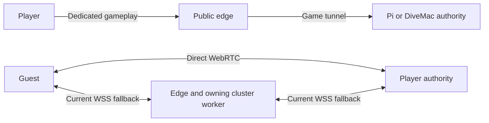

# Multiplayer placement: rooms, authority and connectivity

Research dated 2026-10-24 (Mexico City). **Proposal, not an implemented or
approved replacement for the current hosting contract.** The initial audience
is mostly Mexico and nearby North America, as clarified by the user.

The objective is private rooms joined by code and public games with strangers,
using the existing cluster for good connectivity and low delay while preserving
its other workloads. This investigation reads the existing implementation,
checks the live deployment without creating matches, and compares primary
networking sources. The companion [networking research](multiplayer-networking-research.md)
contains the transport evidence and alternatives.
The follow-up [Burbuja Kernel implementation assessment](burbuja-multiplayer-research.md)
maps the proposal to the actual pinned contracts and identifies the smallest
reusable changes. The user authorized kernel updates and deployment to **dev**
if needed; that authorization does not itself change this research into a
production rollout or an adopted architecture.

The recommended direction is a **single room service with independently chosen
simulation hosts and connection routes**. Retain Pi as the preferred dedicated
worker and DiveMac as conditional overflow. Let suitable player devices run
matches where that meets the room's trust and quality requirements. Room count,
simulation capacity and relay bandwidth must have separate limits.

## What exists and what was verified

The inspected project checkout was `70d3f599555cf9d5e852b4feb36ca9db3d9e824f`,
with concurrent stage/tutorial work preserved. The external kernel checkout was
`64ec8db830bb058de8ba2aa92b6f195165cd06d4`. The deployed servers remain
v0.27.0, revision `0fa367a334c70b73cdf28e2c597ed7b5178f9a13`.
All 42 runtime files on each host matched its deployment manifest; both `/app`
mounts were read-only and pointed to the verified runtime directory. This is
verification against the existing manifests, not a new release-signature audit.
Both workers reported healthy, with zero rooms in the observed fleet snapshot.

Live capacity remains Pi = 2 rooms and DiveMac = 1. Container ceilings remain
one CPU / half a CPU respectively, and 384 MiB each. The current pressure
monitor deferred new DiveMac rooms during the observation; Pi stayed eligible.
These observations support retaining pressure admission, not increasing caps.
The available fleet can therefore be smaller than its configured total of three.

The public `/realtime/v1/games` endpoint returned HTTP 200 and the three current
game registrations. Per-node `/nodes/{node}/realtime/v1/games` requests returned
404; those requests do not test the documented owning-node WebSocket upgrade
route. No new public socket, match, capacity stress or NAT compatibility test
was performed. Private receipts are under ignored
`artifacts/multiplayer-research-20261024/`; personal host/workload inventories do
not belong in repository documentation.

Current source prepares online protocol 2 for v0.28. The v0.27 peer lease and
room-capacity behavior was also inspected at its release commit. A future trial
must use matching client/server protocols rather than treating this checkout as
the deployed release. See [peer hosting](peer-hosting.md) and
[cluster operations](cluster-hosting.md).

| Area | Current behavior | Consequence |
| --- | --- | --- |
| Room admission | `blast`, `blast-lobby` and `blast-peer` all claim one ordinary kernel lobby slot | A peer room still occupies one of the three slots, even though its player runs the simulation |
| Random games | Client queues for `blast-lobby`; FIFO tickets fill eligible rooms, then create more; no RTT measurements in the request | Random matchmaking cannot currently choose a peer host or optimize group network quality |
| Dedicated placement | Pi first, then eligible DiveMac; freshness-bounded pressure exclusions | It protects host resources but does not compare players' actual routes |
| Peer host | Oldest connected eligible player; room leader and simulation host are the same role | The creator can be a poor host; network quality and sustained device performance do not affect election |
| Direct setup | WebRTC links are created when `playing` starts, and recreated on an epoch change | No pre-match connectivity qualification; the opening uses relay while direct paths become healthy |
| Route choice | Direct if connected with a pong seen within two seconds; otherwise WSS relay | Liveness is checked, but a live direct path is not compared with relay RTT, loss or jitter |
| Delivery | One reliable ordered WebRTC channel; cluster WSS is also reliable and ordered | Missing older packets can hold up newer game state |
| Display | 30 Hz authority, 15 Hz full snapshots, roughly 100 ms player interpolation, no local prediction | Network RTT is only part of input-to-visible-response delay |
| Peer churn | Join, departure or reconnect during play resets the entire match to the lobby | Simply enabling random backfill into peer matches would repeatedly interrupt them |
| Recovery | Peer host replacement starts fresh; node loss loses its rooms | Neither room failover nor mid-round authority migration is established |

Implementation anchors:
[client admission](../src/Bomber.Client/NetworkSession.cs),
[public matchmaking](../src/Bomber.Game/PublicLobbyGame.cs),
[placement](../src/Bomber.Cluster/ClusterPlugin.cs),
[peer coordinator](../src/Bomber.Game/PeerRoomSession.cs),
[peer client](../src/Bomber.Client/PeerRoomClient.cs),
[native transport adapter](../scripts/app/GodotPeerLink.cs),
[player interpolation](../scripts/arena/SnapshotMotion.cs).
In the pinned external kernel, `LobbyServer.TryAllocate` and
`LobbyManager.Create` enforce the shared integer room budget;
`RealtimeFleet.BackfillCandidatesAsync` can include running matchmade lobbies
when the game allows join-in-progress. Those private dependency sources remain
outside this repository.

## Why the existing P2P work helps, but does not finish the design

P2P here is a star: one player is authority and the other players connect to
that player. It is not a full mesh or distributed simulation. That is suitable
for retaining one authoritative implementation of bomb and collision rules.

Three distinct paths matter:

Direct peer traffic avoids the game worker and its home uplink. Current peer
relay still travels through the public edge and the owning home worker in each
direction, while the player remains authority. It saves simulation CPU but
does not remove the worker's relay traffic or the home detour. For some groups,
a dedicated Pi match can therefore perform better than a relayed player match.
For nearby players with a good direct path, player hosting can perform better
than either. These are topology-based hypotheses to measure, not observed RTT
rankings.

The edge already provides public reachability and the private directory
backplane. Putting every new role on Pi would reintroduce a Pi dependency for
fallback coordination. Keep the existing gateway/backplane failure boundaries
visible: an edge outage still affects both workers, and direct peer gameplay
currently depends on cluster membership and host leases.

## Proposed player experience

Present three ordinary actions: **Play online**, **Create private room**, and
**Join with code**. Hosting becomes a room policy rather than a second kind of
private room the player must understand. An optional detail panel can show
connection quality, player/server hosting and recovery status.

Private room codes and social leadership should survive a host choice between
matches. The room owner chooses rules and presses Start; the best eligible
device may run the simulation without gaining those social permissions.
Keep the existing explicit private start and CPU practice behavior. Unifying
the UI must not accidentally remove one-human-plus-CPU private matches.
Those matches still need dedicated authority until a separately tested peer
policy supports fewer than two humans.

For random play, propose a short automatic start countdown after enough humans
and validated routes are present, so an absent first player cannot hold the
queue indefinitely. This intentionally changes today's leader-start contract
and needs product acceptance and journey coverage. Do not wait for eight
players when a small population can already play; do not count bots as humans.

Use one casual matchmaking population initially. Fill compatible waiting rooms
before creating more. Group by measured connectivity, protocol and playable
rules; widen soft quality preferences with waiting time, while keeping hard
reachability, version and resource requirements. Never put strangers into a
private code room. For a private group with a poor route, explain the quality
instead of silently removing a friend.

This follows the general distinction between matchmaking quality and placement:
latency must be checked against the actual selected host, not just during
grouping. Official [FlexMatch latency rules](https://docs.aws.amazon.com/gameliftservers/latest/flexmatchguide/match-rules-reference-ruletype.html)
and [queue expansion behavior](https://docs.aws.amazon.com/gameliftservers/latest/flexmatchguide/match-rulesets-components-algorithm.html)
illustrate those constraints. They are design references, not a proposal to buy
or migrate to GameLift.

## Authority policy and host qualification

Initial policy proposal:

| Room | Preferred behavior | If unavailable |
| --- | --- | --- |
| Public random | Eligible dedicated authority meeting the group's quality budget, normally Pi | Eligible DiveMac; or clearly identified community hosting if permitted; otherwise remain queued |
| Private with Auto hosting | Compare qualified player hosts with eligible dedicated workers | Use a measured relay route when necessary; wait with a reason if no feasible plan exists |
| Room requiring server authority | Dedicated only | Queue; a relay does not make a player host trustworthy |
| Room requiring address privacy | Dedicated, or a verified relay-only peer implementation | Never exchange direct candidates as a hidden fallback |

Public dedicated preference gives strangers server-owned outcomes and avoids
exposing their addresses to each other. Community-hosted casual play can expand
capacity, but frame validation cannot prove that a host followed the rules.
Transport encryption and relaying do not establish fair simulation. The user
should be able to make that meaningful trust/privacy choice without selecting
STUN/TURN settings. See the [networking research](multiplayer-networking-research.md)
for the source-backed limits.

A candidate must first pass hard constraints: compatible protocol, permitted
hosting/privacy policy, fresh health, sustained simulation headroom, a viable
route to every participant, and available simulation/relay budget. Candidate
measurements should include RTT distributions, jitter, lost or late probes,
send-queue age, tick overruns and observed upload demand. An open channel or a
fast download connection is insufficient.

Among feasible candidates, favor the lowest **worst-player** tail delay and
late-state rate; use group latency spread, median delay, host stability and
resource cost as subsequent criteria. Treat the host's zero network hop
carefully so it does not win by skewing the group average. Proposed scoring
weights and tolerable RTT bands require measurement and human playtesting.

Measure the actual client-to-worker route for dedicated hosts, not just HTTPS
to the gateway. Likewise, two players both having low RTT to the edge does not
prove they have low RTT to one another. Use a bounded candidate shortlist and
coordinator-authorized probes between prospective room members. At eight
players there are 28 possible pairs; it is unnecessary to keep a global mesh
or continually probe every queued stranger. Expire reports, rate-limit probes,
and do not let clients supply arbitrary network probe targets.

Keep a host stable during healthy gameplay. Switch routes with hysteresis when
quality changes; reconsider authority between matches or on genuine failure.
Do not move a running match merely because another host became slightly faster.
The coordinator remains the only issuer of authority generations and leases.

## Separate the three capacity budgets

1. **Room coordination:** membership, codes, compatibility, matchmaking,
   signalling and host leases. Bound rooms, identities, connections and rates.
   Waiting rooms should not reserve a simulation slot for their whole lifetime.
2. **Simulation:** active matches, including bot cost, tick deadlines, process
   CPU/memory and host pressure. Begin with today's measured Pi/DiveMac caps;
   reserve a slot atomically when starting a dedicated match and release it
   after that match, preserving the logical room.
3. **Relay:** per-host and fleet bytes/second, connections, queue age and burst
   memory. A direct peer room is cheap only while it stays direct. Admission
   must reserve sufficient fallback capacity, or explicitly avoid promising
   universal seamless relay when that capacity is unavailable.

All limits remain bounded. Logical rooms cannot be unlimited just because they
do not simulate, and raising `BLAST_MAX_LOBBIES` would also admit more expensive
dedicated matches under the current model. Weighted placement alone cannot fix
this: the final capacity owner must enforce claims atomically, with reservations,
expiry, cancellation and release across concurrent create/start requests.

A useful bandwidth estimate is `snapshot wire bytes × snapshots/second × remote
recipients`. For illustration only, 8 KiB at 15 Hz to seven guests is about
0.86 MB/s, or 6.9 Mbit/s of host upload before transport overhead and other
messages. This is not a measured v0.27 wire size. Measure actual encrypted wire
traffic per route; JSON size and compressed WSS bytes are different quantities.
Track aggregate uplink saturation and loaded RTT, not CPU alone.

There are two implementation options to review after instrumentation:

- Add generic workload-aware capacity claims to the pinned kernel, keeping
  product policies and room lifecycle in this repository. This offers one
  coherent allocator but changes an external dependency and requires its tests
  and a new reviewed pin.
- Isolate a bounded room/peer broker from dedicated simulation workers, with
  explicit supported-game registration and resource budgets. This can separate
  peer capacity earlier but still needs a stable logical-room directory and
  authenticated match handoff to avoid tying waiting rooms to simulations.

The deeper kernel review identifies a smaller first step than either full
option: add optional **per-server allowed-game enforcement**, then configure
separate peer and dedicated lobby pools within the existing workers. This can
isolate peer counts without adding another process. It still needs measured
peer limits and an aggregate relay budget, and dedicated waiting rooms would
continue consuming dedicated slots until the room/match lifecycle changes.
It does not implement automatic authority switching by itself.

Merely adding logical server IDs on one process today is not sufficient: current
game registration is node-wide, and claims/routing must prevent dedicated
matches from consuming a nominal signalling pool. Do not fork private kernel
code into the product or make the placement plugin own simulation state.

## Connectivity and responsiveness work

**Preflight before Start.** Establish candidate connections in the waiting phase,
validate the selected host and stage readiness, and bind the result to the
current roster and protocol. Separate match generations from transport lifetime
where safe, rather than rebuilding healthy ICE links every rematch. Cancel
stale probes/leases when the roster changes.

**Evaluate TURN at the public edge.** Authenticated TURN could carry WebRTC
through difficult NATs without sending peer gameplay through the home worker.
UDP would be the first transport to measure; TCP/TLS can help restrictive
networks, with existing WSS retained as a final reachable route. This is a trial
candidate, not a recommendation to deploy TURN on Pi or a claim of guaranteed
connectivity. Check edge bandwidth, resource ceilings, public UDP reachability,
relay allocation limits and TCP/TLS port coexistence with HTTPS first.

The pinned Godot extension accepts TURN servers but does not expose every
libdatachannel option or selected-pair statistic. In particular, a relay-only
privacy policy and truthful Direct/TURN labels need verified adapter support.
Adding a TURN URL alone would leave today's `Direct P2P` label misleading.
The [transport report](multiplayer-networking-research.md) traces this to the
pinned source and describes credential/abuse controls.

**Split delivery semantics.** Keep stage/configuration, membership and ordered
actions reliable. Send replaceable state on a sequenced, freshness-oriented
channel after validating the behavior of the native extension. Changing only
`ordered=false` does not remove reliable retransmission. Movement can use recent
input history, but bomb/carry/remote button transitions need explicit delivery,
acknowledgement and deduplication semantics. Preserve stage-before-state and
generation barriers across separate channels. The game must also recover recent
presentation events without duplicating effects.

The kernel review also finds application-level loss distinct from TCP loss:
the bounded WSS outbound queue drops its oldest frame without distinguishing
state from control. Reliable transport therefore does not mean every stage or
control frame survives application overload. Add delivery classes or explicit
control acknowledgement/recovery before claiming end-to-end guarantees.

**Reduce perceived input delay separately.** First instrument input sequence to
authority acknowledgement and visible movement, with monotonic timestamps and
tick IDs. A single HTTP timing or cross-machine UTC subtraction is not that
measurement; peer `serverTime` is based on its simulated epoch. Then evaluate
bounded adaptive interpolation and local movement prediction/reconciliation.
Reuse authoritative movement rules for ramps, falls, collisions, carry and
knockdowns. Hits, bombs and winners remain authoritative. Prediction is a
substantial gameplay integration task, not permission to predict arbitrary
outcomes or silently change physics.

## Public-room churn and failure recovery

Before admitting random players to peer matches, remove the current rule that
every non-host membership change discards the match. Keep the active roster
stable, release disconnected inputs, and stage newcomers or reconnects for a
safe round boundary. Peer hello compatibility and authenticated identities must
still be enforced before simulation/rendering. Dedicated mid-round ghost joins
and peer roster resets currently have different semantics.

For the first iteration, preserve honest host-failure behavior: return to the
same room and start a fresh match. Preserve room settings and clarify whether
scores survive; do not imply that current snapshots support exact migration.
Mid-round transfer needs a versioned authoritative checkpoint including RNG,
timers, bot state, pending actions and all hidden simulation state, plus fencing
against two live hosts. A rendering snapshot is not that checkpoint.

Room-service failover is a separate problem. Valkey directory records alone do
not restore the in-memory room. A durable room record, transferable ownership
lease, reconnect/rebind flow and generation fencing would be required before
claiming that a peer room survives its coordinator process failing. The shared
edge/backplane remains a failure domain even with two game workers.

## Ordered implementation and evidence gates

| Stage | Deliverable | Evidence before promotion |
| --- | --- | --- |
| 1. Observe | Route/RTT/loss/jitter, input ack, snapshot age, tick overruns, relay bytes and admission reason | Measurements from actual game paths; no raw codes, IPs or identities in public reports |
| 2. Isolate pools | Owner-enforced per-server game support; separately measured peer and dedicated limits | No dedicated admission into peer capacity, including named-server and racing requests; aggregate process and relay limits still hold |
| 3. Decouple room and match | Stable room identity; bounded coordination, simulation and relay claims; unchanged current simulation caps | Concurrent starts, cancellation, TTL expiry, empty-room cleanup, pressure recovery, safe membership handoff and no double allocation |
| 4. Qualify hosts | Pre-match candidate checks; leader distinct from authority; measured selection and route hysteresis | Same group on Pi, eligible DiveMac and multiple peer hosts; validate selection versus measured tail delay |
| 5. Improve transport | Separate reliability semantics; public-edge TURN experiment | Burst loss/reordering, stage barriers, action exactly-once effects, truthful route labels and restricted-network fallback |
| 6. Improve matchmaking | Unified entry flow; public fill/countdown; private code privacy; safe peer membership changes | Low-population queues, late joins, absent leader, compatibility mismatch, room-code continuity and clear unavailable-capacity states |
| 7. Improve responsiveness | Adaptive interpolation and local movement prediction | Collision/terrain parity, authoritative correction, action responsiveness and actual human review |

Stages are bounded releases, not one wholesale networking rewrite. Telemetry
and independent peer capacity are the first useful changes. A TURN experiment
can be evaluated separately without making it a dependency of room redesign.
Exact migration can wait until simpler recovery and route behavior are proven.

The test matrix should include 2/4/8 players; zero and maximum permitted bots;
same LAN and independent home/mobile networks; Mexico and North American
participants; IPv4/IPv6, double NAT/CGNAT, UDP-blocked and TCP-443-only networks;
short and sustained host load; direct, mixed and fully relayed peers; bandwidth
limits and burst loss/reordering; host sleep/exit, guest disconnect, coordinator
failure and an edge interruption in an isolated environment.

Suggested impairment sweeps (experimental inputs, not acceptable service targets)
are 0/30/60/100/160/240 ms added round-trip delay, 0/1/3/5% loss, burst loss,
variable jitter and constrained uplink. Specify whether the emulator applies
delay per direction; do not accidentally double a supposed RTT setting. Collect
join success/time, time to first playable match, p50/p95/p99 route RTT, input ack
and displayed-response delay, packet gaps, corrections, tick overruns, relay
traffic and host resources. Compare identical scenarios with warmup excluded.

Retain the existing [guard and capacity process](cluster-hosting.md#capacity-and-failure-checks).
Do not lift Pi/DiveMac caps using idle CPU readings, assume both hosts are always
eligible, or call a local WebRTC test universal NAT coverage. No design can
promise uniformly low latency across all of North America or arbitrary public
networks using one home cluster and one edge location.

## Status of this investigation

No game code, production configuration, capacity limit or deployment changed.
No new infrastructure was provisioned. Existing unrelated work was preserved.
Documentation links and source references are the completion checks for this
research pass; builds and graphical playtests belong to subsequent implementation.
The proposed public countdown, hosting/privacy defaults, capacity boundary and
service-quality thresholds remain decisions to resolve from this evidence.
