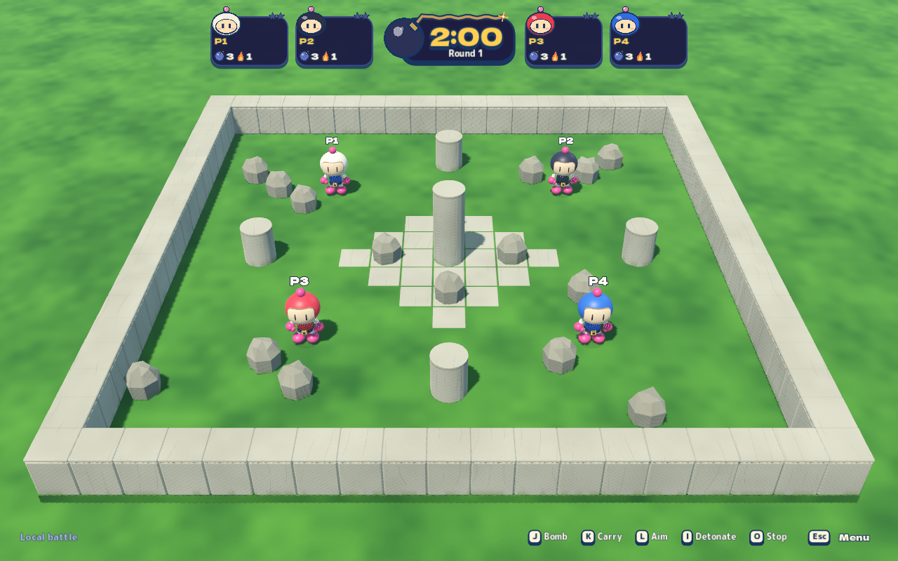
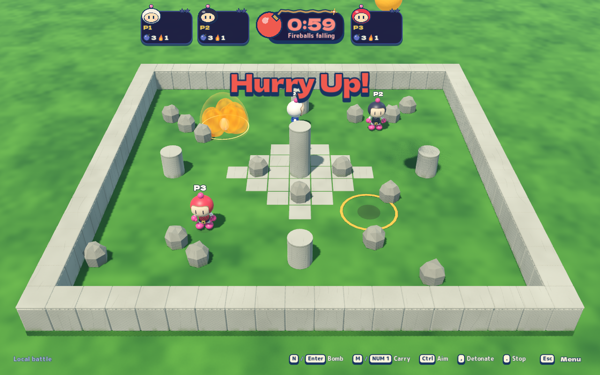

# Rock Garden reconstruction

The arena follows the original Bomberman 64 Rock Garden composition in the two
user-supplied screenshots: a square lawn enclosed by pale stone, five isolated
round columns, a small cross/diamond of paving around the center and scattered
destructible boulders. All meshes and materials are original procedural work.
See the [source research](rock-garden-research.md) for evidence and uncertainty.

## Rendered reference

Actual rebuilt macOS export, Medium graphics / Midday lighting, captured in the
isolated Metal QA desktop on 2026-10-24. The first image is the ordinary battle
camera with four local seats. The second shows an authoritative fireball impact
and a pending target warning.





## Playable contract

- A 19×19 authority grid contains a one-cell solid boundary and a 17×17 flat
  interior. Walking into a wall stops the player; it does not cause a fall.
- Five solid columns occupy `(9,3)`, `(3,9)`, `(9,9)`, `(15,9)` and `(9,15)`.
  The center has an authored 1.35-unit crown versus .9 for the outer columns,
  using the approximately 1.5:1 silhouette in the original imagery. This is image-informed
  project tuning; both support/occlusion and rendering use the same height. They block movement
  and explosions using the shared terrain rules.
- The first four seats start in separate quadrants: `(5,5)`, `(13,5)`, `(5,13)`
  and `(13,13)`. Four additional seats start at the interior corners. All starts
  are distinct and have a clear opening cross.
- A default normal battle has sixteen destructible boulders. Seeded opening
  cover supplies one nearby target per spawn and four boulders on the central
  paving, with the rest balanced across the quadrants. Rows/columns 8 and 10 remain
  clear for travel around the center. Advanced block percentage scales that
  budget; practice has no boulders. Item rolls retain the existing independent
  configured chance and pool.
- The central paving is cosmetic and flat. Column and boulder meshes use the
  shared throw-support heights; terrain collision stays authoritative.
- Sudden death uses falling fireballs in the final minute, as shown in the
  original footage. Each impact has a fixed orange target ring and 1.2 seconds
  of warning. Fireballs arrive every .9 seconds, accelerating to .35 seconds;
  every third warning targets a living player's observed position, the others
  use seeded floor positions. Moving after warning escapes the target. Impacts
  use an ordinary level-two spherical blast (2.2-cell radius, enlarged from
  level one on 2026-10-26 at the user's request) with existing shielding,
  hearts, chains and loot rules. `BlastStages.MeteorBlastRadius` sizes the
  warning ring and CPU danger so all three agree. Bots plan around those same published warnings. Practice and
  disabled sudden death spawn none; new rounds clear all warnings. Local pause
  also freezes rendered descent; online snapshots keep updating under the menu.
  Peer-hosted snapshots validate the warning list, coordinates and countdown
  before creating presentation nodes.

The exact dimensions, additional four seats, seeded boulder positions, continuous
movement, item probabilities, fireball cadence, targeting and damage are Blast Circuit
tuning. This is a reconstruction of the reference composition, not a claim of
recovered original numerical physics or a copied original asset.

## Source and checks

`BlastStages.BuildRockGarden` owns topology for local and online authority.
`TempleStageView.RockGarden` owns its meshes; `ArtMaterials.Garden` owns grass
and limestone shading. `StagePreview` draws the actual authority layout.

```sh
dotnet run --project tests/Bomber.Game.Tests -- --rock-garden
python3 tools/playtest/run.py --scenario rock-garden --headless --build
python3 tools/playtest/run.py --scenario rock-garden
```

The managed checks cover the enclosure, column placement, center traversal,
wall contacts, blast shielding, custom block percentages and real fireball
warning/escape/damage. `rock-garden` drives actual four/eight-player starts, center exploration, wall collision,
plant/retreat/destruction/reward collection, fireball warnings/impacts and
eight-player CPU combat. Its
graphical run captures normal battle and a labeled closer inspection view.
`framing` checks both supported aspect ratios; `stage-lighting` and
`graphics-settings` retain all-stage coverage.

The old wide stone platform, thirteen columns and 110-block budget are superseded.

[Verification results and remaining integration limitation](verification.md#rock-garden-reconstruction-verification--pr-4).
