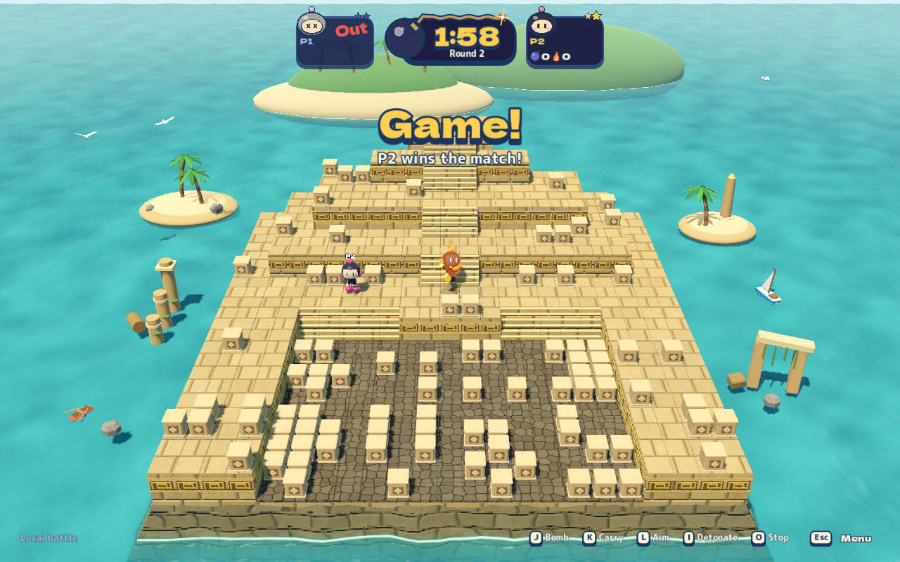
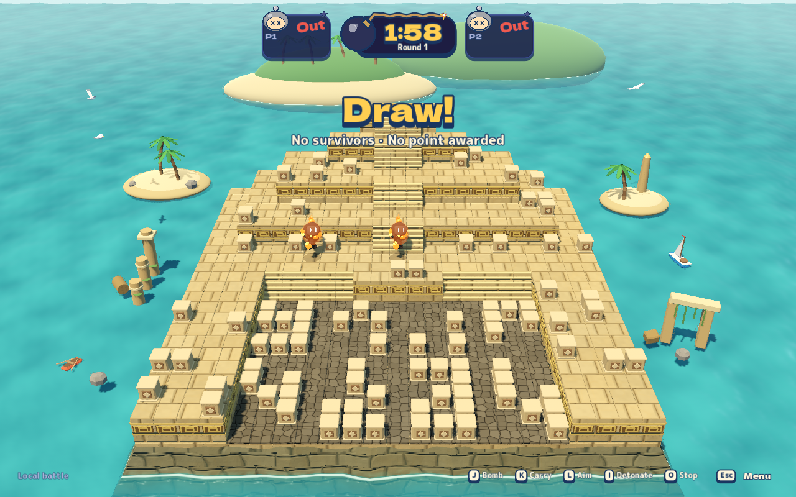
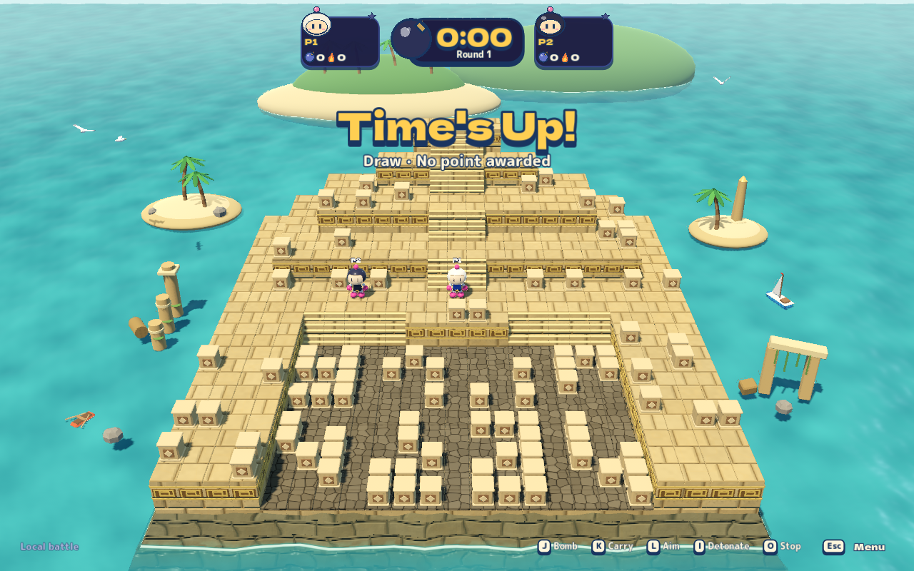
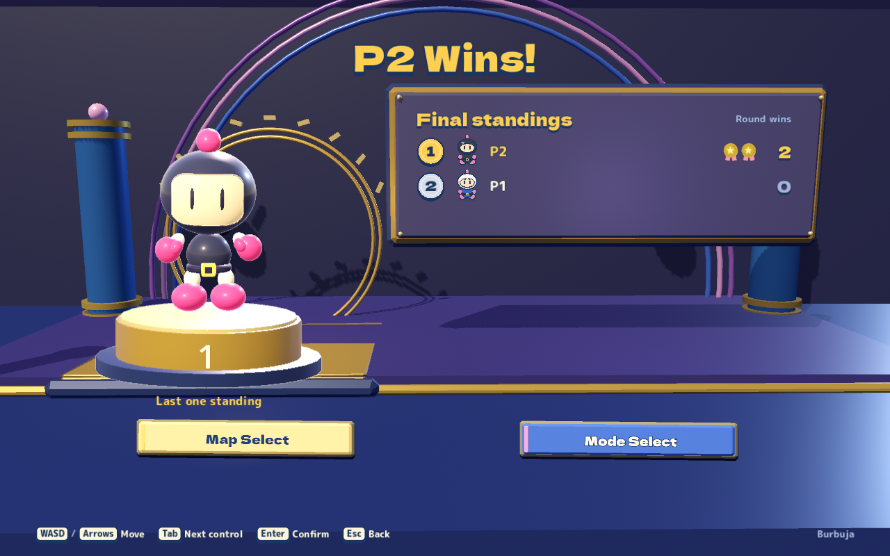
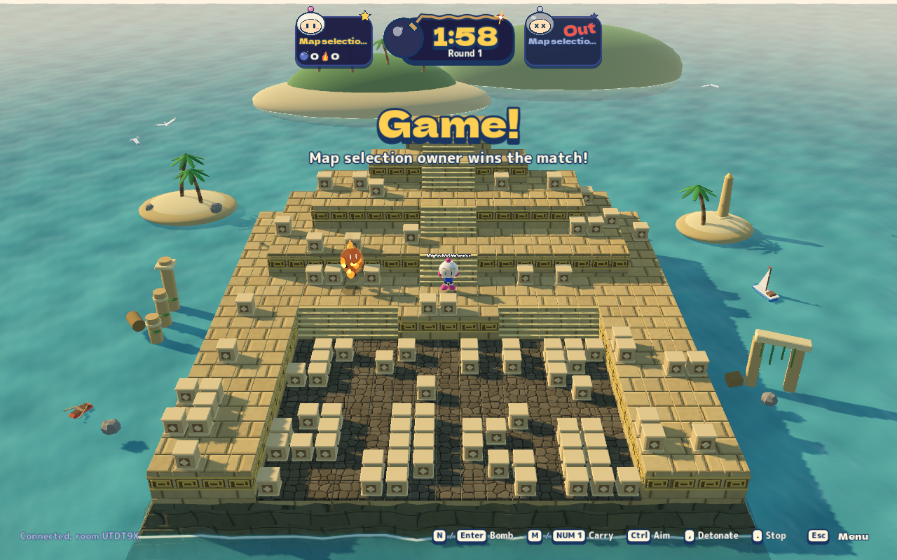

# Round and match ending announcements

Source change investigated 2026-10-28. [Original-game sources and inspected
sequences](round-ending-research.md) establish the original's Game, Draw and
Time's up calls, visible Draw announcement and pause before scoring.

## Behavior and cause

Previously, ordinary rounds entered a three-second Over phase, but the final
point immediately called `EndMatch`. The client therefore replaced the arena
with Results in the same message drain that accepted the elimination; the
winner's pose, round-over HUD and final explosion had no readable finishing beat.

The shared authority now captures the final result when the point is awarded
and emits it when the existing Over interval expires. Local, server-hosted and
peer-hosted matches use this same lifecycle. It immediately publishes the
accepted finish and point, freezes gameplay, and then either starts the next
round or sends the retained result exactly once.

The HUD reads the current round's accepted outcome event, showing **Game!**
with the actual winner and round/match detail. Simultaneous deaths show
**Draw!**; timeout shows **Time's Up!**, with no point awarded. The existing
victory pose/fanfare remains available throughout the finishing beat; draws
have a distinct original synthesized cue. Next-round Ready clears the outcome.
The visible Game banner, named detail and three-second duration are deliberate
Blast Circuit adaptations. Original voice recordings are research references;
the game ships its own synthesized cues.

## Verification entrypoints

```sh
dotnet run --project tests/Bomber.Game.Tests -- --round-ending
python3 tools/playtest/run.py --scenario round-ending --headless
python3 tools/playtest/run.py --scenario round-ending
python3 tools/playtest/run.py --scenario post-match
python3 tools/qa/run.py --profile managed
python3 tools/qa/run.py --profile headless
python3 tools/qa/run.py --profile public
```

The managed regression originally failed with `Match jumped to Results before
the arena finish announcement.` It covers human/CPU round and match wins,
frozen inputs, retained score, exactly one delayed result and timeout/draw
restart. The ordinary-input Godot journey uses actual self-bombs, simultaneous
deaths and timer expiry to inspect the HUD, audio cue count, next-round cleanup
and final Results. Real server and relayed peer smoke checks additionally require
the final arena snapshot and 1.5 seconds without an early result.

## Observed verification (2026-10-28)

- Full managed profile passed: 4,012 game checks, 377 client checks, 98 AI
  checks, 20 synthesized cues, 23 cluster placement checks, the 72-case AI soak,
  staged-server network smoke, forced adaptive relay and 36 real fleet checks.
- Focused authority regression: five human/CPU/timeout cases passed, after the
  retained failing witness on the previous implementation.
- Isolated exported Metal `round-ending`: 30 assertions, five screenshots,
  zero runtime errors or warnings.
- Isolated exported Metal `post-match`: 40 assertions, six screenshots,
  zero runtime errors or warnings; includes the network guest's finish,
  Results, same-room map selection and next-match launch.
- Full public profile passed all eleven steps (boundaries, documentation links,
  layout, tooling contracts, builds and audio).
- Full headless profile passed: 1,953 core assertions, 19 peer-room assertions,
  nine adaptive-room assertions and ten slow-poll assertions. Headless runs
  establish state/control behavior, with no GPU or screenshot claims.

The 1280×800 screenshots below are unmodified captures from actual ordinary-input
gameplay. All selected images were visually reviewed. The [capture manifest](media/round-ending/manifest.json)
retains run paths, source/catalog hashes, renderer and image SHA-256 values.
Graphical evidence uses an isolated macOS guest's Metal Forward+ renderer and
does not establish physical-controller support or native GPU performance.

| Moment | Actual capture |
| --- | --- |
| Ordinary round ends, first point visible |  |
| Final point, before Results |  |
| Simultaneous self-eliminations |  |
| Both players survive until the clock expires |  |
| Final board after the announcement interval |  |
| Real network guest sees the accepted owner win |  |
