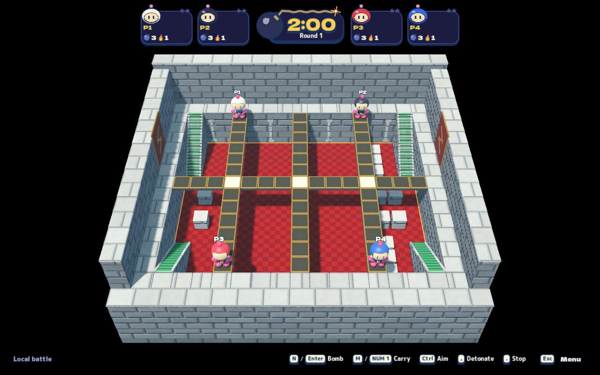

# v0.28 stages, tutorial and explosions

Release candidate **v0.28.0 / build 33**, integrating PRs #2 (Up & Down), #3
(Top Rules), #4 (Rock Garden) and #5 (Circuit Garden/tutorial). Local verification
is complete; publication and shared-server delivery are recorded below when
verified.

## Player changes

- Rock Garden is an enclosed lawn with five columns, sparse boulders and
  telegraphed falling fireballs. Up & Down has a suspended ring, six stair flights,
  lower passages and rising water. Top Rules adds two castle stories, three upper
  lanes, four stairs and inward-moving walls. Sunken Temple remains available.
- Circuit Garden provides 28 selectable tutorials with saved progress, live
  status/charge information, keyboard/controller instructions, retry/next and
  free practice. Graduation includes a real Easy opponent.
- Explosions have a coherent round fireball, brief pointed charged flares,
  expanding cyan power wave and transparent fade. Original imagery informed
  these changes; no original models, textures or recordings ship.
- Bridge support, ceilings, held-player clearance, meteor-triggered bomb chains,
  material lifetime and tutorial completion errors were reviewed and corrected.
  [Standards and Spec findings](stage-integration-review.md) retain the evidence.
- Online play requires the v0.28 protocol. Older clients receive an update message
  before incompatible geometry/hazards arrive; updated clients also check the
  actual worker's version. Existing room limits and hosting topology are unchanged.

## Inspected captures

These are actual captures from the final rebuilt local export, using the normal
battle camera and an isolated macOS Metal renderer. They are not original-game
screenshots or physical-controller evidence.

[Up & Down](media/release-028/up-and-down-battle-camera.png) ·
[Rock Garden](media/release-028/rock-garden-four-player-opening.png) ·
[Charged explosion](media/release-028/blast-large-bloom.png) ·
[Tutorial browser](media/release-028/tutorial-browser.png) ·
[Flood lesson aiming](media/release-028/tutorial-flood-aim.png)

[Stage research](stage-fidelity-research.md) and
[explosion research](explosion-fidelity-research.md) separate publisher/gameplay
observations from project dimensions and visual tuning. Original model listings
were found, but their downloads returned 403; no model coordinates are claimed.
Top Rules' thin decks pass blasts based on explicit official-guide evidence.
Up & Down's corresponding behavior was not established and remains separately
shielded. Physical decks continue to stop bodies and thrown bombs.

## Local verification

Final runtime/harness baseline: `92bb73a`; the later change adds an additional
managed peer-hosted Up & Down traversal check and documentation/media only.

| Gate | Observed result |
| --- | --- |
| Public contracts | Passed, including documentation links and boundaries |
| Game / client / AI | 2,887 / 329 / 65 checks passed |
| Audio / cluster placement | 19 / 19 checks passed |
| AI soak | All 48 combinations passed; longest stationary window 1.27s, below 12s |
| Real network | Full HTTP/WebSocket/peer smoke passed in 153.6s, including 2–8 humans and seven server bots |
| Version admission | 44 checks include legacy update errors, authenticated worker welcome after rejected legacy upgrade, and actual ticket cancellation |
| Layered online routes | Both cluster-hosted and peer-hosted Up & Down traverse the real stairs/underpass and place a bomb below the ring; Top Rules has equivalent real cluster/peer witnesses |
| Headless | 1,228 core assertions plus 19 peer assertions passed |
| Full rebuilt-export graphical suite | 3,260 assertions, 326 captures, zero runtime errors; all registered journeys completed |
| Package | Native controller backend audit, signed export, 255 exported smoke assertions and 19 exported peer assertions passed |

The full graphical run retained one native SCTP stream-reset warning; direct
transport, takeover, relay recovery and eight-peer assertions all passed.
Headless/package shutdown logs also retain Godot ObjectDB warnings. These are
not reported as zero-warning runs. The earlier focused fidelity run passed
448 assertions / 66 captures with zero errors or warnings.

Inspected the final arena silhouettes, ordinary/oblique underpasses, cap depth,
flooding, fireball warnings/impacts, normal/charged/power explosions, tutorial
countdown and live rising-water aim. The final package and graphical exports
have identical managed game assemblies and PCK; native signed-file hashes are
recorded separately. Passing numeric checks do not imply user approval of art,
native-host GPU throughput, universal Internet conditions or physical gamepads.

Receipts are under `artifacts/stage-release/` in the isolated release checkout:
`managed-final`, `headless-final`, `graphical-final`, `package-final`,
`public-final`, `review-regressions/online-version-layered-online`, and
`package-graphical-comparison.json`. Earlier minimal failures remain in the
original checkout's `artifacts/stage-release/review-regressions/`. The unrelated
networking research in the original checkout was preserved.

## Publication and shared service

Pending exact-main CI, signed public artifacts and sequential idle-node updates.
The preflight found both nodes at the verified v0.27 runtime, zero rooms/players,
and unchanged limits. DiveMac's existing pressure exclusion remains respected.
No personal Mac app replacement is part of this release task.
