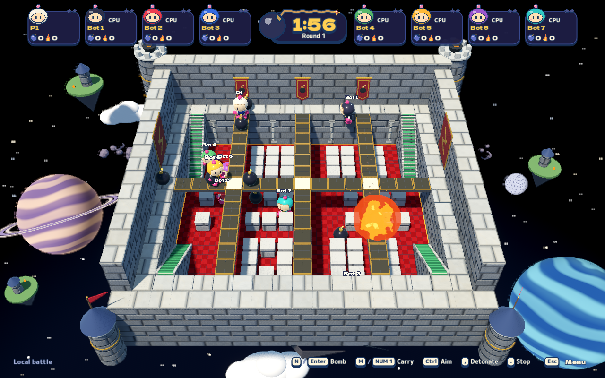
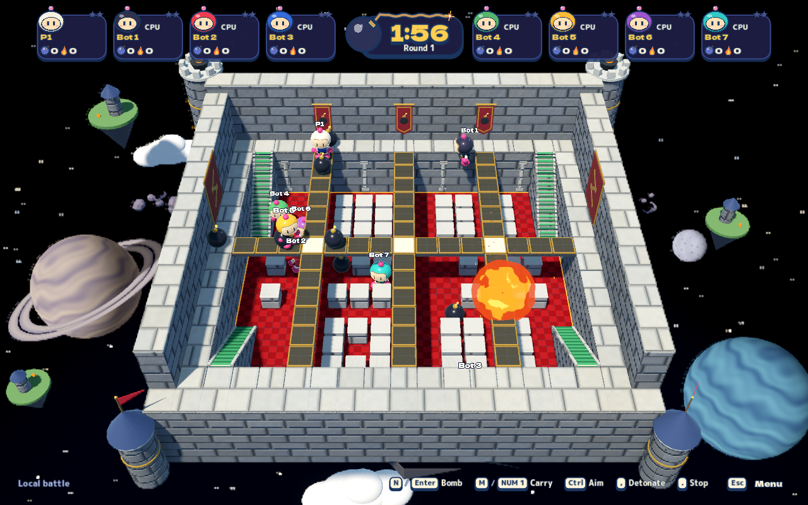
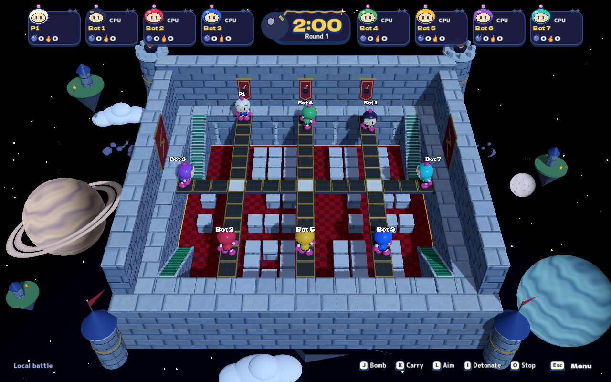

# Top Rules: Orrery Keep

Source work, 2026-11-15. The earlier painted-band tweak below is superseded
by the current Orrery Keep direction. The ordinary battle-camera captures in
[living stage worlds](living-stage-worlds.md#high-ordinary-battle-camera) are the
baseline. The floating castle, crimson court, green stairs, gray masonry,
lighting profiles, camera and playable geometry are retained.

## Current direction: Orrery Keep

The castle, crimson court, green stairs, gray masonry, bridge routes and
authority remain unchanged. The setting becomes a small painted astronomical
model, with a visible rounded rock body under the keep instead of a base fading
to black. Core rock and a broad indigo/violet painted backdrop remain on Low.
Dark slate receives three broad faceted/painted variations. A Top-only
presentation envelope fits that underside while retaining the original
castle camera direction.

White cumulus clouds, pinpoint stars and asteroid noise are removed. Three
small lacquered painted globes sit on original brass curved supports, with one
berry-colored hero, a quieter blue companion and a tiny ivory moon. The
hero has one or two broad soft bands and a small tilted open ring, the blue
world broad painted patches, and the moon a few large crater variations. The
ordinary camera must show each complete globe outside the HUD/footer, at no
more than twelve percent of frame width. Visible brass curves route through
the front/side margins and start inside the crag shoulders. Four thick four-point stars and the
existing turret islets provide restrained surrounding life. One soft violet
rim light from the hero connects the model to the castle walls.

The new closed crag shoulders, star sides and brass tubes use owned packed
geometry and managed presentation math. The focused journey inspects actual
indexed clockwise faces rather than relying on disabled culling. Slow globe
motion and paint clocks freeze with the existing local pause/scenery policy;
menu miniatures omit the deep setting.

The handed-over source's dummy-square headless framing failure is retained as
an unqualified projection diagnostic. Revised source passes 63 headless checks,
including geometry, core Low visibility and real eight-player bombs/blasts.
Build, the complete public QA profile, static checks and reviewed mesh census
pass; editor import exits cleanly. The focused native run passes 99 assertions
with seven Low/Medium/High/Night/oblique/eight-player captures and no runtime
errors or warnings (20261115T235152.996686Z). Each globe has nine visible-
hemisphere samples tested against actual castle/crag triangles, with zero
occlusion hits; this supplements native frame and twelve-percent checks.

That native run precedes the final small arm-root embedding and ring-angle
correction. Their geometry checks/build pass; the final integrated matrix
must recheck the actual current view. Independent fresh all-map/preset review
and rebuilt-export qualification remain required. No personal gallery wait
or final art/release approval is implied by these counts.

## Prior orbital study

The sections and images below record the earlier painted-band/ring study and
its acceptance at that time. The user's subsequent request for stronger
cohesive art supersedes that acceptance; these images are not Orrery Keep
qualification.

## Art intent

The existing planets had bright, nearly regular stripes and thin luminous rings.
The surroundings should read as a small painted astronomical diorama around the
castle: varied soft cloud bands, a rounded shadow side, restrained atmospheric
limbs and a broad layered ring. The blue world is smaller and quieter so the
castle and combat remain the visual focus. The moon has fewer broader craters
and softly mottled plains, rather than dense stippling. Slow motion remains
ambient, with no attack trails, warning circles or paths across the court.

The two ring annuli have a genuinely empty center and division. Opaque,
double-sided triangles give a stable silhouette and let the globe obscure the
rear half without transparency sorting. A subdued painted shadow connects the
ring to the globe. Violet and blue nebula folds add depth in the existing dark
surround, with a radial fade before the backdrop ends. Planet cloud bands and
nebula motion use the existing pausable scenery clock.

## Reference boundary

The [Nintendo-hosted Bomberman 64 manual](https://m1.nintendo.net/docvc/NUS/JPN/NBMJ/NBMJ_J.pdf)
and the earlier [inspected reference notes](living-stage-worlds-research.md)
establish the dark floating-fortress and readable battle-stage context.
[Konami's Super Bomberman R 2 story](https://www.konami.com/games/bomberman/r2/us/en/character/)
was rechecked for this pass: its black moon threatens planetary cities, and its
characters visit planetary ruins. That supports a celestial extension within the
series vocabulary; it does not establish planets as an original Top Rules
feature. These planetary models, shaders and ring geometry are original work.
No reference media or recovered assets are distributed.

## Review and verification

Root verification owns the build, graphical desktop and export. Review the
`stage-scenery` journey's `top-rules` ordinary Medium/High Midday and Night
captures against the baseline, followed by its motion capture. Establishing
views inspect the full ring, planetary shadow and nebula but do not replace
ordinary battle-camera approval. Check both 16:10 and 16:9 framing, where the
large worlds approach the image edges.

The existing journey checks finite textured geometry, absence of collision
bodies, all props outside standing space before/after motion, local pause,
Low visibility and miniature omission. Its mesh winding audit also covers the
new ring faces. These checks establish safety and renderer contracts; actual
captures establish the visual result. No simulation, collision or rules changed.

## Native visual review — 2026-11-15

Root reviewed actual exported Metal captures on Macintosh at the user’s explicit
request: softer irregular cloud bands, broad divided rings and a subdued blue
world retain a readable castle silhouette in daylight and Night. The exported
`scenery-regression` passed 3,485 assertions and 272 captures with zero runtime
errors or warnings. The fresh baseline passed 371 assertions and 40 captures.
Clean C# build and the complete public QA profile also passed.

[Capture provenance](images/top-rules-orbital/manifest.json). These are root’s
visual acceptance and native synthetic-input checks, not physical-controller
evidence or a claim that the user personally approved the images.
