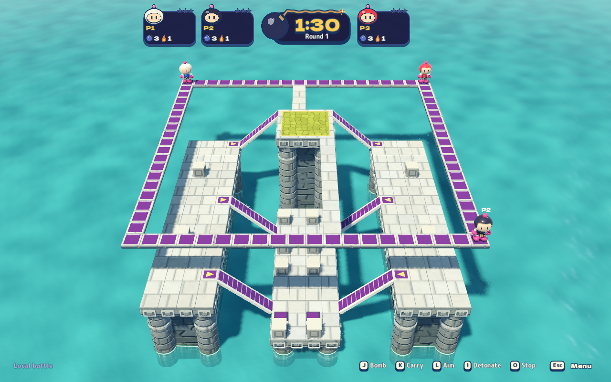

# Up & Down

The `up-and-down` stage is rebuilt around the original game's suspended
three-level composition. [Source research](up-and-down-research.md) records the
manual, original guidebook and inspected gameplay, including unresolved details.
The old filled 23×19 terraces and 88-crate farm are superseded.

## Authored layout

- A 24×26 grid contains a narrow high square ring and a broad green crown at
  elevation 4. Pale staggered north/south links connect crown and perimeter.
- Long pale middle piers sit at elevation 2. Six purple flights connect crown
  to both piers and both piers to the two ends of the low central reward deck
  at elevation 0. Each flight spans three cells and two elevation units.
- Water fills the gaps. Piers/deck continue beneath the front ring, and the
  south link passes above the low deck. These are independently walkable
  surfaces. Exposed edges have ordinary gravity and lethal water contact.
- The first four spawns occupy the ring corners; four additional starts support
  this project's eight-player matches on the upper perimeter.
- Normal cover is 36 blocks: twelve below and twelve on each middle pier,
  sampled randomly beside clear center aisles. Ring, crown, bridges, center lanes and
  flights stay clear. Advanced block/drop rules still apply. Practice clears
  cover through its existing rules.
- Sudden death uses the shared rising-water policy, beginning at the one-minute
  warning. Low terrain submerges before the piers; the ring is the last refuge.

The middle piers extend to the inward side-rail lips: ordinary inward drops
land on stone, while exposed outward exits still reach water. Destructible
blocks use original procedural gray stone cubes with pale worn rims and square
insets, independent of the temple's sandstone/diamond model. Default cover has
twelve random low blocks and twelve per pier; Advanced block density
scales the random regional budgets, and Practice remains empty.

Grid dimensions, elevations, exact flight offsets, additional spawns, block
allocation and flood constants are **Blast Circuit tuning**. The expanded 36-block
budget is requested gameplay tuning; the former twelve-block layout followed
a plausible visual reading, not a verified original coordinate census. No original textures, models, music or reference scans ship in the game.

## Rendered views



[Arena-selection miniature](images/up-and-down-menu.png) ·
[Gray stone block inspection](images/up-and-down-stone-blocks.png) ·
[Ordinary side-drop landing](images/up-and-down-side-drop.png) ·
[Oblique inspection](images/up-and-down-oblique.png) ·
[Lower-deck flooding in a real three-human match](images/up-and-down-flood.png).
The inspection view changes only the camera. These captures are generated by
the `up-and-down` journey, not original-game reference images.

## Authority and rendering

`BlastStages` owns the geometry for local and online sessions. `CellDef.Below`
represents one surface beneath a suspended slab; complete stage messages carry
both floors and fractional ramp endpoints. Height-aware queries choose support
using the entity's elevation. Movement, falling, bomb placement/travel, throw
projection, item presentation and flood checks preserve that floor. Slabs block
rising bodies, side contact and blasts, while leaving their underside open.
CPU navigation uses distinct nodes at overlapping positions; danger intervals
and visible targets remain height-aware.

`TempleStageView.UpAndDown.cs` builds independent procedural pale stonework,
fluted foundations, square friezes, purple panels/flights, yellow landing arrows
and a green crown mosaic. Thin bridge slabs receive no solid foundation.
Older stage packets without bridge metadata keep the generic terrain renderer.
The menu miniature/preview follows the real layout. Its Up & Down sea is an
opaque circular display surface inside the round plinth; its foundations stop
above the plinth instead of projecting beneath it. This trims only the menu
instance. Paving tops sit above structural slabs to prevent depth fighting in
both the miniature and gameplay. Camera fitting includes
both floors with player headroom; all existing lighting/graphics choices apply.

The seed-64 one-minute stock combat witness after the side-drop/recovery
correction records 29 placements, 27 blasts, ten opened blocks and four items
with three CPUs; seven CPUs produce 36 placements, 35 blasts, six opened blocks
and three items. The earlier 18-bomb upper-only observation describes the
pre-correction layout. A separate lower-start fixture still verifies real CPU
planting/escape below. These bounded observations establish activity and routing
on that seed, rather than CPU win rate or general human-rated difficulty.

## Verification

The `UpAndDownChecks` managed journey and native `up-and-down` scenario retain
round trips through all six flights and the confirmed underpasses. The native
journey uses ordinary inputs in practice, then an ordinary cover-filled
three-human match; it observes sea contact and timed low/middle flooding.
Inspection cameras are labeled separately from ordinary battle-camera captures.
The scenario belongs to both graphical `all` and `core-headless`.
`asset-audit` also checks menu-plate face winding and legacy packet presentation;
`menu-preview` combines effect preparation, graphics switching, asset inspection
and setup to exercise the rendered miniature. The whole graphical suite has a
bounded 1200-second budget; the QA profile honors the catalog deadline.

```sh
dotnet run --project tests/Bomber.Game.Tests -- --up-and-down
python3 tools/playtest/run.py --build --scenario up-and-down --headless
python3 tools/playtest/run.py --scenario up-and-down
```

Full completion also requires the managed, headless, public and graphical gates.
See [testing and delivery](agents/testing-and-delivery.md) for ownership and
renderer evidence limits. Exact observed receipts are recorded in the PR.

### Side-drop/rendering correction verification — 2026-10-25

Canonical receipts are retained locally under ignored
`artifacts/up-and-down-fixes/`:

- `managed-final`: 2,836 game, 337 client, 80 AI, 19 audio and 23 cluster checks;
  all 48 AI soak cases (longest open idle 1.60 seconds), real network smoke,
  nine adaptive-relay checks and 36 fleet checks pass. Both server-hosted and
  peer-hosted observers see the new landing edges and a real side drop.
- `headless-final`: core 1,303 assertions, peer rooms 19 and adaptive rooms nine.
- `public-final`: all ten profile steps pass, including private-file boundaries,
  tooling contracts, documentation links and audio.
- `graphical-final`: rebuilt self-contained export, real isolated macOS/Metal
  Forward+, all 48 catalog journeys, 3,682 assertions and 349 captures. Zero
  runtime errors; one SCTP reset warning is retained from the network portion.
  Reviewed all three graphics presets, four lighting profiles, corrected
  miniature, both pier landings and real block destruction. The block close-up
  needed an unobstructed inspection camera; the subsequent focused rebuilt
  export supplies that corrected view.
- `graphical-stage-final`: fresh final export after the inspection-camera change,
  151 assertions and 16 captures; zero runtime errors or warnings. Both side
  drops, all six flights, underpasses, real block destruction, exposed-edge death
  and low/middle flooding pass again. The published stage images use this run
  (the menu miniature comes from the complete graphical run).

Red controls retain the original missed landing, coplanar slab/paving failure,
protruding miniature supports and a CPU recovery sidestep that reaches water
before the next reaction. Current falling constants and ordinary exposed-edge
water elimination are preserved. Original-game coordinates/drop physics remain
unverified; see the source research. Guest rendering and synthetic inputs do
not certify native host GPU performance or physical controller behavior. This
source PR does not install an app or deploy an external server.
